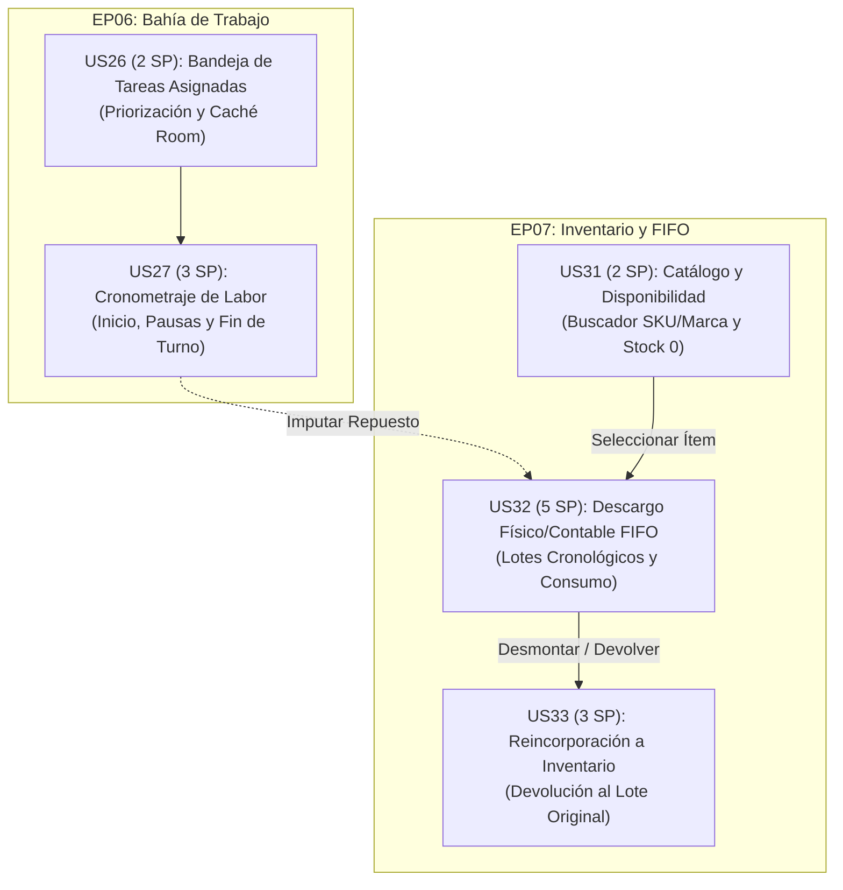

# Documento de Arquitectura y Aprendizaje (DA) — Atelier Mobile

> **Cátedra de Aplicaciones Móviles**  
> **Proyecto:** Atelier Workshop (Mobile Staff App)  
> **Equipo:** Andeva  
> **Documento vivo de arquitectura, análisis técnico, patrones y bitácora de conexiones.**

---

## 1. Introducción y Enfoque Pedagógico

¡Bienvenidos al diario y documento de arquitectura (**DA**) del proyecto **Atelier Mobile**! 

Como su profesor de aplicaciones móviles, este documento servirá como el eje central donde iremos consolidando, analizando y documentando de forma estructurada:
1. **La arquitectura del software** (Clean Architecture + Feature-First + DDD).
2. **La configuración y ciclo de vida de Gradle** (construcción y dependencias).
3. **El mecanismo de conexiones** (Networking con Retrofit/OkHttp, base de datos local con Room, sincronización offline y DataStore).
4. **Las convenciones de código y buenas prácticas** aplicadas al proyecto real.

A medida que vayamos revisando cada componente del repositorio, este documento irá evolucionando progresivamente.

---

## 2. Análisis del Entorno de Construcción: Gradle y `.gradle`

Para construir una aplicación Android moderna, robusta y escalable, el sistema de construcción es el cimiento de todo.

### 2.1. ¿Qué es la carpeta `.gradle/` y por qué es importante?
- **Naturaleza:** Es un directorio autogenerado por el motor de Gradle en la máquina local o entorno de desarrollo.
- **Función:** Almacena cachés de tareas (`task cache`), índices de dependencias resueltas, ejecutores de workers y demonios locales de Gradle (`daemon`).
- **Regla de oro:** **Nunca se versiona en Git** (está excluida en el `.gitignore`). Si el proyecto presenta problemas de caché corrupta o artefactos desactualizados, se puede limpiar de forma segura con `./gradlew clean` o eliminando `.gradle/`.

### 2.2. Version Catalog (`gradle/libs.versions.toml`)
El proyecto implementa la recomendación oficial de Google: **Gradle Version Catalog**. Esto evita duplicar versiones en múltiples archivos y centraliza dependencias:
- **Lenguaje y Core:** Kotlin `2.4.20`, Android Gradle Plugin (AGP) `9.4.0`, KSP `2.3.4`.
- **UI:** Jetpack Compose BOM `2026.09.00`, Material 3 `1.4.0`.
- **Inyección de dependencias:** Dagger Hilt `2.60.1` procesado con **KSP** (no Kapt, lo que acelera los tiempos de compilación).
- **Networking:** Retrofit `3.0.0` + OkHttp `4.12.0` + Gson Converter.
- **Persistencia y Offline:** Room `3.0.3` (KSP) + WorkManager `2.10.5` + DataStore Preferences `1.2.1`.
- **Navegación:** Navigation Compose `2.9.5` con serialización type-safe (`kotlinx-serialization-json 1.9.0`).

### 2.3. Configuración del Módulo `app/build.gradle.kts`
El archivo de construcción del módulo principal define:
```kotlin
android {
    namespace = "com.andeva.atelier.mobile"
    compileSdk { version = release(37) } // Android 16

    defaultConfig {
        applicationId = "com.andeva.atelier.mobile"
        minSdk = 26                      // Android 8.0 Oreo (soporte amplio para mecánicos)
        targetSdk = 37
        versionCode = 1
        versionName = "1.0"
        
        // Variables de entorno inyectadas desde local.properties (sin filtrar secretos a Git):
        buildConfigField("String", "API_BASE_URL", ...)
        buildConfigField("String", "GOOGLE_WEB_CLIENT_ID", ...)
        buildConfigField("String", "SUPABASE_URL", ...)
        buildConfigField("String", "SUPABASE_ANON_KEY", ...)
        buildConfigField("String", "SUPABASE_BUCKET", ...)
    }
}
```

---

## 3. Arquitectura del Módulo `app/`

El código está estructurado bajo **Clean Architecture** con modularización lógica **Feature-First**:

```text
app/src/main/java/com/andeva/atelier/mobile/
│
├── AtelierApplication.kt       # Application class (@HiltAndroidApp, WorkManager config)
├── MainActivity.kt             # Single Activity que hostea AppNavHost
│
├── core/                       # NÚCLEO TRANSVERSAL (reutilizado por todas las features)
│   ├── data/                   # Implementaciones de red, Room, DataStore y sincronización
│   ├── designsystem/           # Tokens de diseño, tipografía, paleta, componentes base
│   ├── di/                     # Módulos globales de Hilt (Network, Database, DataStore, Work)
│   ├── domain/                 # Entidades y contratos puros (Session, Permission, ApiException)
│   ├── media/                  # Manejo de imágenes (Supabase uploader, compresión)
│   └── notifications/          # Manejo de Push FCM y navegación de alertas
│
├── features/                   # BOUNDED CONTEXTS (unidades funcionales de negocio)
│   ├── auth/                   # Autenticación, sesión, invitaciones, OTP, sedes
│   ├── main/                   # Contenedor principal con BottomBar filtrada por permisos
│   ├── attendance/             # Asistencia con geocerca y validación de turnos
│   ├── tasks/                  # Gestión de tareas operativas del mecánico
│   ├── reception/              # Check-in e inspección de vehículos en recepción
│   ├── workorders/             # Órdenes de trabajo, estados, fotos de evidencia
│   ├── inventory/              # Repuestos, alertas de stock mínimo, escaneo de lotes
│   ├── diagnostics/            # Diagnóstico OBD-II, códigos DTC e informe IA
│   ├── bays/                   # Ocupación de bahías y elevadores
│   ├── cashier/                # Cobro y validación de pagos en caja
│   ├── reports/                # Reportes operativos y métricas
│   └── team/                   # Directorio del equipo y asignaciones
│
└── navigation/                 # Grafo global type-safe (AppNavHost, rutas raíz)
```

---

## 4. Conexiones y Flujo de Datos

### 4.1. Networking (Retrofit + OkHttp)
- **Doble cliente OkHttp:**
  1. *Cliente de aplicación:* con interceptor de autenticación que inyecta `Bearer <token>` y `TokenAuthenticator` para renovación ante 401.
  2. *Cliente de sesión (aislado):* sin interceptor de token, utilizado exclusivamente para el endpoint `POST /auth/refresh`, evitando bucles infinitos de llamadas de refresh.
- **Manejo de errores:** Todas las llamadas remotas se encapsulan con `apiCall` o `apiCallUnit`, mapeando respuestas fallidas a la clase de dominio `ApiException(code, message)`.

### 4.2. Persistencia Local (Room SQLite)
- **Base de datos:** `AppDatabase` agrupa 18 entidades Room (`customers`, `vehicles`, `appointments`, `work_orders`, `tasks`, `parts`, `batches`, `attendances`, etc.).
- **Mantenimiento de sesión:** `CacheMaintenanceDao` permite limpiar selectivamente tablas operativas al cerrar sesión sin destruir la cola pendiente de subida.

### 4.3. DataStore Preferences
- Almacena el estado volátil y de sesión: tokens JWT, ID de usuario, ID de membresía, sucursal activa (`selectedBranchId`) y permisos del usuario.

### 4.4. Sincronización y Cola Offline (WorkManager)
- Tabla `pending_operations`: encola acciones que fallan o se generan offline (fotos periciales, propuestas técnicas).
- `SyncWorker`: ejecuta en segundo plano con restricciones de red, procesando cada elemento mediante `OperationHandler`.

---

## 5. Convenciones de Inyección de Dependencias con Dagger Hilt

- **`@Provides` en `object`:** para instanciación de librerías externas (Retrofit, Room, OkHttp, DataStore).
- **`@Binds` en `interface`:** para vincular interfaces de dominio a implementaciones de infraestructura (`RepositoryImpl`).
- **Procesamiento KSP:** 100% libre de Kapt para máxima velocidad de compilación.
- **Anotación `@HiltViewModel`:** inyecta los casos de uso necesarios en cada pantalla de Jetpack Compose.

---

## 6. Análisis de Requerimientos del Sistema (`docs/01-requirements/`)

El sistema cubre 9 épicas transversales:
1. **EP01:** Autenticación y control de acceso móvil.
2. **EP02:** Control de asistencia satelital y turnos laborales con geocercas.
3. **EP03:** Recepción pericial e inspección en patio (US11–US15, US44).
4. **EP04:** Diagnóstico electrónico y telemetría OBD-II con IA.
5. **EP05:** Presupuestos y cotizaciones de taller.
6. **EP06:** Ejecución de tareas operativas en bahía (US26–US30).
7. **EP07:** Abastecimiento y descargo contable de repuestos FIFO (US31–US35).
8. **EP08:** Facturación electrónica y cierre comercial.
9. **EP09:** Monitoreo operativo y supervisión gerencial.

---

## 7. Estudio Minucioso de las APIs del Backend (`docs/api/`)

- **8 Bounded Contexts:** `iam.md`, `hr.md`, `crm.md`, `operations.md`, `inventory.md`, `invoicing.md`, `iot.md` y `analytics.md`.
- **Convenciones:** 
  - Fechas en UTC ISO-8601 (`YYYY-MM-DDTHH:mm:ssZ`), convertidas localmente a `America/Lima` con `BusinessTime`.
  - Monedas en importes netos sin IGV (`finalPrice`, `basePrice`), computando el backend el 18% reglamentario.
  - Respuestas de error estandarizadas: `{ "code": "...", "message": "..." }`.

---

## 8. Sistema de Diseño, Branding e Identidad Visual (`docs/branding/`)

- **Identidad:** Taller tecnológico y corporativo.
- **Tipografías:** `PlusJakartaSans` (títulos e interfaces), `JetBrainsMono` (códigos DTC, VIN, placas, odómetros) y `AlbertSans` (apoyo).
- **Tokens de Color:** `AtelierTheme.colors` sin color dinámico (evita distorsión pericial). Colores semánticos: primario, fondo oscuro/claro, badges de severidad (`LOW`, `MEDIUM`, `CRITICAL`).

---

## 9. Contexto de Negocio y Regla de Asimetría (`atelier-documentation.md`)

- **Regla de Asimetría:** La aplicación móvil es de uso exclusivo para el **personal de taller (Staff App)**: técnicos mecánicos, asesores de recepción y supervisores.
- Los clientes y dueños de taller acceden a través de la plataforma Web/SaaS.

---

## 10. Modelo de Seguridad y Control de Acceso (RBAC)

- **Regla Fundamental:** La UI nunca evalúa nombres de rol en texto ("dueño", "mecánico").
- Toda acción, botón o pantalla se valida mediante permisos atómicos: `Session.has(Permission.X)`.

---

## 11. Matriz de Trazabilidad (`docs/03-traceability.md`)

Cada historia de usuario mapea directamente a sus endpoints de API, códigos de respuesta HTTP, excepciones de dominio y permisos requeridos.

---

## 12. Integraciones de Hardware y Sensores (`docs/04-mobile-integration.md`)

- **GPS Satelital:** Geocerca en torno a la sede para marcación de entrada y salida (`POST /hr/attendances/clock-in`).
- **Bluetooth SPP:** Comunicación serial con dongle ELM327 OBD-II para telemetría vehicular.
- **Cámara:** Integrada con CameraX; subida directa o asíncrona al bucket `atelier-evidence` de Supabase.
- **Push FCM:** Recepción de eventos operativos (`TASK_ASSIGNED`, `JUSTIFICATION_REVIEWED`, etc.).

---

## 13. Persistencia Offline-First y Sincronización (`docs/06-offline-sync.md`)

- Lectura inmediata desde SQLite Room para trabajo en fosos o sótanos sin señal.
- Encolado de mutaciones en `pending_operations`.
- Sincronización transparente e idempotente mediante WorkManager.

---

## 14. Roadmap de Construcción Paso a Paso (`docs/07-roadmap.md`)

Pasos del 0 al 9 ordenados por dependencia de dominio:
- Paso 0: Configuración general ✅
- Paso 1: Núcleo `core/` ✅
- Paso 2: `auth` ✅
- Paso 3: `main` ✅
- Paso 4: `attendance` ✅
- Paso 5: `tasks` (infraestructura ✅, UI planificada en Sección 21)
- Paso 6: `reception` + `workorders` (EP03 UI ✅, probada con 526 tests)
- Paso 7: `inventory` (infraestructura ✅, UI planificada en Sección 21)
- Pasos 8 y 9: Diagnóstico OBD-II, Bahías, Caja, Reportes.

---

## 15. Reglas de Calidad y Protocolo de Agentes (`AGENTS.md`)

- Compilación limpia con Gradle.
- Textos localizados en `res/values/strings.xml`.
- Pruebas unitarias para cada ViewModel y UseCase.
- Prohibido filtrar credenciales reales a Git.


---

## 16. Lista de Verificación General y Estado Consolidado

- [x] **Configuración de Construcción:** Gradle Kotlin DSL, Version Catalog, KSP, dependencias centralizadas y secrets en `local.properties`.
- [x] **Arquitectura Base:** Clean Architecture + Feature-First + DDD, estricta separación de responsabilidades en `core/` y `features/`.
- [x] **Conexiones y Red:** Doble cliente OkHttp (estándar con autenticador y aislado para refresh), manejo de errores unificado con `ApiException` y resiliencia ante arranques en frío.
- [x] **Identidad Visual y Tokens:** Isotipo, imagotipo, tipografías (`PlusJakartaSans`, `JetBrainsMono`, `AlbertSans`) y extensión de roles `AtelierColors` en Compose sin color dinámico.
- [x] **Requerimientos y Trazabilidad:** Las 9 épicas móviles (`US01`–`US44`), actores de taller y mapeo estricto a contratos backend.
- [x] **Estudio de APIs (8 Contextos):** Convenciones de fecha/moneda, códigos HTTP y 200+ endpoints catalogados.
- [x] **Integraciones de Hardware:** Sensores GPS satelitales, Bluetooth SPP con escáner ELM327, cámara con Supabase Storage y notificaciones FCM.
- [x] **Persistencia Offline-First:** 18 entidades Room, DataStore reactivo, tabla `pending_operations` y sincronización con WorkManager.
- [x] **Roadmap de Construcción:** Pasos del 0 al 9 trazados y auditados contra el avance de ramas.
- [x] **Protocolo de Agentes y Calidad:** Reglas de oro de `AGENTS.md`, `CLAUDE.md` y comandos `./gradlew`.
- [x] **Entorno Real y Cuentas de Prueba:** Directrices del líder, endpoints en Render, Supabase (`atelier-evidence`) y credenciales para Dueño y Mecánico.

---

## 17. Directrices del Líder de Equipo y Configuración del Entorno Real

### 17.1. Configuración de Variables en `local.properties`
El líder del equipo ha indicado que para conectar la aplicación contra el backend real en producción (desplegado en Render) y el servicio de almacenamiento pericial de Supabase, se debe configurar el archivo `local.properties` (que nunca se sube a Git) con las siguientes propiedades:

```properties
sdk.dir=C\:\\Users\\ASUS\\AppData\\Local\\Android\\Sdk
API_BASE_URL=https://atelier-platform.onrender.com/
GOOGLE_WEB_CLIENT_ID=1097377178165-d0ot8ftv6ki4j29m3006pfs93ts3kkhp.apps.googleusercontent.com
SUPABASE_URL=https://nywtvblomboeyerojiju.supabase.co
SUPABASE_BUCKET=atelier-evidence
SUPABASE_ANON_KEY=<SUPABASE_ANON_KEY>
```

> **Detalle Crítico de Configuración:** El bucket oficial de producción es **`atelier-evidence`** (a diferencia del valor por defecto `atelier`), permitiendo la persistencia y lectura pública de las fotos de recepción y foso.

### 17.2. Cuentas Corporativas para Pruebas de Integración E2E
El líder ha provisto dos cuentas de prueba reales pre-aprovisionadas en la base de datos de producción:

| Rol del Negocio | Correo Corporativo | Propósito y Validación en la App |
| :--- | :--- | :--- |
| **Dueño de Taller** | `shouychat@gmail.com` | Control total, visualización de métricas, configuración de sucursales, supervisión de OTs y aprobación gerencial. |
| **Técnico Mecánico** | `lemonhappibrik@gmail.com` | Ejecución de tareas (`/tasks/my`), cronómetro de labor efectiva, reporte de hallazgos en foso y marcación GPS. |

### 17.3. Validación de Geocerca GPS en el Campus Universitario
- **Ubicación Estratégica de la Sede:** La sucursal configurada en el backend se encuentra georreferenciada en las inmediaciones del campus universitario.
- **Prueba de Campo:** Esto permite que el personal (o los estudiantes durante las pruebas) pueda probar la marcación de asistencia real (`POST /hr/attendances/clock-in` y `clock-out`) usando el GPS real del teléfono móvil o emulador, verificando que la distancia calculada caiga dentro del radio de geocerca de la sede sin que el backend devuelva `422 UNPROCESSABLE_ENTITY`.

---

## 18. Bitácora de Aprendizaje Consolidada y Próximos Pasos

Con la finalización de este estudio exhaustivo, la documentación técnica y de diseño de **Atelier Mobile** queda unificada en este archivo canónico.

---

## 19. Plan de Implementación — UI de EP03 (US11, US12, US13, US14, US15, US44)

> **Estado:** ✅ **Completado, Auditado y Mergeado en `develop`** (Commit `7ff3997`).
> **Alcance:** Capa `presentation` completa para `features/reception` y `features/workorders` (US11, US12, US13, US14, US15 y US44). Todos los casos de uso, estados MVI y 526 pruebas unitarias en verde.

### 19.1. Permisos por Pantalla de EP03
| Pantalla | Permiso que habilita la acción |
| :--- | :--- |
| Búsqueda y ficha (US11) | `crm:vehicles:read`, `crm:customers:read`; "marcar llegada de cita": `crm:appointments:update` |
| Alta de cliente y vehículo (US11 E2, US44) | `crm:customers:create`, `crm:vehicles:create` |
| Apertura de OT (US12) | `operations:work_orders:create` |
| Galería pericial (US13) | `operations:inspections:upload_photos`; consultar: `operations:work_orders:read` |
| Reporte de hallazgo (US14) | `operations:proposals:create` |
| Panel de propuestas (US15) | `operations:proposals:notify` y `operations:proposals:resolve` |

---

## 20. Auditoría de Código y Resultados de Testeo — Épica EP03 (US11, US12, US13, US14, US15, US44)

> **Cátedra de Aplicaciones Móviles — Evaluación Técnica de Entrega**  
> **Resultado Global de Suite de Pruebas:** `BUILD SUCCESSFUL`  
> **Total Tests Ejecutados:** **526 tests unitarios** | **0 fallos** | **0 omitidos** | **Tiempo:** `40.563 s`  
> **Ramas Auditadas:** `feature/reception-workorders-ui` integrada en `develop` (Commit `7ff3997`).

A continuación se presenta el examen minucioso del código implementado para la **Épica EP03: Recepción e Inspección Vehicular**, contrastado con las directrices de Clean Architecture, reactividad con StateFlow, seguridad basada en permisos y cobertura de pruebas automatizadas:

### 20.1. US11: Búsqueda y vinculación de cliente y vehículo por placa o documento (2 SP)
- **Archivos Clave:**
  - `features/reception/presentation/search/VehicleSearchScreen.kt`
  - `features/reception/presentation/search/VehicleSearchViewModel.kt`
  - `features/reception/presentation/search/VehicleSearchUiState.kt`
  - `features/reception/presentation/search/VehicleSearchViewModelTest.kt`
- **Revisión de Código:**
  - **Patrón de Búsqueda Dual:** Selector de modo `SearchMode.PLATE` o `SearchMode.DOCUMENT`. La normalización de placas sanitiza guiones y minúsculas mediante `ReceptionValidation.normalizePlate(...)`.
  - **Flujo E1 (Placa Existente):** Invoca `FindVehicleByPlateUseCase` para obtener la unidad y su propietario actual. Expone el botón *"Iniciar atención"* que navega hacia la apertura de OT (`OpenWorkOrderRoute`).
  - **Manejo de Citas del Día:** El ViewModel inicializa un observer de `observeAppointments(today)` convirtiendo la hora UTC a la zona horaria del taller (`America/Lima`) mediante `BusinessTime`. Al marcar *"Llegó"* con `MarkAppointmentArrivedUseCase`, se maneja el caso asíncrono **H10** (la OT en borrador con kilometraje cero se crea en backend; la UI presenta un estado de espera transitorio).
  - **Flujo E2 (Placa Inexistente / 404):** Si el backend responde 404, la UI despliega un estado informativo *"Vehículo no encontrado"* ofreciendo registrar inmediatamente al cliente y su vehículo (`RegisterCustomerRoute`).
- **Verificación de Pruebas Unitarias:**
  - Valida permisos, autoselección por DNI/RUC cuando hay un único resultado, y resiliencia offline (`IOException` preserva caché de Room).

### 20.2. US44: Alta y afiliación de clientes según tenencia previa de cuenta (3 SP)
- **Archivos Clave:**
  - `features/reception/presentation/affiliation/AffiliationScreen.kt`
  - `features/reception/presentation/affiliation/AffiliationViewModel.kt`
  - `features/reception/presentation/affiliation/AffiliationUiState.kt`
  - `features/reception/presentation/affiliation/AffiliationViewModelTest.kt`
- **Revisión de Código:**
  - **Verificación de Tenencia Previa:** Consulta reactiva a `LookupAffiliationUseCase(email)`.
  - **Bifurcación Inteligente (`nextStep`):**
    1. Si `nextStep == NextStep.AFFILIATE`: El conductor ya posee cuenta en la red Atelier. Muestra sus autos registrados y solicita únicamente el `taxId` (obligatorio) y teléfono para afiliarlo con `AffiliateCustomerUseCase`.
    2. Si `nextStep == NextStep.REGISTER_WALK_IN`: El conductor es nuevo; redirige a `RegisterCustomerRoute(email)`.

### 20.3. US12: Apertura de orden de trabajo y parametrización de tareas iniciales (3 SP)
- **Archivos Clave:**
  - `features/workorders/presentation/open/OpenWorkOrderScreen.kt`
  - `features/workorders/presentation/open/OpenWorkOrderViewModel.kt`
  - `features/workorders/presentation/open/OpenWorkOrderUiState.kt`
  - `features/workorders/presentation/open/OpenWorkOrderViewModelTest.kt`
- **Revisión de Código:**
  - **Prevención de Error 409:** Detecta borradores existentes con `findDraft(branchId, vehicleId)` y utiliza `UpdateWorkOrderUseCase`.
  - **Campos del Formulario:** Odómetro positivo, selector gráfico de combustible de 8 niveles (`FuelLevelSelector`), motivo de ingreso y selección dinámica de faenas desde el catálogo de servicios (`GetServiceCatalogUseCase`).

### 20.4. US13: Registro pericial de evidencias fotográficas de recepción (2 SP)
- **Archivos Clave:**
  - `features/workorders/presentation/intake/IntakeGalleryScreen.kt`
  - `features/workorders/presentation/intake/IntakeGalleryViewModel.kt`
  - `features/workorders/presentation/intake/IntakeGalleryUiState.kt`
  - `features/workorders/presentation/intake/IntakeGalleryViewModelTest.kt`
- **Revisión de Código:**
  - **Cuadrícula Pericial 360°:** 6 ángulos reglamentarios (Frontal, Trasera, Laterales, Tablero, Odómetro) más Daño Específico.
  - **Cámara y Optimización:** Integración con CameraX, compresión JPEG a ≤ 1600 px y encolado en `pending_operations` para subida a Supabase (`atelier-evidence`).

### 20.5. US14: Generación de propuesta de tarea adicional por hallazgo en foso (3 SP)
- **Archivos Clave:**
  - `features/workorders/presentation/finding/ReportFindingScreen.kt`
  - `features/workorders/presentation/finding/ReportFindingViewModel.kt`
  - `features/workorders/presentation/finding/ReportFindingUiState.kt`
  - `features/workorders/presentation/finding/ReportFindingViewModelTest.kt`
- **Revisión de Código:**
  - Severidad obligatoria (`LOW`, `MEDIUM`, `CRITICAL`), foto obligatoria (botón bloqueado hasta capturar) y encolado offline en Room.

### 20.6. US15: Notificación y aprobación de propuesta técnica con el cliente (2 SP)
- **Archivos Clave:**
  - `features/workorders/presentation/proposals/ProposalsPanelScreen.kt`
  - `features/workorders/presentation/proposals/ProposalsPanelViewModel.kt`
  - `features/workorders/presentation/proposals/ProposalsPanelUiState.kt`
  - `features/workorders/presentation/proposals/ProposalsPanelViewModelTest.kt`
- **Revisión de Código:**
  - Notificar por correo al cliente (`NotifyProposalUseCase`), aprobación modal (servicio, horas de labor y precio final sin IGV) y rechazo con observaciones del cliente (`customerNotes`).

---

## 21. Análisis y Plan de Implementación — Operaciones de Bahía e Inventario FIFO (US26, US27, US31, US32, US33)

> **Cátedra de Aplicaciones Móviles — Guía de Arquitectura e Implementación**  
> **Alcance:** Capa `presentation` de `features/tasks` (EP06: Tareas en Bahía) y `features/inventory` (EP07: Repuestos FIFO).  
> **Volumen de Trabajo:** 5 Historias de Usuario | **15 Story Points (SP)**.  
> **Estado:** ✅ **Implementado en `feature/tasks-inventory-ui`** (ver §22: bitácora de ejecución, commits y diferencias con este plan).

---

### 21.1. Contexto de Negocio y Regla del Dominio

En el ecosistema de taller mecánico automotriz, este conjunto de historias representa el **corazón productivo y logístico** de la operación:
1. **El Técnico Mecánico en Bahía (EP06):** No atiende al público; su foco es la ejecución técnica en foso. Requiere una aplicación ágil, con navegación táctil apta para dedos con guantes, que funcione fluidamente en sótanos o zonas de baja cobertura celular (Offline-First mediante Room SQLite).
2. **El Almacén de Repuestos y Regla FIFO (EP07):** Toda imputación de materiales a una orden de trabajo debe realizarse bajo el principio contable de **Primeras Entradas, Primeras Salidas (FIFO: First In, First Out)**. Esto garantiza que se descuenten primero los lotes de compra más antiguos y que el costo real de salida refleje con exactitud la inflación y los precios de adquisición, manteniendo el margen bruto de rentabilidad del taller.

---

### 21.2. Desglose Detallado de las Historias de Usuario (15 SP)



#### 1. US26 (2 SP) — Consulta y priorización de tareas mecánicas asignadas en bahía (EP06)
* **Alcance:** Bandeja principal de trabajo para el mecánico en bahía con listado ordenado de faenas por prioridad operativa y estado (`IN_PROGRESS` → `ON_HOLD` → `ASSIGNED`), con persistencia local en Room SQLite para visualización sin red.
* **Criterios de Aceptación:**
  - **E1 (Mis asignaciones):** Consume `GET /tasks/my`. Cada tarjeta visualiza: placa del vehículo (obtenida de la caché `vehicles`), nombre de la bahía (de la caché `bays`), número de OT, tiempo estimado de labor (`estimatedHours`) y descripción técnica.
  - **E2 (Aviso push):** La recepción de un push `TASK_ASSIGNED` dispara la recarga automática de la bandeja de trabajo.
  - **Resiliencia sin red:** Si el foso o taller no tiene conexión, la app lee inmediatamente las tareas persistidas en la entidad Room `tasks`, garantizando operatividad ininterrumpida.
* **Casos de Uso Existentes:** `ObserveMyTasksUseCase`, `RefreshMyTasksUseCase`, `ObserveTaskUseCase`.
* **Permisos Requeridos:** `operations:tasks:read`, `crm:vehicles:read`, `operations:bays:read`.

---

#### 2. US27 (3 SP) — Cronometraje de labor efectiva, pausas operativas y turnos laborales (EP06)
* **Alcance:** Cronómetro de labor en foso con botones de inicio, pausa y culminación, cómputo exacto de tiempo efectivo de intervención y suspensión automática al cumplirse el fin de turno.
* **Criterios de Aceptación:**
  - **E1 (Inicio de faena):** Acción `POST /tasks/{taskId}/start` (pasa a `IN_PROGRESS`). Se activa el cronómetro en vivo en la pantalla.
  - **E2 (Pausa de labor):** Modal para tipificar la pausa (`POST /tasks/{taskId}/pause` con `PauseReason`: `BREAK` o `END_OF_SHIFT`). La tarea pasa a `ON_HOLD` y acumula `totalPausedSeconds`.
  - **E3 (Pausa por fin de turno):** Si el turno aún está vigente, el backend rechaza `END_OF_SHIFT` con error de negocio; la UI expone el `message` del servidor.
  - **E4 (Sincronización con marcación):** Si el mecánico marca su salida satelital (`POST /hr/attendances/clock-out`), el backend suspende automáticamente sus tareas en curso.
  - **E5 (Reanudación):** Botón *Reanudar* invoca nuevamente `POST /tasks/{taskId}/start`, continuando el conteo de tiempo efectivo acumulado.
* **Casos de Uso Existentes:** `StartTaskUseCase`, `PauseTaskUseCase`, `CompleteTaskUseCase`, `SuggestLaborHoursUseCase`.
* **Permisos Requeridos:** `operations:tasks:track_time`, `operations:tasks:complete`.

---

#### 3. US31 (2 SP) — Búsqueda y consulta de disponibilidad de repuestos en catálogo (EP07)
* **Alcance:** Buscador reactivo de repuestos con filtros por SKU, categoría y marca, visualización de existencias en almacén y precio base unitario.
* **Criterios de Aceptación:**
  - **E1 (Búsqueda reactiva):** Consulta mediante `GET /inventory/items?search=&category=`. Soporta filtrado por chips de categorías oficiales (`ItemCategory`: `LUBRICANTS`, `BRAKES`, `SUSPENSION`, `ENGINE`, `ELECTRICAL`, `TIRES`, `FILTERS`, `BODYWORK`, `ACCESSORIES`).
  - **E2 (Saldo en almacén y precio):** Visualiza `totalStock`, `minimumStock` y `basePrice` (precio de venta sin IGV).
  - **E3 (Tratamiento de agotados):** Si `totalStock <= 0` (`isOutOfStock = true`), el repuesto se resalta visualmente en rojo/gris y se bloquea su selección para imputación en tareas.
  - **E4 (Operatividad Offline):** Sin conexión a Internet, la búsqueda recurre a la entidad Room `parts` almacenada localmente.
* **Casos de Uso Existentes:** `ObservePartsCatalogUseCase`, `RefreshPartsCatalogUseCase`, `SearchPartsCatalogUseCase`, `FindPartBySkuUseCase`.
* **Permisos Requeridos:** `inventory:parts:read`.

---

#### 4. US32 (5 SP) — Descargo contable y físico automatizado mediante regla FIFO por lote (EP07)
* **Alcance:** Despacho de insumos en almacén consumiendo automáticamente los lotes de adquisición más antiguos de forma cronológica, validando saldo no negativo y valorizando el costo real de salida.
* **Criterios de Aceptación:**
  - **E1 (Inspección de lotes cronológicos):** Consulta de detalle con `GET /inventory/items/{id}/batches`. La interfaz organiza los lotes en estricto orden cronológico (de más antiguo a más nuevo según `arrivalDate`). Los lotes con `remainingQty > 0` (`isActive = true`) se marcan como prioritarios para el siguiente descargo.
  - **E2 (Descargo e imputación a tarea técnica):** Al despachar material para una faena, se ejecuta `POST /tasks/{taskId}/products { productId, quantity }`. El backend descuenta las cantidades recorriendo los lotes FIFO automáticamente.
  - **E3 (Validación de saldo no negativo):** Si la cantidad solicitada supera las existencias físicas totales, el backend aborta con código HTTP **409 Conflict** (`Insufficient stock for SKU: requested X, available Y`). La UI captura la `ApiException` y previene inconsistencias de stock.
* **Casos de Uso Existentes:** `ObservePartBatchesUseCase`, `RefreshPartBatchesUseCase`, `GetPartDetailUseCase` (en `inventory`) y `AddPartToTaskUseCase` (en `tasks`).
* **Permisos Requeridos:** `inventory:batches:read` (para visualizar lotes FIFO) y `operations:tasks:charge_parts` o `operations:work_orders:update` (para imputar/descargar insumo).

---

#### 5. US33 (3 SP) — Reincorporación lógica de materiales a inventario por remoción técnica (EP07)
* **Alcance:** Devolución y reincorporación de repuestos no instalados restituyendo las existencias al lote cronológico original y rebajando el costo imputado en la orden de trabajo.
* **Criterios de Aceptación:**
  - **E1 (Devolución a inventario):** Cuando un técnico no utiliza un repuesto previamente imputado o se desmonta la pieza, el usuario autorizado ejecuta `DELETE /tasks/{taskId}/products/{productId}` o `UpdateTaskPartQuantityUseCase`.
  - **E2 (Restitución al lote de origen):** El backend revierte el consumo restituyendo las existencias al lote cronológico del que salieron (último lote afectado primero).
  - **E3 (Ajuste automático en orden de trabajo):** Se rebaja de inmediato el subtotal imputado a la orden de trabajo y se emite la auditoría en `part-movements`.
* **Casos de Uso Existentes:** `RemovePartFromTaskUseCase`, `UpdateTaskPartQuantityUseCase` (en `tasks`) y `GetPartMovementsUseCase` (en `workorders`).
* **Permisos Requeridos:** `operations:work_orders:update`, `inventory:batches:read` o `inventory:batches:restore`.

---

### 21.3. Matriz de Permisos por Pantalla (RBAC)

| Pantalla / Módulo | Permisos de Sesión Requeridos (`Session.has(...)`) |
| :--- | :--- |
| **Bandeja de Tareas (US26)** | `operations:tasks:read`, `crm:vehicles:read`, `operations:bays:read` |
| **Cronómetro y Cierre (US27)** | `operations:tasks:track_time`, `operations:tasks:complete` |
| **Catálogo de Repuestos (US31)** | `inventory:parts:read` |
| **Detalle de Lotes FIFO (US32)** | `inventory:batches:read` |
| **Imputación de Repuesto (US32)** | `operations:tasks:charge_parts` (mecánico) o `operations:work_orders:update` (supervisor) |
| **Devolución / Remoción (US33)** | `operations:work_orders:update` |

---

### 21.4. Arquitectura de Paquetes y Componentes a Construir

Siguiendo Clean Architecture + Feature-First:

```text
features/tasks/presentation/
├── navigation/TasksNavGraph.kt            # TasksNavGraphRoute, rutas y composables
├── mytasks/                               # US26: Bandeja de entrada del mecánico
│   ├── MyTasksScreen.kt
│   ├── MyTasksViewModel.kt
│   └── MyTasksUiState.kt
├── detail/                                # US27 & US33: Detalle, Cronómetro y Repuestos
│   ├── TaskDetailScreen.kt
│   ├── TaskDetailViewModel.kt
│   ├── TaskDetailUiState.kt
│   └── components/
│       ├── ChronometerTimer.kt            # Visualizador reactivo de tiempo efectivo
│       ├── PauseReasonDialog.kt           # Diálogo de pausa tipificada
│       └── TaskPartsSection.kt            # Lista de repuestos imputados con botón devolver (US33)
└── TaskErrors.kt                          # Traductor de ApiException a UiText

features/inventory/presentation/
├── navigation/InventoryNavGraph.kt        # InventoryNavGraphRoute, rutas y composables
├── catalog/                               # US31: Catálogo y buscador reactivo
│   ├── PartsCatalogScreen.kt
│   ├── PartsCatalogViewModel.kt
│   ├── PartsCatalogUiState.kt
│   └── components/
│       ├── CategoryFilterChips.kt         # Chips de filtrado por ItemCategory
│       └── PartCard.kt                    # Tarjeta con precio base y semáforo de existencias
├── detail/                                # US32: Lotes FIFO y asignación
│   ├── PartDetailScreen.kt
│   ├── PartDetailViewModel.kt
│   ├── PartDetailUiState.kt
│   └── components/
│       ├── BatchFifoTimeline.kt           # Línea de tiempo visual de lotes cronológicos
│       └── ChargePartDialog.kt            # Modal para imputar a la tarea del mecánico
└── InventoryErrors.kt                     # Traductor de ApiException a UiText
```

---

### 21.5. Plan de Ejecución Paso a Paso

* **Nombre Oficial de la Rama:** `feature/tasks-inventory-ui` (creada a partir de `develop`).
* **Estrategia de Versionado:** Mínimo 20 commits atómicos (planificados **22 commits granulares**) siguiendo la especificación *Conventional Commits* (`feat:`, `test:`, `build:`, `docs:`) para garantizar una trazabilidad impecable en la cátedra de móviles y el historial de Git.

---

### 21.6. Matriz de los 22 Commits Atómicos

| # | Mensaje del Commit | Historia / Alcance | Archivos Clave Afectados | Objetivo y Verificación Técnica |
| :---: | :--- | :---: | :--- | :--- |
| **01** | `build: register local properties and configure runtime environment` | Config | `local.properties` | Configuración de URLs de Render, Supabase (`atelier-evidence`) y Google Client ID. |
| **02** | `feat(tasks): define type-safe navigation routes and nav graph skeleton` | EP06 Nav | `TasksNavGraph.kt` | Declaración de `MyTasksRoute` y `TaskDetailRoute(taskId)` con `@Serializable`. |
| **03** | `feat(inventory): define type-safe navigation routes and nav graph skeleton` | EP07 Nav | `InventoryNavGraph.kt` | Declaración de `PartsCatalogRoute` y `PartDetailRoute(partId)` con `@Serializable`. |
| **04** | `feat(navigation): integrate tasks and inventory nav graphs in AppNavHost` | Core Nav | `AppNavHost.kt` | Registro de `tasksNavGraph` e `inventoryNavGraph` en el grafo raíz de la aplicación. |
| **05** | `feat(tasks): create TaskUiState and string resources for mechanics bay` | US26 | `MyTasksUiState.kt`, `strings.xml` | Definición de estados MVI para la bandeja de tareas y textos periciales en español. |
| **06** | `feat(tasks): implement MyTasksViewModel with Room reactive caching` | US26 | `MyTasksViewModel.kt` | ViewModel que observa `ObserveMyTasksUseCase` desde Room y refresca con `RefreshMyTasksUseCase`. |
| **07** | `feat(tasks): build MyTasksScreen UI with bay cards and priority sorting` | US26 | `MyTasksScreen.kt`, `TaskCard.kt` | Tarjetas con vehículo, placa, bahía y orden prioritario (`IN_PROGRESS` → `ON_HOLD` → `ASSIGNED`). |
| **08** | `test(tasks): add unit tests for MyTasksViewModel covering permissions and offline cache` | US26 | `MyTasksViewModelTest.kt` | Validación de permisos `operations:tasks:read` y resiliencia offline ante caídas de red. |
| **09** | `feat(tasks): create TaskDetailUiState and PauseReason modal components` | US27 | `TaskDetailUiState.kt`, `PauseReasonDialog.kt` | Estado MVI para el detalle de la tarea y diálogo modal tipificado (`BREAK`, `END_OF_SHIFT`). |
| **10** | `feat(tasks): implement TaskDetailViewModel with elapsed time and pause handling` | US27 | `TaskDetailViewModel.kt` | Lógica de inicio (`StartTaskUseCase`), pausas (`PauseTaskUseCase`) y cierre técnico. |
| **11** | `feat(tasks): build TaskDetailScreen with dynamic chronometer timer and complete dialog` | US27 | `TaskDetailScreen.kt`, `ChronometerTimer.kt` | Cronómetro reactivo en Compose y modal de confirmación de horas efectivas sugeridas. |
| **12** | `test(tasks): add unit tests for TaskDetailViewModel chronometer, pause and completion` | US27 | `TaskDetailViewModelTest.kt` | Pruebas de inicio de cronómetro, acumulación de pausas y rechazo de fin de turno con jornada activa. |
| **13** | `feat(inventory): create PartsCatalogUiState and item category filter chips` | US31 | `PartsCatalogUiState.kt`, `CategoryFilterChips.kt` | Estado del catálogo y chips de filtrado para las 9 categorías oficiales `ItemCategory`. |
| **14** | `feat(inventory): implement PartsCatalogViewModel with reactive SKU search and out-of-stock check` | US31 | `PartsCatalogViewModel.kt` | Búsqueda reactiva por texto/SKU con debounce y detección de agotados (`isOutOfStock`). |
| **15** | `feat(inventory): build PartsCatalogScreen UI with parts cards and inventory status` | US31 | `PartsCatalogScreen.kt`, `PartCard.kt` | Visualización de existencias, precio base unitario y bloqueo visual de ítems sin saldo. |
| **16** | `feat(inventory): create PartDetailUiState and FIFO batch timeline component` | US32 | `PartDetailUiState.kt`, `BatchFifoTimeline.kt` | Visualizador de lotes cronológicos ordenados de más antiguo a más nuevo según `arrivalDate`. |
| **17** | `feat(inventory): implement PartDetailViewModel with chronological batches and task charge dialog` | US32 | `PartDetailViewModel.kt`, `ChargePartDialog.kt` | Observación de lotes FIFO y modal para imputar insumos con validación de saldo no negativo. |
| **18** | `feat(inventory): build PartDetailScreen UI with batch details and charge validation` | US32 | `PartDetailScreen.kt` | Pantalla de inspección de lotes, indicador de lote activo y manejo de error 409 por stock insuficiente. |
| **19** | `feat(tasks): add charged parts section to TaskDetailScreen with return to inventory action` | US33 | `TaskPartsSection.kt` | Sección en el detalle de la tarea que lista los repuestos imputados con botón de devolución. |
| **20** | `feat(tasks): integrate RemovePartFromTaskUseCase in TaskDetailViewModel with origin batch restoration` | US33 | `TaskDetailViewModel.kt` | Conexión con `RemovePartFromTaskUseCase` para revertir consumo al lote cronológico original. |
| **21** | `test(inventory): add unit tests for PartsCatalogViewModel and PartDetailViewModel FIFO logic` | US31/US32 | `PartsCatalogViewModelTest.kt`, `PartDetailViewModelTest.kt` | Cobertura de búsqueda, ordenamiento cronológico FIFO y validación de descargo de inventario. |
| **22** | `docs(tasks-inventory): update roadmap and da.md with completed EP06 and EP07 deliverables` | Docs | `docs/07-roadmap.md`, `docs/da.md` | Cierre formal de las 5 historias en la bitácora técnica con métricas de pruebas unitarias verdes. |


---

## 22. Bitácora de Ejecución — EP06 y EP07 (US26, US27, US31, US32, US33)

> **Rama:** `feature/tasks-inventory-ui` (desde `develop`, sobre el commit `eb38fc8`).
> **Resultado:** `./gradlew assembleDebug testDebugUnitTest` en verde — **576 pruebas unitarias | 0 fallos | 0 omitidas**.
> **Commits:** 21 commits convencionales, enlazados en §22.5. Todos llevan la línea `Co-Authored-By`.
> **Estado de la prueba manual:** ejecutada en emulador contra el backend real; resultados en §23.

### 22.1. Qué se construyó

Solo la capa `presentation` de `features/tasks` y `features/inventory`. Los casos de uso, repositorios, DAOs y entidades Room ya existían (pasos 5 y 7 del roadmap) y no se modificaron. Las pantallas usan los componentes de `core/designsystem` sin cambiarlos.

**US26 — Mis tareas** (`features/tasks/presentation/mytasks/`)
- `MyTasksViewModel` observa `ObserveMyTasksUseCase` (Room) y llama a `RefreshMyTasksUseCase` al abrir y con el botón *Actualizar*. Si la recarga falla (sin red), conserva la caché y muestra el aviso `showingCache`.
- `MyTasksScreen` + `TaskCard`: placa, bahía, número de OT, horas estimadas, descripción y chip de estado. Toda la tarjeta es el área táctil (uso con guantes).
- Permiso: `operations:tasks:read` (`canRead`).

**US27 — Detalle, cronómetro, pausa y cierre** (`features/tasks/presentation/detail/`)
- `TaskDetailViewModel`: `onStart` (iniciar y reanudar con `StartTaskUseCase`), `onPause(reason)` con `PauseTaskUseCase`, y cierre con `CompleteTaskUseCase`. El cierre precarga las horas de `SuggestLaborHoursUseCase`; acepta coma o punto decimal.
- `ChronometerTimer`: calcula `startedAt` menos `totalPausedSeconds` (hueco H3), con tope en 0 y formato `HH:MM:SS`. Cuenta cada segundo solo con la tarea `IN_PROGRESS`.
- `PauseReasonDialog` (`BREAK` / `END_OF_SHIFT`) y `CompleteTaskDialog`. Si el backend rechaza un fin de turno anticipado, la pantalla muestra su `message` y la tarea sigue `IN_PROGRESS`.
- Una suspensión por repuesto (`HoldReason` que no es pausa del mecánico) no se puede reanudar desde esta pantalla: solo un supervisor la levanta.
- Permisos: `operations:tasks:track_time` (iniciar, pausar) y `operations:tasks:complete` (cerrar).

**US31 — Catálogo de repuestos** (`features/inventory/presentation/catalog/`)
- `PartsCatalogViewModel`: sin texto observa la caché Room por categoría; con texto busca por nombre o SKU con `debounce(300 ms)` y `collectLatest`, de modo que solo se consulta el último texto. Sin red, la búsqueda usa la caché.
- `CategoryFilterChips`: una chip por cada una de las 9 `ItemCategory`; tocar la activa la quita.
- `PartCard`: semáforo de existencias (`Agotado` / `Stock mínimo` / `Disponible`), saldo y precio base sin IGV. Un agotado se atenúa y no se puede elegir para imputar.
- Permiso: `inventory:parts:read`.

**US32 — Lotes FIFO y descargo** (`features/inventory/presentation/detail/` y `features/tasks/presentation/detail/`)
- `PartDetailViewModel` + `BatchFifoTimeline`: lotes ordenados del más antiguo al más nuevo (`arrivalDate`, sin fecha al final); el primero con saldo se marca «Siguiente en salir» y los agotados se atenúan. Permiso: `inventory:batches:read`.
- `ChargePartDialog` (en el detalle de tarea): búsqueda en línea con debounce, elección de un repuesto con saldo y cantidad. Llama a `AddPartToTaskUseCase`; el descargo FIFO lo hace el backend. Un 409 (`Insufficient stock for SKU: requested X, available Y`) se muestra con su `message` y deja abierto el formulario.
- Permisos: `operations:tasks:charge_parts` o `operations:work_orders:update`.

**US33 — Devolución al lote de origen** (`features/tasks/presentation/detail/`)
- `TaskPartsSection` lista los repuestos imputados (cantidad, unitario y total). Con `operations:work_orders:update` ofrece *Corregir cantidad* (`UpdateTaskPartQuantityUseCase`) y *Devolver a inventario* (`RemovePartFromTaskUseCase`).
- Tras imputar o devolver, el ViewModel recarga el detalle de la tarea (hueco H9: no se confía en la respuesta del `PUT`).

### 22.2. Piezas transversales añadidas

| Pieza | Dónde | Para qué |
| --- | --- | --- |
| `Money.format()`, `BigDecimal.formatQuantity()` | `core/presentation/MoneyFormat.kt` | Importes con dos decimales (`S/ 1,250.50`, `US$ 40.00`) y cantidades sin ceros sobrantes |
| `Instant.formatLimaDate()` | `core/presentation/DateFormat.kt` | Fecha del taller (America/Lima) desde un instante UTC |
| `taskStatusLabelRes`, `taskStatusChipKind` | `features/tasks/presentation/TaskLabels.kt` | Texto y color del estado; una pausa por repuesto se muestra como suspendida |
| `toTaskUiText`, `invalidTaskField` | `features/tasks/presentation/TaskErrors.kt` | Mensaje del backend o aviso genérico; campo inválido para marcarlo |
| `tasksNavGraph` (`TasksNavGraphRoute`, `MyTasksRoute`, `TaskDetailRoute`) | `features/tasks/presentation/navigation/` | Navegación type-safe del mecánico |
| `inventoryNavGraph` (`InventoryNavGraphRoute`, `PartsCatalogRoute`, `PartDetailRoute`) | `features/inventory/presentation/navigation/` | Navegación type-safe del catálogo |
| `DebugEntryPoints` | `navigation/DebugEntryPoints.kt` | Botones provisionales (solo debug) a Mis tareas y Repuestos desde la pantalla de asistencia |

### 22.3. Pruebas

Se añadieron 4 clases de prueba de `ViewModel` más 2 de utilidades (`ChronometerTimerTest`, `MoneyFormatTest`):

| Clase | Casos que cubre |
| --- | --- |
| `MyTasksViewModelTest` | Caché + recarga al abrir, sin red, error del backend y reintento, permisos, caché vacía |
| `TaskDetailViewModelTest` | Carga, sin red, iniciar, permisos, pausa y reanudación, fin de turno anticipado (mensaje del backend), suspensión no reanudable, cierre con horas sugeridas, horas inválidas, coma decimal, imputar, 409 por stock, agotado no elegible, cantidad inválida o cero, devolver, corregir cantidad, error al devolver |
| `PartsCatalogViewModelTest` | Recarga al abrir, sin red, búsqueda con debounce, solo el último texto, filtro por categoría, error de búsqueda, quitar filtros, agotados, permisos, recarga forzada |
| `PartDetailViewModelTest` | Orden FIFO, siguiente en salir, sin lotes con saldo, lote sin fecha, ficha desde caché, sin red, error del backend, permiso de lotes |

### 22.4. Diferencias con el plan de §21

1. **Commit 01 omitido:** `local.properties` está ignorado por git (regla de `AGENTS.md`: sin secretos en el repositorio).
2. **Rutas de navegación (commits 02–04):** se registran junto a la pantalla de cada historia y no como esqueletos previos, porque un grafo con rutas sin pantalla no compila.
3. **`ChargePartDialog`:** vive en el detalle de tarea (`features/tasks`) y no en `features/inventory/.../detail/components`. Así `tasks` no depende de `inventory` y la imputación usa `SearchPartsUseCase` y `AddPartToTaskUseCase`, que ya son de `tasks`.
4. **Acceso provisional:** se añadió `DebugEntryPoints` (no figuraba en el plan) porque `main` aún no tiene pestañas.
5. **Total de commits:** 21, no 22. Los commits 17–21 del plan se reorganizaron en commits por capa (componentes, `ViewModel`, pantalla, pruebas), y el de documentación no incluye `da.md`, que estaba sin seguimiento al empezar.
6. **Filtro por marca (US31):** no se implementó; `PartResource` no tiene ese campo (hueco H35 en `docs/03-traceability.md`).

### 22.5. Commits

Repositorio: [`upc-pre-202620-1acc0238-4951-andeva/atelier-mobile-android`](https://github.com/upc-pre-202620-1acc0238-4951-andeva/atelier-mobile-android). Los enlaces apuntan a cada commit una vez que la rama se publique con `git push`.

| # | Commit | Mensaje | Historia | Archivos clave |
| :---: | :--- | :--- | :---: | :--- |
| 01 | [`4c94f66`](https://github.com/upc-pre-202620-1acc0238-4951-andeva/atelier-mobile-android/commit/4c94f667142ef9fa465f894fdc743a9dd99e8ca7) | `feat(tasks): add MyTasksViewModel with Room reactive caching and strings` | US26 | `MyTasksUiState.kt`, `MyTasksViewModel.kt`, `TaskLabels.kt`, `strings.xml` |
| 02 | [`8df5dab`](https://github.com/upc-pre-202620-1acc0238-4951-andeva/atelier-mobile-android/commit/8df5dabc2022f1b77922bf0d4c4ad9291e07c311) | `feat(tasks): build MyTasksScreen with task cards and register tasks nav graph` | US26 | `MyTasksScreen.kt`, `TaskCard.kt`, `TasksNavGraph.kt`, `AppNavHost.kt` |
| 03 | [`64db59a`](https://github.com/upc-pre-202620-1acc0238-4951-andeva/atelier-mobile-android/commit/64db59a3e78bb268f9bc382935be6eee056b5bd9) | `test(tasks): add unit tests for MyTasksViewModel covering permissions and offline cache` | US26 | `MyTasksViewModelTest.kt` |
| 04 | [`e4e4af3`](https://github.com/upc-pre-202620-1acc0238-4951-andeva/atelier-mobile-android/commit/e4e4af3afa0cd8c71855623331cd9c60251f41a2) | `feat(tasks): create TaskDetailUiState and pause reason modal components` | US27 | `TaskDetailUiState.kt`, `ChronometerTimer.kt`, `TaskDialogs.kt`, `TaskErrors.kt` |
| 05 | [`d68677c`](https://github.com/upc-pre-202620-1acc0238-4951-andeva/atelier-mobile-android/commit/d68677c182209196dc070ace943050b65fabc29c) | `feat(tasks): implement TaskDetailViewModel with elapsed time and pause handling` | US27 | `TaskDetailViewModel.kt` |
| 06 | [`227381e`](https://github.com/upc-pre-202620-1acc0238-4951-andeva/atelier-mobile-android/commit/227381e3b3d6a5d0751d1f3df6e9ff07f4be87c6) | `feat(tasks): build TaskDetailScreen with dynamic chronometer timer and complete dialog` | US27 | `TaskDetailScreen.kt`, `TasksNavGraph.kt` |
| 07 | [`b46568d`](https://github.com/upc-pre-202620-1acc0238-4951-andeva/atelier-mobile-android/commit/b46568d169bb11ff060f56ae0966effef04ce422) | `test(tasks): add unit tests for TaskDetailViewModel chronometer, pause and completion` | US27 | `TaskDetailViewModelTest.kt`, `ChronometerTimerTest.kt`, corrección de `MyTasksViewModelTest.kt` |
| 08 | [`d62ea2a`](https://github.com/upc-pre-202620-1acc0238-4951-andeva/atelier-mobile-android/commit/d62ea2a8d487f788ecdaad28cd021d43fad22a1d) | `feat(inventory): create PartsCatalogUiState and item category filter chips` | US31 | `PartsCatalogUiState.kt`, `CategoryFilterChips.kt`, `InventoryLabels.kt`, `MoneyFormat.kt` |
| 09 | [`866d470`](https://github.com/upc-pre-202620-1acc0238-4951-andeva/atelier-mobile-android/commit/866d470c3eb2b19ad1d5bc37ed99f140b9f78263) | `feat(inventory): implement PartsCatalogViewModel with reactive SKU search and out-of-stock check` | US31 | `PartsCatalogViewModel.kt` |
| 10 | [`e162e51`](https://github.com/upc-pre-202620-1acc0238-4951-andeva/atelier-mobile-android/commit/e162e51bbc51c3a55238e075433fe3b5c03f8e47) | `feat(inventory): build PartsCatalogScreen UI with parts cards and register inventory nav graph` | US31 | `PartsCatalogScreen.kt`, `PartCard.kt`, `InventoryNavGraph.kt`, `AppNavHost.kt` |
| 11 | [`768d904`](https://github.com/upc-pre-202620-1acc0238-4951-andeva/atelier-mobile-android/commit/768d904e8e6d696f6c82e0f6f2623ceef43a11ce) | `test(inventory): add unit tests for PartsCatalogViewModel and money formatting` | US31 | `PartsCatalogViewModelTest.kt`, `MoneyFormatTest.kt` |
| 12 | [`087ac92`](https://github.com/upc-pre-202620-1acc0238-4951-andeva/atelier-mobile-android/commit/087ac92fa10a281ac8e4d6d8b686b0fe2aa5da53) | `feat(inventory): create PartDetailUiState and FIFO batch timeline component` | US32 | `PartDetailUiState.kt`, `BatchFifoTimeline.kt`, `DateFormat.kt` |
| 13 | [`3b7db27`](https://github.com/upc-pre-202620-1acc0238-4951-andeva/atelier-mobile-android/commit/3b7db27bd7f4858ec35ee00f48b2f2cb90acfa5b) | `feat(inventory): implement PartDetailViewModel with chronological FIFO batches` | US32 | `PartDetailViewModel.kt` |
| 14 | [`94e7b1e`](https://github.com/upc-pre-202620-1acc0238-4951-andeva/atelier-mobile-android/commit/94e7b1ec719f13199793ab729df9740e1dfdc817) | `feat(inventory): build PartDetailScreen UI with batch details and next-batch indicator` | US32 | `PartDetailScreen.kt`, `InventoryNavGraph.kt` |
| 15 | [`2d0e3cc`](https://github.com/upc-pre-202620-1acc0238-4951-andeva/atelier-mobile-android/commit/2d0e3ccf80a656872e032ca8593974303fe2960b) | `test(inventory): add unit tests for PartDetailViewModel FIFO ordering` | US32 | `PartDetailViewModelTest.kt` |
| 16 | [`4f105d8`](https://github.com/upc-pre-202620-1acc0238-4951-andeva/atelier-mobile-android/commit/4f105d85a26dd00564b4642fe809ab68c5ed757c) | `feat(tasks): add charged parts section and part dialogs for charge, edit and return` | US32 / US33 | `TaskPartsSection.kt`, `PartDialogs.kt`, `strings.xml` |
| 17 | [`b840b3b`](https://github.com/upc-pre-202620-1acc0238-4951-andeva/atelier-mobile-android/commit/b840b3b5df010d45de3df57b9fdc96305b489a6c) | `feat(tasks): integrate charge, edit and RemovePartFromTaskUseCase in TaskDetailViewModel with origin batch restoration` | US32 / US33 | `TaskDetailViewModel.kt` |
| 18 | [`267ffa7`](https://github.com/upc-pre-202620-1acc0238-4951-andeva/atelier-mobile-android/commit/267ffa7f4edeffa5106011ab6cde43d5e879e74e) | `feat(tasks): wire parts section and dialogs into TaskDetailScreen` | US32 / US33 | `TaskDetailScreen.kt` |
| 19 | [`b6dc18e`](https://github.com/upc-pre-202620-1acc0238-4951-andeva/atelier-mobile-android/commit/b6dc18ed88b5b96db09b2df364b590bb4ab1ad5d) | `test(tasks): cover part charge, stock conflict, return and quantity edit in TaskDetailViewModel` | US32 / US33 | `TaskDetailViewModelTest.kt` |
| 20 | [`226cdf2`](https://github.com/upc-pre-202620-1acc0238-4951-andeva/atelier-mobile-android/commit/226cdf21d6fbda66a25dfcf0041b0a4f616d899f) | `feat(navigation): add debug-only entry points to tasks and inventory from attendance` | Acceso | `DebugEntryPoints.kt`, `AppNavHost.kt`, `strings.xml` |
| 21 | [`69c61bd`](https://github.com/upc-pre-202620-1acc0238-4951-andeva/atelier-mobile-android/commit/69c61bdb666f0ce2acaeef54f854ff0c5df81049) | `docs(tasks-inventory): update roadmap and traceability with EP06 and EP07 presentation deliverables` | Docs | `docs/07-roadmap.md`, `docs/03-traceability.md` |

### 22.6. Decisiones de diseño que conviene recordar

- **Estado:** cada pantalla tiene un `UiState` inmutable y un `ViewModel` con `MutableStateFlow` privado y `StateFlow` público, mutado con `update { it.copy(...) }`. Los formularios (pausa, cierre, imputar, editar) son campos anulables del `UiState`.
- **Errores:** el flujo se decide por el tipo de excepción y se muestra el `message` del backend (`UiText.Dynamic`); sin red, el aviso `error_requires_connection`. Un dato inválido antes de llamar (`InvalidTaskInputException`) marca el campo en el formulario.
- **Offline:** la lectura va por Room (red → Room → UI). Las acciones de tareas e inventario son en línea (docs/06-offline-sync.md): no se encolan en `pending_operations`.
- **Cronómetro:** vive en la UI (`ChronometerTimer`) y no en el ViewModel, para que el estado sea determinista y probable. La cuenta es `startedAt − totalPausedSeconds`; la ambigüedad del backend sobre `startedAt` es el hueco H3.
- **Permisos por UI:** cada botón depende de `Session.has(Permission.X)`; nunca del nombre del rol.

### 22.7. Pendiente

- **Probar en emulador:** hecho el 29/10/2026 (ver §23). Quedan los casos que no se pudieron verificar.
- **Push `TASK_ASSIGNED`:** no recarga la bandeja; lo consume `main` mediante `PushInbox`.
- **Suspensión por repuesto (US29), fotos de desmontaje y montaje (US28):** fuera de esta entrega.
- **Retirar `DebugEntryPoints`** al integrar el contenedor de `main`.
- **Entorno:** `./gradlew` requiere `JAVA_HOME` en un JDK con `jlink` (JDK 24 en `C:\Program Files\Java\jdk-24`); el JDK de la extensión de antigravity no lo trae.


---

## 23. Resultados de la Prueba en Emulador contra el Backend Real

> **Fecha:** 29/10/2026 (UTC; en Lima era la noche del 28/10).
> **Entorno:** emulador Android de Android Studio, build `debug` de `feature/tasks-inventory-ui`, backend de producción `https://atelier-platform.onrender.com/` (`API_BASE_URL`).
> **Cuentas:** mecánico (`lemonhappibrik@gmail.com`, con tareas asignadas) y dueño (`shouychat@gmail.com`, sin perfil laboral: elige sede al entrar).
> **Resultado global:** **no todo se pudo verificar en el dispositivo.** De los 21 escenarios revisados, 14 pasaron en el dispositivo y 7 no se pudieron comprobar (por la hora, por falta de datos, por ser irreversibles o porque dependen de pantallas que aún no existen); varios de estos últimos quedan cubiertos por pruebas unitarias. Además se encontraron 4 comportamientos raros del backend (§23.3).

### 23.1. Escenarios verificados

| # | Historia | Escenario | Resultado | Evidencia |
| :---: | :---: | :--- | :---: | :--- |
| 1 | US26 E1 | Mis tareas desde `GET /tasks/my`: placa, bahía, OT y horas estimadas | ✅ | 2 tareas de la placa `D4K719`, bahía «Elevador 1», OT #1, 0.5 h y 1.5 h |
| 2 | US26 | Sin red muestra las tareas guardadas | ✅ | Wi-Fi y datos apagados: la lista sigue completa con el aviso «Requiere conexión» |
| 3 | US27 E1 | Iniciar faena | ✅ | Estado «En curso» y el cronómetro avanza cada segundo |
| 4 | US27 E2 | Pausar por refrigerio | ✅ | Estado «En pausa» y el cronómetro se congela |
| 5 | US27 E5 | Reanudar | ✅ | Vuelve a «En curso»; muestra «En pausa acumulada: 00:00:16» y la cuenta sigue desde donde estaba |
| 6 | US27 | El estado sobrevive a cerrar y abrir la pantalla | ✅ | Reabierta, seguía «En curso» y el cronómetro marcaba 00:03:43 |
| 7 | US30 | Abrir «Terminar tarea» | ✅ | Precarga las horas sugeridas (0.02 h) y permite corregirlas |
| 8 | US31 E1 | Catálogo real, búsqueda por SKU y filtro por categoría | ✅ | Búsqueda «BRK» deja solo `BRK-PAD-H1`; el chip «Frenos» filtra; «zzzz» muestra «Ningún repuesto coincide» y «Quitar filtros» |
| 9 | US31 E2 | Saldo y precio base sin IGV | ✅ | Por ejemplo «Stock: 40 · S/ 45.00 sin IGV» |
| 10 | US31 E4 | Catálogo sin red desde Room | ✅ | Con la red apagada y la app reiniciada, el catálogo se ve completo desde la caché |
| 11 | US32 E1 | Lotes en orden FIFO (dueño) | ✅ | Lote `L-2026-BRK-PAD-H1`, «Siguiente en salir», ingreso 03/10/2026, saldo 8, costo S/ 110.00 |
| 12 | US32 | Sin `inventory:batches:read` no se ven los lotes (mecánico) | ✅ | «Tu perfil no tiene permiso para ver los lotes» |
| 13 | US32 E2 | Imputar un repuesto a la tarea | ✅ | Aceite 5W-30 ×1: aparece en «Repuestos de la tarea» (S/ 45.00) y el stock de la API bajó de 40 a 39 |
| 14 | US32 E3 | Stock insuficiente | ✅ | Pedir 500 muestra el `message` del backend (`Insufficient stock for OIL-5W30-1L: requested 500, available 40.`) y deja abierto el formulario |

### 23.2. Escenarios sin verificar en el dispositivo

| Historia | Escenario | Estado | Motivo |
| :---: | :--- | :---: | :--- |
| US27 E3 | Fin de turno anticipado rechazado | ⚠️ No comprobable ahora | Depende de la hora de Lima: el turno es de 08:00 a 17:00 y la prueba se hizo de noche, así que el backend aceptó `END_OF_SHIFT`. Repetir entre las 08:00 y las 17:00 |
| US27 / US30 | Confirmar el cierre de la tarea | ⚠️ No ejecutado | Es irreversible en producción (cierra la tarea real y puede cerrar la orden). Cubierto por `TaskDetailViewModelTest` |
| US31 E3 | Repuesto agotado en rojo y bloqueado | ⚠️ Sin datos | El catálogo de producción no tiene ningún repuesto con stock 0. Cubierto por `PartsCatalogViewModelTest` y por `ChargePartDialog` (un agotado no se puede elegir) |
| US32 E1 | Orden FIFO con varios lotes | ⚠️ Sin datos | Los repuestos probados tienen un solo lote. Cubierto por `PartDetailViewModelTest` |
| US33 | Botones *Corregir cantidad* y *Devolver* | ⚠️ No alcanzable en el dispositivo | Requieren `operations:work_orders:update`. El mecánico no lo tiene y el dueño no tiene tareas propias ni forma de abrir una tarea ajena (falta la pantalla de orden o de supervisor). Cubierto por `TaskDetailViewModelTest`; el backend se verificó por API (§23.3) |
| US26 E2 | Push `TASK_ASSIGNED` recarga la bandeja | ⚠️ No implementado | Lo consume `main` mediante `PushInbox`; pendiente de integrar `main` |
| US31 E4 | Búsqueda sin red | ⚠️ No concluyente | El resultado apareció cuando ya se había restaurado la red; no se puede afirmar que viniera de la caché |

### 23.3. Hallazgos del backend

Verificados con llamadas directas a la API como dueño y como mecánico. Son comportamientos del servidor, no de la app; conviene avisar al equipo de backend.

| # | Endpoint | Observación | Efecto en la app |
| :---: | :--- | :--- | :--- |
| H36 | `GET /tasks/{id}` | `products[].productName` llega como `Product <uuid>` en vez del nombre del repuesto | «Repuestos de la tarea» muestra «Product 5acf4d46-…». Mejora posible: resolver el nombre con el catálogo (`inventory`) |
| H37 | `DELETE /tasks/{taskId}/products/{productId}` | Responde 204 y **sí devuelve el stock al lote** (39 → 40), pero la línea sigue apareciendo en `products` del detalle de la tarea | Tras *Devolver*, el detalle recargado seguiría mostrando el repuesto aunque el stock ya volvió. Riesgo de devolverlo dos veces |
| H38 | `PUT /tasks/{taskId}/products/{productId}` | Responde 200 pero no cambia nada: la cantidad sigue en 1 y el stock no varía (se pidió 2). Confirma lo anotado en H9 | *Corregir cantidad* no tendría efecto real hasta que el backend lo corrija |
| H39 | `GET /tasks/{id}` | `serviceName` llega como «Service» | La cabecera del detalle muestra «Service» como nombre del servicio |

### 23.4. Estado de los datos de producción tras la prueba

- **Stock:** el aceite `OIL-5W30-1L` volvió a 40 unidades (se imputó 1 y se devolvió con el `DELETE` del supervisor).
- **Tarea de `D4K719`** («Lectura de códigos y prueba de carga de la batería»): quedó **en pausa** (refrigerio), con una línea de repuesto residual por H37. No se cerró.
- **Otra tarea** («Revisar termostato…»): sin tocar, `ASSIGNED`.
- **Cuenta de la app:** quedó con la sesión del mecánico abierta en el emulador.

### 23.5. Conclusión

La capa `presentation` de US26, US27, US31 y US32 funciona contra el backend real, incluido el modo sin red de Mis tareas y del catálogo, el control por permisos y el manejo del 409. Quedan pendientes de comprobar en el dispositivo: el rechazo de fin de turno (de día), el cierre de tarea, el repuesto agotado, los lotes múltiples y los botones de US33. US33 depende de una pantalla de orden o de supervisor que aún no existe y de tres correcciones de backend (H36–H38).


---

## 24. Segunda Ronda de Pruebas — Backend Corregido (30/10/2026)

> **Fecha y hora:** 30/10/2026, entre las 15:50 y las 16:10 en Lima (turno de 08:00 a 17:00 vigente).
> **Entorno:** emulador *Medium Phone API 37.2* de Android Studio, build `debug` de la rama `develop` (con `feature/tasks-inventory-ui` ya integrada), backend real `https://atelier-platform.onrender.com/`.
> **Cuentas:** mecánico `lemonhappibrik@gmail.com` y dueño `shouychat@gmail.com`.
> **Motivo:** el equipo de backend corrigió las observaciones H36–H39 del §23.3; se repitieron las pruebas y se completaron las que antes no se podían hacer.
> **Resultado global:** las **4 correcciones del backend funcionan**. De los 19 escenarios revisados, **15 pasaron** (14 en el dispositivo y 1 por API), **4 siguen sin poder verificarse** (§24.4) y aparecieron **3 defectos nuevos de la app** (§24.3). Suite unitaria: **576 pruebas, 0 fallos**.

### 24.1. Correcciones del backend (H36–H39)

Verificadas con un ciclo completo por API (mecánico imputa, supervisor corrige y devuelve) y en la app.

| Hallazgo | Antes (§23.3) | Ahora | Estado |
| :---: | :--- | :--- | :---: |
| H36 | `productName` llegaba como `Product <uuid>` | Llega «Aceite sintético 5W-30 (1 L)» y la app lo muestra | ✅ Corregido |
| H37 | `DELETE` devolvía el stock pero dejaba la línea en la tarea | `DELETE` responde 204, devuelve el stock y la línea desaparece | ✅ Corregido |
| H38 | `PUT` de cantidad respondía 200 sin cambiar nada | `PUT` cantidad=2 deja la línea en 2 y baja el stock (39 → 38) | ✅ Corregido |
| H39 | `serviceName` llegaba como «Service» | Llega «Diagnóstico electrónico OBD-II» y la app lo muestra | ✅ Corregido |

Además, `GET /work-orders/{id}/part-movements` registra cada descargo y reintegro con `returnedQuantity` y `lastReturnedAt` (US33 E2): quedaron 5 movimientos de la prueba.

### 24.2. Escenarios verificados en el dispositivo

| # | Historia | Escenario | Resultado | Evidencia |
| :---: | :---: | :--- | :---: | :--- |
| 1 | US26 E1 | Mis tareas: placa, bahía, OT y horas | ✅ | 2 tareas de `D4K719`, «Elevador 1», OT #1 |
| 2 | US27 E5 | Reanudar una tarea en pausa | ✅ | Pasa a «En curso» y suma la pausa (`En pausa acumulada`) |
| 3 | US27 E3 | **Fin de turno rechazado con el turno vigente** (antes no comprobable) | ✅ | La app muestra el mensaje del backend: «The shift is still running until 17:00: pause for a break instead of the end of the shift.» y la tarea sigue «En curso» |
| 4 | US27 E2 | Pausa por refrigerio | ✅ | «En pausa» y el cronómetro se congela (00:04:56 sin cambio) |
| 5 | US32 E2 | Imputar un repuesto | ✅ | Aceite ×1: línea «Aceite sintético 5W-30 (1 L)», S/ 45.00 (nombre real, ver H36) |
| 6 | US32 E3 | Stock insuficiente | ✅ | Pedir 500 muestra «Insufficient stock for OIL-5W30-1L: requested 500, available 40.» y deja el formulario abierto |
| 7 | US31 E3 | **Repuesto agotado en rojo** (antes sin datos) | ✅ | Tras imputar las 3 baterías, el catálogo muestra «Agotado» en rojo, atenuado y «Stock: 0» |
| 8 | US31 E3 | **Agotado bloqueado para imputar** | ✅ | En el diálogo sale «Batería 12 V 75 Ah — Agotado», atenuado; tocarlo no lo selecciona |
| 9 | US31 E1/E2 | Stock en vivo | ✅ | Tras imputar, el catálogo mostró «Stock: 39» y «Stock: 0» sin reiniciar la app |
| 10 | US31 E4 | **Búsqueda sin red** (antes no concluyente) | ✅ | Con la red apagada, «BRK» devuelve «Pastillas de freno delanteras» desde Room |
| 11 | US26 | Mis tareas y detalle sin red | ✅ | Lista y detalle visibles desde Room con el aviso «Requiere conexión» |
| 12 | US30 | **Confirmar el cierre de la tarea** (antes no ejecutado) | ✅ | Horas sugeridas 0.09 h; al confirmar, la tarea sale de la bandeja y el backend ya no la lista en `/tasks/my` |
| 13 | US26 | Bandeja vacía (dueño) | ✅ | «No tienes tareas asignadas.» |
| 14 | US32 E1 | Lotes FIFO (dueño) | ✅ | `L-2026-BRK-PAD-H1`, «Siguiente en salir», ingreso 03/10/2026, saldo 8, S/ 110.00 |
| 15 | US33 E1/E2 | Devolver al lote de origen (supervisor, por API) | ✅ | Batería 0 → 3 y aceite 39 → 40; las líneas desaparecen; quedan registradas en `part-movements` |

### 24.3. Defectos nuevos de la app

Encontrados durante esta ronda. No se corrigieron (la indicación fue solo probar).

| # | Gravedad | Dónde | Qué pasa | Cómo reproducirlo | Causa probable |
| :---: | :---: | :--- | :--- | :--- | :--- |
| D1 | Media | `ChronometerTimer` (US27) | Con la tarea **en pausa**, al abrir la pantalla el cronómetro muestra un valor que depende de cuándo se abre, no del tiempo trabajado real. Se vio **40:01:36**, **00:05:24** y **00:12:27** para la misma tarea pausada | Pausar una tarea, salir y volver a abrirla: el valor es mayor cada vez | `ChronometerTimer` calcula `startedAt − totalPausedSeconds` hasta «ahora». `totalPausedSeconds` no incluye la pausa en curso y el backend no entrega la hora de la pausa (hueco H3) |
| D2 | Baja | `MyTasksViewModel` (US26) | El aviso «Requiere conexión» **sigue visible aunque ya haya red**, hasta tocar «Actualizar» | Abrir Mis tareas sin red, restaurar la red y volver a esa pantalla: el aviso queda | El `ViewModel` se creó sin red, `showingCache` quedó en true y nadie recarga al volver la conexión |
| D3 | Media | Detalle de tarea sin red (US33) | Sin red dice «Todavía no hay repuestos imputados» aunque la tarea tiene 2; y «Imputar repuesto» sigue habilitado | Abrir una tarea con repuestos con la red apagada | Los productos no se guardan en Room (solo vienen de `GET /tasks/{id}`); la lista vacía por defecto se interpreta como «sin repuestos» |

Observación menor: los mensajes del backend mezclan español e inglés («Se produjo un conflicto de negocio: Insufficient stock for …»). La app los muestra tal cual, como pide `AGENTS.md`.

### 24.4. Escenarios que siguen sin verificarse

| Historia | Escenario | Motivo |
| :---: | :--- | :--- |
| US33 | Botones *Corregir cantidad* y *Devolver* en la app | Exigen `operations:work_orders:update`. El mecánico no lo tiene y el dueño no tiene tareas propias ni forma de abrir una tarea ajena (falta la pantalla de orden o supervisor). Verificado solo por API (§24.2, #15) y por `TaskDetailViewModelTest` |
| US32 E1 | Orden FIFO con **varios lotes** | Los repuestos de producción tienen un solo lote y el endpoint de recepción de compras no permite crear más (H15). Cubierto por `PartDetailViewModelTest` |
| US26 E2 | Push `TASK_ASSIGNED` recarga la bandeja | No implementado: lo consume `main` mediante `PushInbox` |
| US27 E4 | Salida satelital pausa las tareas en curso | Es regla del backend ligada a `clock-out`; no es parte de la capa de presentación de tareas |

### 24.5. Estado de los datos de producción tras la prueba

- **Stock:** `OIL-5W30-1L` en 40 y `BAT-12V-75` en 3 (se imputó y se devolvió todo).
- **Tarea «Lectura de códigos y prueba de carga de la batería»:** **cerrada** (`COMPLETED`, 0.09 h) durante la prueba US30. Es irreversible.
- **Tarea «Revisar termostato, bomba de agua y nivel de refrigerante»:** sin tocar, `ASSIGNED`.
- **Emulador:** quedó con la sesión del dueño abierta y la red restaurada.

### 24.6. Nota sobre los enlaces del §22.5

Los enlaces del §22.5 apuntan a los commits originales de `feature/tasks-inventory-ui` (por ejemplo `4c94f66`). En `develop` los mismos cambios aparecen con otros hashes (por ejemplo `b99e4e4` para «add MyTasksViewModel…» y `fad3f5b` para las pruebas de repuestos), porque la rama se integró reescribiendo el historial. Si la rama original se elimina, hay que actualizar esos enlaces con los hashes de `develop`.

### 24.7. Conclusión

La capa `presentation` de EP06 y EP07 funciona contra el backend real: **todos los escenarios alcanzables en el dispositivo pasaron** y las 4 correcciones del backend están confirmadas. Quedan **tres defectos de la app** (D1–D3) y **cuatro escenarios** que dependen de pantallas o datos que aún no existen. El defecto más relevante es D1, porque muestra al mecánico un tiempo de labor incorrecto en las tareas pausadas.


---

## 25. Correcciones de los Defectos D1–D3 (rama `feature/movil`)

> **Rama:** `feature/movil`. **Estado:** cambios hechos y verificados en el emulador; **sin commitear**.
> **Resultado:** los tres defectos del §24.3 quedaron corregidos. Suite unitaria: **591 pruebas, 0 fallos** (15 nuevas).

### 25.1. D1 — Cronómetro de una tarea pausada

**Problema:** al abrir una tarea en pausa, el cronómetro mostraba un valor que dependía de la hora de apertura (40:01:36, 00:05:24, 00:12:27).

**Causa:** el backend no envía la hora de la pausa. `startedAt − totalPausedSeconds` hasta «ahora» incluye el tiempo de la pausa en curso, porque `totalPausedSeconds` solo se actualiza al reanudar.

**Corrección:**
- Al **pausar**, la app calcula el tiempo efectivo antes de llamar al backend (`LaborTime.effectiveSeconds`) y lo guarda por tarea en el DataStore (`PausedElapsedStore` en `domain`, `DataStorePausedElapsedStore` en `infrastructure/local`, enlazado en `TaskTimerModule`).
- Al **abrir una tarea pausada**, el cronómetro muestra ese valor guardado y ya no cambia con la hora.
- Al **reanudar o cerrar** la tarea, el valor se borra.
- Si la pausa **no se hizo en este teléfono** (no hay valor guardado), el cronómetro muestra `--:--:--` y el texto «El tiempo al pausar no está disponible en este teléfono.» En lugar de inventar un número.
- `ChronometerTimer` recibe ahora el estado (`running`, `paused`) y el valor guardado; la decisión de qué mostrar está en la función pura `timerDisplay`, probada aparte.

**Limitación conocida:** el valor guardado vive en el teléfono. Cerrar sesión lo borra y una pausa hecha desde otro dispositivo no lo tiene. Solo el backend puede resolverlo del todo si añade la hora de la pausa (hueco H3).

### 25.2. D2 — Aviso «Requiere conexión» que no se quitaba

**Problema:** el aviso seguía visible aunque ya hubiera red, hasta tocar «Actualizar».

**Corrección:** `MyTasksViewModel`, `PartsCatalogViewModel` y `PartDetailViewModel` observan `ConnectivityObserver.isOnline`. Si la última recarga falló y la red vuelve, recargan solos y el aviso desaparece. Con red desde el inicio no hay una segunda recarga.

### 25.3. D3 — Repuestos sin el detalle en línea

**Problema:** sin red, el detalle de tarea decía «Todavía no hay repuestos imputados» aunque hubiera 2, y «Imputar repuesto» seguía habilitado.

**Causa:** los productos solo vienen de `GET /tasks/{id}` y no se guardan en Room; una lista vacía por defecto se interpretaba como «sin repuestos».

**Corrección:**
- `TaskDetailUiState.partsAvailable` es verdadero solo si el detalle en línea se cargó.
- Sin él, la sección muestra «Los repuestos imputados se consultan con conexión.», oculta los botones de imputar y ofrece «Reintentar».
- `TaskDetailViewModel` carga el detalle solo cuando vuelve la red.

### 25.4. Archivos cambiados

| Archivo | Cambio |
| :--- | :--- |
| `features/tasks/domain/PausedElapsedStore.kt` (nuevo) | Contrato para guardar el tiempo efectivo al pausar |
| `features/tasks/infrastructure/local/DataStorePausedElapsedStore.kt` (nuevo) | Implementación con DataStore, una clave por tarea |
| `features/tasks/infrastructure/di/TaskTimerModule.kt` (nuevo) | `@Binds` del store |
| `features/tasks/domain/LaborTime.kt` | `effectiveSeconds` pasa al dominio |
| `features/tasks/presentation/detail/components/ChronometerTimer.kt` | `timerDisplay`, estado en pausa y texto de «no disponible» |
| `features/tasks/presentation/detail/TaskDetailViewModel.kt` | Guardar, recuperar y borrar el tiempo; recarga al volver la red |
| `features/tasks/presentation/detail/TaskDetailUiState.kt` | `pausedElapsedSeconds` y `partsAvailable` |
| `features/tasks/presentation/detail/TaskDetailScreen.kt` | Pasa el estado al cronómetro; «Reintentar» sin detalle |
| `features/tasks/presentation/detail/components/TaskPartsSection.kt` | Mensaje de «solo con conexión» |
| `MyTasksViewModel.kt`, `PartsCatalogViewModel.kt`, `PartDetailViewModel.kt` | Recarga al volver la red |
| `res/values/strings.xml` | Dos textos nuevos |
| Pruebas: `TaskDetailViewModelTest`, `ChronometerTimerTest`, `MyTasksViewModelTest`, `PartsCatalogViewModelTest`, `PartDetailViewModelTest` | 15 pruebas nuevas y constructores actualizados |

### 25.5. Verificación en el emulador

Build `debug` instalado en el emulador de Android Studio, backend real, cuenta de mecánico.

| # | Defecto | Prueba | Resultado |
| :---: | :---: | :--- | :---: |
| 1 | D1 | Iniciar la tarea, pausarla (refrigerio) y ver el cronómetro | ✅ 00:00:35 congelado |
| 2 | D1 | Salir, esperar más de 30 s y reabrir | ✅ sigue en 00:00:35 |
| 3 | D1 | Cerrar la app del todo y reabrir | ✅ sigue en 00:00:35 |
| 4 | D1 | Borrar datos, reentrar y abrir la tarea pausada (pausa «de otro teléfono») | ✅ `--:--:--` con su explicación |
| 5 | D3 | Sin red, abrir el detalle de la tarea | ✅ «Los repuestos imputados se consultan con conexión.», «Reintentar» y sin botón de imputar |
| 6 | D3 | Restaurar la red sin tocar nada | ✅ el detalle se recarga solo y vuelve a mostrar «Todavía no hay repuestos imputados.» |
| 7 | D2 | Volver a la lista tras restaurar la red | ✅ el aviso «Requiere conexión» ya no aparece |

### 25.6. Observaciones

- **Backend dormido:** durante la verificación el backend de Render tardó más de 2 minutos en responder la primera vez y el login falló con «Requiere conexión». Es el arranque en frío del plan gratuito; con el servidor despierto todo funcionó.
- **Dato de producción:** la tarea «Revisar termostato, bomba de agua y nivel de refrigerante» quedó **en pausa** (se inició y pausó para la prueba). La otra tarea ya estaba cerrada desde la ronda anterior.


---

## 26. Correcciones de US31 (marca) y US33 (corregir y devolver) — `feature/movil`

> **Rama:** `feature/movil`. **Estado:** cambios hechos y probados; **sin commitear**.
> **Suite unitaria:** **610 pruebas, 0 fallos** (19 nuevas respecto al §25).
> **Resultado:** **US33 queda cumplida y verificada en el dispositivo.** **US31 queda lista en la app, pero el filtro por marca no se puede ver funcionando porque el backend no envía la marca** (§26.1).

### 26.1. US31 — Filtro por marca

**Qué faltaba:** el alcance de US31 pide filtrar por SKU, categoría **y marca**. La app solo filtraba por texto y categoría.

**Qué se comprobó del backend (API real):** `PartResource` solo trae `basePrice, category, id, minimumStock, name, sku, status, tenantId, totalStock, unitOfMeasure`. **No existe campo de marca** y el parámetro `?brand=Bosch` se ignora (devuelve todo el catálogo). Es el hueco H35.

**Decisión:** no inventar marcas (por ejemplo sacándolas del nombre). Se dejó la app preparada de punta a punta para cuando el backend las envíe, y el filtro **no se dibuja mientras no haya marcas**.

**Qué se implementó:**
- `Part.brand` y `PartDto.brand` (opcionales, `null` por ahora). Si el backend añade `brand`, Gson lo toma sin más cambios.
- **Base de datos versión 2:** columna `brand` en `parts` con `MIGRATION_1_2` (`ALTER TABLE parts ADD COLUMN brand TEXT`) y su esquema `2.json`. Así el catálogo con marca también funciona sin red.
- `PartDao.observeAll` y `search` aceptan marca; `observeBrands()` devuelve las marcas distintas y ordenadas, sin vacíos.
- `InventoryRepository` y casos de uso: `observeCatalog(category, brand)`, `searchParts(query, category, brand)` y el nuevo `ObservePartBrandsUseCase`. En línea, como el backend no filtra por marca, la búsqueda filtra el resultado en la app.
- `PartsCatalogViewModel`: `brand` y `brands` en el estado, `onBrandClick` (tocar la activa la quita), la marca se combina con el texto y la categoría, y se quita sola si deja de existir. «Quitar filtros» también la quita.
- `BrandFilterChips` (no se dibuja sin marcas) y la marca en `PartCard` cuando existe.

**Verificación:**

| # | Prueba | Resultado |
| :---: | :--- | :---: |
| 1 | Backend: campos de `GET /inventory/items` y parámetro `brand` | ✅ Confirmado que no hay marca (H35) |
| 2 | Instalar la versión nueva **sobre** la anterior (base v1 → v2) con datos guardados | ✅ La app abre sin errores; la base queda en `user_version = 2`, con la columna `brand` y las 5 filas del catálogo intactas |
| 3 | Catálogo en el dispositivo sin marcas | ✅ No aparece ninguna fila de marcas ni texto «Marca» |
| 4 | Pruebas de `PartsCatalogViewModel` | ✅ Sin marcas no hay filtro; filtrar por marca y quitarla; marca + texto; marca que desaparece; quitar filtros |
| 5 | Pruebas de `InventoryDaoTest` (Room) | ✅ Filtro por marca en catálogo y búsqueda; marcas distintas, ordenadas y sin vacíos; lista vacía sin marcas |
| 6 | Ver el filtro por marca funcionando **en el dispositivo** | ⚠️ **No verificable**: producción no tiene datos de marca |

**Pendiente de backend:** añadir `brand` a `PartResource` (y, si se quiere, el parámetro `brand` a `GET /inventory/items`). Con eso aparecerán las chips sin tocar la app.

### 26.2. US33 — Corregir cantidad y devolver desde la app

**Qué faltaba (§24.4):** los botones *Corregir cantidad* y *Devolver a inventario* exigen `operations:work_orders:update`. El mecánico no lo tiene y el dueño no tenía forma de abrir una tarea ajena: faltaban la lista y el detalle de órdenes.

**Qué se implementó:**
- **Órdenes de la sede** (`features/workorders/presentation/list/`): `WorkOrdersViewModel` y `WorkOrdersScreen`. Observa Room y recarga al abrir (`ObserveBranchWorkOrdersUseCase`, `RefreshBranchWorkOrdersUseCase`); con la red caída sigue con la caché y se actualiza sola al volver. Permiso `operations:work_orders:read`.
- **Detalle de orden** (`.../detail/`): `WorkOrderDetailViewModel` y `WorkOrderDetailScreen`. Muestra la orden y sus tareas (estado, servicio, mecánico, repuestos imputados). Tocar una tarea abre `TaskDetailRoute`.
- **Navegación:** `WorkOrdersRoute` y `WorkOrderDetailRoute` en `workOrderNavGraph`, y un botón «Órdenes» en `DebugEntryPoints` (solo debug, provisional hasta integrar `main`).
- **Tarea ajena:** `TaskDetailScreen` ya muestra la cabecera aunque la tarea no esté en Room (supervisor): el título es el servicio y se ve el mecánico.
- **Aviso engañoso:** «Tu perfil no tiene permiso para esta acción» salía al dueño aunque sí puede imputar y devolver. Ahora solo aparece si no tiene ninguna acción disponible.

**Verificación en el emulador** (dueño, backend real, OT #1):

| # | Prueba | Resultado |
| :---: | :--- | :---: |
| 1 | Botón «Órdenes» abre «Órdenes de la sede» con la OT #1 | ✅ «En curso», «Total: S/ 318.60» |
| 2 | Entrar a la OT #1 | ✅ Lista sus 2 tareas («Completada» y «En pausa») con «Repuestos imputados: 0» |
| 3 | Abrir la tarea en pausa del mecánico | ✅ Se abre con su cabecera («Revisión del sistema de refrigeración») |
| 4 | Imputar 2 aceites | ✅ Aparece la línea «Aceite sintético 5W-30 (1 L) ×2, S/ 90.00» y **aparecen *Corregir cantidad* y *Devolver a inventario*** |
| 5 | **Corregir cantidad** 2 → 1 | ✅ «Cantidad actualizada.»; la línea queda en ×1, S/ 45.00; el stock de la API bajó a 39 |
| 6 | **Devolver a inventario** | ✅ «Repuesto devuelto al lote de origen.»; la lista queda sin repuestos; el stock de la API vuelve a **40** |
| 7 | Aviso de permiso en la tarea del dueño | ✅ Ya no aparece |

Con esto se cierra también el escenario de US33 E2 en la app (reintegro al lote de origen), que antes solo estaba verificado por API.

### 26.3. Archivos nuevos y cambiados

| Archivo | Cambio |
| :--- | :--- |
| `core/data/local/AppDatabase.kt`, `Migrations.kt` (nuevo), `core/di/DatabaseModule.kt`, `app/schemas/.../2.json` (nuevo) | Base versión 2 y migración 1 → 2 |
| `inventory/domain/Part.kt`, `InventoryRepository.kt` | Marca y firmas con `brand` |
| `inventory/infrastructure/{local,remote,repository}/…` | `PartEntity`, `PartDao`, `InventoryMappers`, `InventoryDtos`, `InventoryRepositoryImpl` |
| `inventory/application/ObservePartBrandsUseCase.kt` (nuevo), `ObservePartsCatalogUseCase.kt`, `SearchPartsCatalogUseCase.kt` | Marca en los casos de uso |
| `inventory/presentation/catalog/…` | Estado, `ViewModel`, pantalla, `BrandFilterChips` (nuevo) y `PartCard` |
| `workorders/presentation/list/…` y `detail/…` (nuevos), `WorkOrderLabels.kt` (nuevo), `WorkOrderNavGraph.kt` | Órdenes y detalle de orden |
| `tasks/presentation/detail/TaskDetailScreen.kt` | Cabecera de tarea ajena y aviso de permiso |
| `navigation/DebugEntryPoints.kt`, `AppNavHost.kt`, `res/values/strings.xml` | Botón «Órdenes» y textos |
| Pruebas | `InventoryDaoTest`, `PartsCatalogViewModelTest`, `WorkOrdersViewModelTest` (nuevo), `WorkOrderDetailViewModelTest` (nuevo), `TaskDetailViewModelTest` |

### 26.4. Estado de los datos de producción

- **Stock:** `OIL-5W30-1L` en 40 (se imputó y se devolvió); sin cambios en los demás repuestos.
- **Tarea «Revisar termostato…»:** sigue **en pausa**, sin repuestos.
- **Tarea «Lectura de códigos…»:** cerrada desde la ronda del §24.
- **Emulador:** sesión del dueño abierta.

### 26.5. Observación

El detalle de orden muestra «Standard Service» como nombre de servicio de cada tarea: viene así de `GET /work-orders/{id}` (el hueco H11 de `docs/03-traceability.md`), mientras que `GET /tasks/{id}` ya devuelve el nombre real. La app muestra lo que recibe; en el detalle de la tarea se ve el nombre correcto.

### 26.6. Conclusión

| Historia | Estado |
| :---: | :--- |
| **US33** | ✅ Cumplida y verificada en el dispositivo (corregir y devolver, con el stock restaurado) |
| **US31** | ⚠️ App lista para la marca (migración, filtro, pruebas); falta que el backend envíe `brand`. Hasta entonces el filtro por marca no se muestra |


---

## 27. Prueba en Emulador de EP03 — US11, US12, US13, US14, US15 y US44 (03/11/2026)

> **Fecha:** 03/11/2026 (hora de Lima: 15:07 a 15:35).
> **Entorno:** emulador *Medium Phone API 37.2* de Android Studio, build `debug` de la rama `develop` (commit `d2a86ff`, con la barra inferior de `main`), backend real `https://atelier-platform.onrender.com/`.
> **Cuenta:** dueño `shouychat@gmail.com` (pestañas Inicio · Órdenes · Recepción · Stock · Ajustes).
> **Alcance:** solo se probó y se documentó. No se corrigió código ni se hicieron commits.
> **Resultado global:** de **21 escenarios**, **16 pasaron**, **3 fallaron** por causas ajenas a la app (backend/infraestructura) y **2 no se pudieron verificar**. Se encontraron **7 mejoras de frontend** (§27.3) y **3 fallos de backend o infraestructura** (§27.4).

### 27.1. Resumen por historia

| Historia | Veredicto | Comentario |
| :---: | :---: | :--- |
| **US11** búsqueda y vinculación por placa o documento | ✅ Cumplida | Placa, DNI/RUC y alta de cliente y vehículo funcionan. Citas de hoy no verificables (no hay citas). Tres mejoras de frontend (F1–F3) |
| **US12** apertura de orden de trabajo | ✅ Cumplida | La orden se crea y el 409 se muestra, pero el error queda fuera de pantalla (F4) |
| **US13** galería pericial | ⚠️ Parcial | La app pide el permiso, abre la cámara y captura; la foto **no se sube** porque el proyecto de Supabase no existe (B1) |
| **US14** reporte de hallazgo | ⚠️ Parcial | Validaciones y cola correctas; la propuesta **no llega** al backend por el mismo fallo de Supabase (B1) |
| **US15** panel de propuestas | ✅ / ❌ | Aprobar y rechazar funcionan y el backend recalcula bien. **Notificar al cliente falla** con un 500 del backend (B2) |
| **US44** alta y afiliación | ✅ Cumplida | Las tres ramas del flujo responden bien. No se ejecutó la afiliación real (§27.5) |

### 27.2. Escenarios probados

| # | Historia | Escenario | Resultado | Evidencia |
| :---: | :---: | :--- | :---: | :--- |
| 1 | US11 E1 | Buscar una placa existente | ✅ | `d4k-719` se normaliza a `D4K719`; muestra «Hyundai H-1 2021», «Titular: Transportes Andinos S.A.C.» y «Iniciar atención» |
| 2 | US11 E1 | Buscar por DNI/RUC | ✅ | El RUC `20601234573` encuentra al cliente, lo selecciona solo y lista su vehículo con «Iniciar atención» |
| 3 | US11 E2 | Placa inexistente | ✅ | «Vehículo no registrado. Es un primer ingreso…» con «Registrar cliente y vehículo» y «Afiliar por correo» |
| 4 | US11 E2 | Registrar cliente y vehículo | ✅ | La API confirma el cliente «Prueba Atelier QA» (DNI `77000001`) y el vehículo `TST123` Toyota Yaris 2020 |
| 5 | US11 | Citas de hoy y «marcar llegada» | ⚠️ | Producción no tiene citas para hoy y la app no puede crearlas: no verificable |
| 6 | US12 | Abrir una orden nueva | ✅ | OT #2 en `DRAFT`, 12000 km, combustible «1/4», motivo y la faena «Cambio de aceite y filtro» en `PENDING` |
| 7 | US12 | Vehículo que ya tiene una orden abierta | ✅ | El backend responde 409: «Vehicle already has an open work order #1 (IN_PROGRESS)…» y la app lo muestra (con el defecto F4) |
| 8 | US13 | Permiso de cámara y captura | ✅ | La app pide `CAMERA`; se abre la cámara del sistema (escena virtual del emulador); la foto aparece en el panel «Frente» |
| 9 | US13 | Foto guardada sin depender de la red | ✅ | El panel muestra la miniatura con la etiqueta «En cola» y la foto queda en `pending_uploads` |
| 10 | US13 | La foto sube a Supabase y se registra en la orden | ❌ | `UPLOAD_FILE` falla: `Unable to resolve host "nywtvblomboeyerojiju.supabase.co"` (B1). La orden sigue con 0 fotos |
| 11 | US14 | Validaciones del formulario | ✅ | Severidad Baja/Media/Crítica (sin «Alta»), foto obligatoria con aviso y «Enviar hallazgo» bloqueado hasta completar |
| 12 | US14 | Enviar el hallazgo | ✅ | «Hallazgo guardado. Se enviará a supervisión en cuanto haya señal.» y queda en la cola |
| 13 | US14 | La propuesta llega al backend | ❌ | `GET /work-orders/{id}/proposals` devuelve `[]`: depende de la subida de la foto (B1) |
| 14 | US15 | Panel de propuestas | ✅ | Lista cada propuesta con severidad, estado «En revisión» y las acciones Notificar, Registrar aprobación y Registrar rechazo |
| 15 | US15 E1 | Notificar al cliente | ❌ | `POST …/proposals/{id}/notify` responde `500 INTERNAL_ERROR` (B2); la app muestra «Ocurrió un error interno inesperado…» |
| 16 | US15 E2 | Registrar aprobación | ✅ | Servicio, precio 120 y 1.5 h: la propuesta pasa a «Aprobada»; el backend crea la tarea a S/ 120.00 y recalcula la orden (subtotal 240.00, IGV 43.20 = 18 %, total 283.20) |
| 17 | US15 E2 | Registrar rechazo | ✅ | Las observaciones son obligatorias; «Rechazada» con «Cliente no quiere el gasto» guardado en el backend |
| 18 | US44 E1 | Correo de un cliente ya registrado | ✅ | «Ya es cliente del taller. Prueba Atelier QA ya está afiliado.» |
| 19 | US44 E2 | Correo sin cuenta en Atelier | ✅ | «Sin cuenta en Atelier. Registra al cliente y su vehículo en el taller.» con «Registrar cliente presencial» |
| 20 | US44 E1 | Cuenta de Atelier sin cliente en el taller | ✅ | «Cuenta de Atelier encontrada… Pide su documento para afiliarlo»; el DNI es obligatorio y «Afiliar al taller» queda bloqueado sin él |
| 21 | US44 E1 | Ejecutar la afiliación | ⚠️ | No se ejecutó: la cuenta encontrada es de una persona real del taller y quedaría vinculada como cliente |

### 27.3. Mejoras de frontend (errores de la app)

| # | Gravedad | Historia | Dónde | Qué pasa | Origen | Cómo arreglarlo |
| :---: | :---: | :---: | :--- | :--- | :---: | :--- |
| F1 | Media | US11 | Búsqueda de recepción, tras registrar | Después de registrar al cliente y su vehículo, la app vuelve a la búsqueda y **sigue mostrando «Vehículo no registrado»**, que ya es falso. Hay que buscar la placa otra vez | **Frontend** | Al volver del alta, lanzar la búsqueda de la placa registrada (o navegar directo a la unidad con «Iniciar atención»). En `VehicleSearchViewModel`, repetir `FindVehicleByPlateUseCase` cuando el alta termine con éxito |
| F2 | Baja | US11 | Formulario «Registrar cliente» | La placa que se buscó no se precarga en el campo «Placa» | **Frontend** | Pasar la placa normalizada como argumento de la ruta del alta (`RegisterCustomerRoute(plate)`) y usarla como valor inicial del formulario |
| F3 | Baja | US11 | Búsqueda por placa | Si se escribe un RUC en el modo «Placa», la app llama al backend y muestra su error en inglés: «The license plate '20601234573' does not conform to the standard vehicle plate format» | **Frontend** (falta validar) y backend (mensaje en inglés) | Validar el formato de placa con `ReceptionValidation` antes de llamar y mostrar un aviso en español en `strings.xml`. Opcional: sugerir cambiar a «DNI / RUC» |
| F4 | Media | US12 | «Abrir orden» | Si el backend rechaza la orden (por ejemplo, 409 por orden abierta), el aviso aparece **al final del formulario, fuera de pantalla**: el usuario pulsa el botón y no ve nada | **Frontend** | Mostrar el error junto al botón «Abrir orden» (fijo, sin necesidad de desplazarse) o desplazar la lista hasta el aviso cuando aparezca. En `OpenWorkOrderScreen`, usar un `Snackbar` o un banner encima del botón fijo |
| F5 | Baja | US13, US14 | Galería y reporte de hallazgo | El mensaje «Se enviará… en cuanto haya señal» y la etiqueta «En cola» aparecen aunque el dispositivo **sí tenga señal**: el fallo real es del servidor de archivos, y la foto queda en cola sin avisar | **Frontend** | Mostrar en la tarjeta de la foto el último error de la cola (`last_error_message`) tras varios reintentos y, al superar un umbral, pasar a `PhotoStatus.FAILED` con una acción «Reintentar» (usar la pantalla de «Pendientes de sincronizar» de `main`) |
| F6 | Baja | US15 | Tarjeta de propuesta | Si la foto no carga, queda un **hueco en blanco de unos 600 px** dentro de la tarjeta | **Frontend** | Dar a `AsyncImage` un `placeholder` y un `error` (ícono de imagen rota con el texto «Foto no disponible») y reducir la altura cuando falla |
| F7 | Informativa | US12, US13 | Documentación (`da.md` §20.3 y §20.4) | El documento dice «selector de combustible de 8 niveles» y «6 ángulos más daño específico», pero la app tiene **5 niveles** (Reserva, 1/4, 1/2, 3/4, Lleno) y **7 paneles** (Frente, Trasera, Lateral izquierdo, Lateral derecho, Techo, Tablero, Otra foto) | **Documentación** | Corregir el texto de §20.3 y §20.4, o ampliar la app a los niveles y ángulos que pide la historia (por ejemplo, añadir «Odómetro») |

### 27.4. Fallos de backend e infraestructura

| # | Gravedad | Historia | Qué pasa | Origen | Evidencia | Cómo arreglarlo |
| :---: | :---: | :---: | :--- | :---: | :--- | :--- |
| **B1** | **Alta** | US13, US14 (y US28, US34 que también suben fotos) | **El proyecto de Supabase `nywtvblomboeyerojiju` no existe en DNS.** Ninguna foto se puede subir, así que las fotos de recepción, los hallazgos y los comprobantes quedan en cola para siempre | **Infraestructura / backend** | `nslookup nywtvblomboeyerojiju.supabase.co` → `Non-existent domain` (con el DNS del router y con `8.8.8.8`). `pending_operations`: `Unable to resolve host "nywtvblomboeyerojiju.supabase.co"` | Revisar el proyecto en el panel de Supabase: si está **pausado**, reanudarlo; si se **borró**, crear uno nuevo con el bucket público `atelier-evidence`. Después actualizar `SUPABASE_URL` y `SUPABASE_ANON_KEY` en `local.properties` del equipo y en la configuración de Render (el backend valida que la imagen apunte a su bucket) |
| **B2** | **Alta** | US15 E1 | `POST /work-orders/{id}/proposals/{id}/notify` responde **500** `INTERNAL_ERROR` («An unexpected internal error occurred») | **Backend** | Respuesta de la API; la app lo muestra como «Ocurrió un error interno inesperado…» | Revisar los logs del servidor en Render. Causas probables: fallo al enviar el correo (SMTP) o al leer la foto de la propuesta desde Supabase caído (B1) para adjuntarla. Devolver un error de negocio claro (por ejemplo, 502/503 con mensaje) en vez de un 500 genérico, y no perder la propuesta si el correo falla |
| **B3** | Baja | US11, US12 | Los mensajes de error del backend llegan **en inglés** («Vehicle already has an open work order #1…», «The license plate … does not conform…», «Insufficient stock for …») | **Backend** | Respuestas 400 y 409 | Localizar los mensajes de error al español, o enviar un `code` estable (`VEHICLE_HAS_OPEN_ORDER`, `INVALID_PLATE`, …) para que la app los traduzca. Hoy la app los muestra tal cual, como pide `AGENTS.md` |

Observación sobre la API (no es un fallo): `POST /work-orders/{id}/proposals` rechaza con 400 una `imageUrl` que no apunte al bucket de la plataforma («Image URL must point to the platform storage bucket»). Es una validación correcta; para probar el panel de US15 se creó la propuesta con una URL con el formato del bucket, aunque la imagen no exista.

### 27.5. Escenarios que no se pudieron verificar

| Escenario | Motivo | Qué hace falta |
| :--- | :--- | :--- |
| US11: citas de hoy y «marcar llegada» (y H10: orden creada de forma asíncrona) | No hay citas para hoy y la app móvil no puede crearlas | Crear una cita desde la web o el backend para hoy, con una placa registrada, y repetir la prueba |
| US44: ejecutar la afiliación | Habría que vincular como cliente a una persona real del taller | Una cuenta de la plataforma dedicada a pruebas, sin cliente en el taller |
| US13 y US14 de punta a punta | Bloqueados por B1 | Reparar Supabase y repetir: foto en la orden, hallazgo recibido y notificación |
| US15 E1 (notificar) | Bloqueado por B2 | Corregir el 500 y repetir con un correo de prueba real |

### 27.6. Datos de prueba que quedaron en producción

- **Cliente:** «Prueba Atelier QA», DNI `77000001`, correo `prueba.atelier@example.com`.
- **Vehículo:** `TST123` (Toyota Yaris 2020), de ese cliente.
- **Orden OT #2** (`DRAFT`, 12000 km): tarea «Cambio de aceite y filtro» (S/ 120.00) y la tarea creada al aprobar «[PRUEBA QA] Fuga de aceite en el carter» (S/ 120.00). Total S/ 283.20.
- **Propuestas** (creadas por API para poder probar US15): una aprobada y una rechazada, ambas marcadas «[PRUEBA QA]».
- **Cola del emulador:** una foto de recepción y un hallazgo pendientes de subir (B1). Se enviarán solos cuando Supabase vuelva.
- La orden OT #1 y su inventario no se tocaron.

### 27.7. Conclusión

Las pantallas de EP03 funcionan contra el backend real: **US11, US12 y US44 cumplen sus escenarios**, y **US15 cumple aprobar y rechazar** con el recálculo correcto del IGV. Lo que impide cerrar US13, US14 y la notificación de US15 **no está en la app**: el proyecto de Supabase no existe (B1) y el envío de la notificación falla en el servidor (B2). Del lado de la app quedan siete mejoras, las más útiles son F1 (resultado obsoleto tras registrar) y F4 (error de «Abrir orden» fuera de pantalla).

---

## 28. Plan de Implementación — EP01: Login y Registro por Invitación (A3, A4, A5, A6)

> **Estado:** plan listo para ejecutar en una sola sesión.
> **Rama:** `feature/auth-login-register`, creada desde `develop`.
> **Historias:** US01 (registro por invitación), US02 (OTP), US03 (login) y US05 (recuperar contraseña). US04 (cierre de sesión) ya está implementada: solo se verifica.
> **Cierre:** `./gradlew assembleDebug testDebugUnitTest` en verde, prueba manual contra el backend real y `docs/07-roadmap.md` actualizado.

### 28.1. Punto de partida (auditoría de `develop`)

`docs/07-roadmap.md` marca el paso 2 `auth` como ✅ Hecho, pero el mismo documento deja pendientes: pantalla A6, cierre de sesión, `POST_NOTIFICATIONS`, Google y prueba contra el backend. La auditoría del código en `develop` da este estado real:

| Capa | Archivos | Estado |
| :--- | :--- | :---: |
| `domain` | `AuthValidation`, `AuthRepository`, `BranchChoiceRepository`, `BranchOption`, `InvitationPreview`, `AcceptInvitation`, `InvalidInvitationException` | ✅ |
| `application` | `SignIn`, `SignOut`, `AcceptInvitation`, `ValidateInvitation`, `VerifyEmail`, `ResendVerification`, `ForgotPassword`, `ResetPassword`, `GoogleSignIn`, `SelectBranch`, `SkipBranchChoice`, `GetSelectableBranches`, `GetPendingOperationCount` | ✅ |
| `infrastructure` | `AuthService`, `AuthRefreshService`, `AuthRepositoryImpl`, `*Dto`, `*ApiModule`, `*RepositoryModule`, `GoogleIdTokenProvider` | ✅ |
| `presentation` | `login/`, `register/`, `verifyemail/`, `branch/` | ✅ |
| `presentation` | `forgot/` y `reset/` (A6) | ❌ no existen |
| `navigation` | `AuthNavGraph` con `LoginRoute`, `RegisterRoute`, `VerifyEmailRoute`, `BranchSelectionRoute` | ⚠️ falta A6 |
| Tests | `AuthValidationTest`, `AuthRepositoryImplTest`, `LoginViewModelTest`, `RegisterViewModelTest`, `VerifyEmailViewModelTest`, `BranchSelectionViewModelTest`, `TokenAuthenticatorTest` | ✅ |
| Tests | `ForgotPasswordViewModelTest`, `ResetPasswordViewModelTest`, cierre de sesión | ❌ faltan |
| Notificaciones | `DeviceTokenRegistrar` y `AtelierMessagingService` existen; nadie pide `POST_NOTIFICATIONS` al entrar | ⚠️ |

**Conclusión:** A3, A4 y A5 ya están construidos y probados. Este plan **no los reescribe**: los audita contra `docs/api/iam.md`, corrige solo lo que no cumpla y completa lo que falta (A6, permiso de notificaciones, pruebas de regresión y prueba manual). Si la auditoría no encuentra defectos, los commits de corrección se omiten y queda solo el commit de pruebas.

### 28.2. Alcance

**Dentro del alcance**

| Flujo | Pantalla | Historia | Qué se hace |
| :--- | :--- | :---: | :--- |
| A5 Login | `LoginScreen` | US03 | Auditar: `canSubmit`, 401, 403 `EMAIL_NOT_VERIFIED` → A4 con correo precargado, mensaje del backend, estado de carga |
| A3 Registro por invitación | `RegisterScreen` | US01 | Auditar: `Link → Form → Gone`, `tokenFrom()`, 400/404/409/410, reglas de contraseña, entrada directa con la sesión que devuelve `accept` |
| A4 Verificación OTP | `VerifyEmailScreen` | US02 | Auditar: 6 dígitos, 15 min, reenvío con espera de 60 s, 400, vuelta al login con aviso |
| A6 Recuperar contraseña | **nuevas** `ForgotPasswordScreen` y `ResetPasswordScreen` | US05 | Construir: solicitud por correo, confirmación, pegado de token/enlace (H1), nueva contraseña y 400 |
| Notificaciones | `MainActivity` / `AppNavHost` | US04 | Pedir `POST_NOTIFICATIONS` una vez con sesión iniciada (API 33+) |
| Cierre de sesión | `ProfileScreen` | US04 | Verificar orden: `device-token = null` → `sign-out` → borrar DataStore; la cola se conserva |

**Fuera del alcance**

- `POST /auth/sign-up`: el alta del taller la hace el dueño en la web (regla del roadmap).
- Google Sign-In: requiere `GOOGLE_WEB_CLIENT_ID`; el proveedor ya existe, la UI se conecta en otro paso.
- Deep links / App Links (hueco H1): se mantiene el pegado del enlace o del token.
- A5b elegir sede: ya implementada; solo se prueba de paso.
- Cambios en `core/designsystem/`: es de otro equipo; se usan los componentes existentes.

### 28.3. Rama y convención de commits

```bash
git switch develop
git pull --ff-only
git switch -c feature/auth-login-register
```

- **Rama:** `feature/auth-login-register` (kebab-case, prefijo `feature/`, una sesión por rama).
- **Commits:** Conventional Commits, `tipo(alcance): descripción en inglés, imperativo y minúscula`, ≤ 72 caracteres. Alcances: `auth`, `navigation`, `docs`, `test`.
- Un commit = un cambio verificable. Al final de cada fase, `./gradlew assembleDebug` debe compilar; al cerrar, también `testDebugUnitTest`.
- Nunca se versionan `local.properties`, `google-services.json`, llaves ni cuentas de prueba.

### 28.4. Flujos funcionales

**A5 Login (US03)**

```text
LoginRoute
  └─ email + contraseña → POST /auth/sign-in
       ├─ 200 → SessionManager guarda sesión → AppNavHost cambia al grafo con sesión
       │        └─ si Session.needsBranchChoice → BranchSelectionRoute (A5b)
       ├─ 403 EMAIL_NOT_VERIFIED → VerifyEmailRoute(email)
       ├─ 401 → error del backend bajo el formulario (sin borrar lo escrito)
       └─ sin red / 5xx → mensaje de error; el formulario sigue habilitado
```

**A3 Registro por invitación (US01)**

```text
LoginRoute → "Tengo un enlace de invitación" → RegisterRoute
  └─ pegar enlace o token → GET /invitations/validate?token=
       ├─ 200 → formulario (nombres, apellidos, contraseña, confirmación)
       │         └─ POST /invitations/accept → 201 con sesión → entra directo
       ├─ 410 → estado "invitación vencida" (48 h)
       ├─ 404 → estado "invitación revocada o inexistente"
       └─ 400 → error de token inválido o vacío
  └─ POST /invitations/accept
       ├─ 201 → sesión guardada (mismo camino que A5)
       ├─ 409 → "ya perteneces a un taller" / "invitación ya aceptada"
       └─ 400/410 → se vuelve al estado correspondiente del enlace
```

**A4 Verificación OTP (US02)**

```text
VerifyEmailRoute(email)
  └─ OTP de 6 dígitos → POST /auth/verify-email
       ├─ 200 → LoginRoute(verifiedEmail = email) con aviso "Correo verificado"
       └─ 400 → error; el contador de 15 min sigue corriendo
  └─ "Reenviar código" → POST /auth/resend-verification (espera 60 s)
```

**A6 Recuperar contraseña (US05) — nuevo**

```text
LoginRoute → "¿Olvidaste tu contraseña?" → ForgotPasswordRoute
  └─ correo → POST /auth/forgot-password
       └─ 200/202 → confirmación genérica ("si el correo existe…") + "Ya tengo el enlace"
            └─ ResetPasswordRoute
                 └─ pegar enlace o token + nueva contraseña + confirmación
                      └─ POST /auth/reset-password
                           ├─ 200 → LoginRoute con aviso "Contraseña actualizada"
                           └─ 400 → "El enlace venció o no es válido" + volver a solicitar
```

> El backend no confirma si el correo existe (evita enumeración de cuentas): la UI siempre muestra la misma confirmación. `ResetPasswordUseCase` ya extrae `token` de una URL completa con `AuthValidation.tokenFrom()` (H1); la pantalla no debe duplicar esa lógica.

### 28.5. Contratos usados (de `docs/api/iam.md`)

| Endpoint | Request | Éxito | Errores que decide el flujo |
| :--- | :--- | :--- | :--- |
| `POST /auth/sign-in` | `SignInRequestDto { email, password }` | 200 `AuthenticatedUserDto` | 401 credenciales; 403 `EMAIL_NOT_VERIFIED` |
| `GET /invitations/validate` | `?token=` | 200 `InvitationValidationDto` | 400 vacío; 404 inexistente/revocada; 410 vencida |
| `POST /invitations/accept` | `AcceptInvitationRequestDto` | 201 `AuthenticatedUserDto` | 400; 404; 409; 410 |
| `POST /auth/verify-email` | `VerifyEmailRequestDto { email, token }` | 200 `MessageResponseDto` | 400 código incorrecto o vencido |
| `POST /auth/resend-verification` | `ResendVerificationRequestDto { email }` | 200 `MessageResponseDto` | 400 |
| `POST /auth/forgot-password` | `ForgotPasswordRequestDto { email }` | 200/202 `MessageResponseDto` | 400 correo inválido |
| `POST /auth/reset-password` | `ResetPasswordRequestDto { token, newPassword }` | 200 `MessageResponseDto` | 400 token inválido, vencido o ya usado |
| `PUT /users/me/device-token` | `{ fcmToken: null }` | 200 | 401 (lo maneja el refresh) |
| `POST /auth/sign-out` | `{ refreshToken }` | 200 | 401 (se ignora: igual se borra la sesión) |

Reglas transversales: mostrar siempre el `message` del backend cuando venga; decidir por código HTTP, no por texto; fechas en UTC → America/Lima solo al mostrar; nada de auth se encola (todo es en línea).

### 28.6. Matriz de trazabilidad de la entrega

| Historia / escenario | Pantalla | Caso de uso | Prueba |
| :--- | :--- | :--- | :--- |
| US01 E1 validate + accept | `RegisterScreen` | `ValidateInvitationUseCase`, `AcceptInvitationUseCase` | `RegisterViewModelTest`, `AuthRepositoryImplTest` |
| US01 E2 409 membresía activa | `RegisterScreen` | `AcceptInvitationUseCase` | `RegisterViewModelTest` |
| US01 E3 410 / 404 / 400 | `RegisterScreen` | `ValidateInvitationUseCase` | `RegisterViewModelTest` |
| US02 E1 OTP correcto | `VerifyEmailScreen` | `VerifyEmailUseCase` | `VerifyEmailViewModelTest` |
| US02 E2 OTP incorrecto + reenvío | `VerifyEmailScreen` | `VerifyEmailUseCase`, `ResendVerificationUseCase` | `VerifyEmailViewModelTest` |
| US03 E1 login y contexto | `LoginScreen` | `SignInUseCase` | `LoginViewModelTest` |
| US03 E2 401 / 403 `EMAIL_NOT_VERIFIED` | `LoginScreen` → `VerifyEmailScreen` | `SignInUseCase` | `LoginViewModelTest` |
| US05 E1 solicitud | `ForgotPasswordScreen` | `ForgotPasswordUseCase` | **nuevo** `ForgotPasswordViewModelTest` |
| US05 E2 token vencido/adulterado | `ResetPasswordScreen` | `ResetPasswordUseCase` | **nuevo** `ResetPasswordViewModelTest` |
| US04 E1 cierre de sesión | `ProfileScreen` | `SignOutUseCase` | `AuthRepositoryImplTest` / `ProfileViewModelTest` |

### 28.7. Fases de ejecución

**F0 — Preparación (sin código de producción).**
Crear la rama desde `develop`; comprobar árbol limpio; ejecutar la línea base `./gradlew assembleDebug testDebugUnitTest`; anotar el resultado en §28.13. *Hecho cuando:* la línea base está registrada y la rama existe.

**F1 — Auditoría de A5, A3 y A4.**
Leer `LoginViewModel`, `RegisterViewModel`, `VerifyEmailViewModel` y `AuthRepositoryImpl` contra §28.5. Revisar: `canSubmit`, mapeo 401/403/400/404/409/410, `tokenFrom()`, precarga del correo verificado, doble envío bloqueado, contraseña nunca logueada. *Hecho cuando:* hay una lista de hallazgos (posiblemente vacía) y cada hallazgo tiene su commit en F2.

**F2 — Correcciones mínimas (solo si F1 las encuentra).**
Tocar únicamente los archivos implicados; añadir la prueba que reproduce el defecto antes del arreglo. *Hecho cuando:* la prueba nueva falla sin el cambio y pasa con él.

**F3 — A6 dominio y aplicación.**
Verificar que `ForgotPasswordUseCase` y `ResetPasswordUseCase` cubren el contrato; no crear casos de uso nuevos si los existentes bastan. *Hecho cuando:* no hay cambios de dominio o quedan justificados por un hueco real.

**F4 — A6 presentación (nuevo).**
Crear, siguiendo el patrón de `verifyemail/`:
- `presentation/forgot/ForgotPasswordUiState.kt` (`email`, `isLoading`, `sent`, `error`, `canSubmit` con `AuthValidation.isEmail`).
- `presentation/forgot/ForgotPasswordViewModel.kt` (`MutableStateFlow` privado + `StateFlow` público, `update { it.copy(...) }`).
- `presentation/forgot/ForgotPasswordScreen.kt` (correo, aviso de 2 h, confirmación genérica, acción "Ya tengo el enlace").
- `presentation/reset/ResetPasswordUiState.kt` (`token`, `password`, `confirmation`, `passwordVisible`, `isLoading`, `done`, `error`; reglas `PASSWORD_MIN`, mayúscula y coincidencia).
- `presentation/reset/ResetPasswordViewModel.kt` (llama a `ResetPasswordUseCase`; no re-extrae el token).
- `presentation/reset/ResetPasswordScreen.kt` (campo "Enlace o token", reglas visibles, aviso de vencimiento).
- Strings nuevos en `res/values/strings.xml`: `auth_forgot_title`, `auth_forgot_body`, `auth_forgot_action`, `auth_forgot_sent`, `auth_have_token`, `auth_reset_title`, `auth_reset_body`, `auth_reset_token_label`, `auth_reset_action`, `auth_reset_done`, `auth_reset_invalid`, `auth_reset_hint`.

*Hecho cuando:* ambas pantallas compilan, respetan Material 3 y no tienen texto hardcodeado.

**F5 — Navegación.**
En `AuthNavGraph.kt`: añadir `ForgotPasswordRoute` y `ResetPasswordRoute(token: String? = null)`; conectar `LoginScreen(onForgotPassword = { … })`; al terminar el reset, `LoginRoute()` con `popUpTo<LoginRoute> { inclusive = true }`; desde la confirmación de forgot, navegar a `ResetPasswordRoute()`. *Hecho cuando:* se recorre Login → Forgot → Reset → Login sin dejar pantallas apiladas.

**F6 — `POST_NOTIFICATIONS`.**
Con sesión iniciada (API 33+) y permiso no concedido, lanzar el launcher una vez desde `MainActivity`/`AppNavHost`; no bloquear el login si se rechaza. `DeviceTokenRegistrar` sigue siendo el único que sube el token. *Hecho cuando:* en emulador API 33+ aparece el diálogo tras el primer login y el rechazo no rompe nada.

**F7 — Pruebas y documentación.**
Añadir `ForgotPasswordViewModelTest` (éxito, 400, error de red, doble envío), `ResetPasswordViewModelTest` (token pegado, URL completa, 400, contraseñas que no coinciden), completar `LoginViewModelTest`/`RegisterViewModelTest` si F1 dejó huecos y verificar el orden del cierre de sesión. Ejecutar la suite completa y la prueba manual de §28.10; volcar resultados en §28.13 y actualizar `docs/07-roadmap.md`. *Hecho cuando:* todo está en verde y la documentación refleja la realidad.

### 28.8. Matriz de commits

| # | Commit | Contenido |
| :---: | :--- | :--- |
| 01 | `docs(auth): add EP01 login and registration plan` | §28 de `docs/da.md` |
| 02 | `test(auth): add regression tests for sign-in and invitation errors` | `LoginViewModelTest`, `RegisterViewModelTest` (401/403 y 400/404/409/410) |
| 03 | `fix(auth): align auth error mapping with iam.md codes` | solo si F1 encuentra desajustes |
| 04 | `feat(auth): add forgot password state and view model` | `presentation/forgot/ForgotPasswordUiState.kt`, `ForgotPasswordViewModel.kt` |
| 05 | `test(auth): cover forgot password success, 400 and network error` | `ForgotPasswordViewModelTest.kt` |
| 06 | `feat(auth): add forgot password screen` | `ForgotPasswordScreen.kt` + strings |
| 07 | `feat(auth): add reset password state and view model` | `presentation/reset/ResetPasswordUiState.kt`, `ResetPasswordViewModel.kt` |
| 08 | `test(auth): cover reset password token extraction and expired token` | `ResetPasswordViewModelTest.kt` |
| 09 | `feat(auth): add reset password screen` | `ResetPasswordScreen.kt` + strings |
| 10 | `feat(auth): add forgot and reset password routes` | `AuthNavGraph.kt` |
| 11 | `feat(auth): connect forgot password action on login` | call site de `LoginScreen` |
| 12 | `feat(auth): request notification permission after sign-in` | `MainActivity` / `AppNavHost` |
| 13 | `test(auth): cover sign-out order and session clearing` | `AuthRepositoryImplTest` / `ProfileViewModelTest` |
| 14 | `docs(auth): record EP01 flows and manual test results` | §28.13 de `docs/da.md` |
| 15 | `docs(roadmap): mark EP01 auth step as complete` | `docs/07-roadmap.md` |

> Los commits 02–03 se reducen a uno si la auditoría no encuentra defectos. Los commits 04–11 son independientes entre sí y se pueden revisar en ese orden. Ningún commit mezcla A6 con correcciones de A3/A5.

### 28.9. Criterios de aceptación

- **US03:** con credenciales válidas se entra y `Session` queda con permisos, taller y `membershipId`; con 401 se ve el mensaje del backend sin perder el correo; con 403 `EMAIL_NOT_VERIFIED` se abre A4 con el correo precargado; el botón se deshabilita mientras carga.
- **US01:** un enlace válido muestra el taller y el rol; 409, 410, 404 y 400 tienen mensajes distintos en español; al aceptar se entra directo, sin volver a escribir la contraseña; una invitación vencida no permite continuar.
- **US02:** solo se envía con 6 dígitos; el contador de 15 min y la espera de 60 s son visibles; el reenvío limpia el código; al verificar se vuelve al login con el aviso.
- **US05:** la solicitud muestra siempre la misma confirmación (no revela si el correo existe); un token pegado o una URL completa funcionan igual; 400 muestra "venció o no es válido" y ofrece volver a solicitar; al cambiar la contraseña se vuelve al login con aviso.
- **US04:** el cierre de sesión limpia DataStore, deja `fcmToken = null` y conserva `pending_operations`; al reabrir la app se ve el login.
- **Transversal:** sin texto hardcodeado, sin logs de token/contraseña, sin endpoints ni campos inventados, y `assembleDebug` + `testDebugUnitTest` en verde.

### 28.10. Pruebas

**Unitarias (`app/src/test/.../features/auth/`)**

| Archivo | Casos mínimos |
| :--- | :--- |
| `AuthValidationTest` | correo, contraseña 8–64, OTP de 6, `tokenFrom()` con token y con URL |
| `LoginViewModelTest` | éxito, 401, 403 `EMAIL_NOT_VERIFIED`, error de red, `canSubmit` |
| `RegisterViewModelTest` | validate 200, 400, 404, 410; accept 201, 409; reglas de contraseña |
| `VerifyEmailViewModelTest` | código válido, 400, reenvío, contadores |
| `ForgotPasswordViewModelTest` (**nuevo**) | éxito, 400, red, doble envío |
| `ResetPasswordViewModelTest` (**nuevo**) | token y URL, 400, contraseñas distintas, éxito |
| `AuthRepositoryImplTest` | orden de sign-out, borrado de sesión, `device-token = null` |

**Manual (emulador + backend real)**

| # | Flujo | Resultado esperado |
| :---: | :--- | :--- |
| 1 | Login con credenciales válidas | Entra; si no tiene perfil laboral, aparece A5b |
| 2 | Login con contraseña incorrecta | 401 con mensaje del backend; el correo se conserva |
| 3 | Login con correo sin verificar | 403 `EMAIL_NOT_VERIFIED` → A4 con correo precargado |
| 4 | OTP correcto | Vuelve al login con "Correo verificado" |
| 5 | OTP incorrecto | 400; se puede reenviar tras 60 s |
| 6 | Enlace de invitación válido | Muestra taller y rol; el formulario aparece |
| 7 | Aceptar invitación | Entra directo con sesión completa |
| 8 | Invitación vencida / revocada / basura | 410 / 404 / 400 con mensajes distintos |
| 9 | Invitación ya aceptada | 409 con mensaje del backend |
| 10 | "¿Olvidaste tu contraseña?" con correo real | Confirmación genérica; llega el correo |
| 11 | Pegar enlace del correo y cambiar contraseña | 200 → login con aviso; la contraseña nueva funciona |
| 12 | Token de reset vencido o adulterado | 400 con "venció o no es válido" |
| 13 | Cerrar sesión desde Ajustes | Vuelve al login; reabrir la app pide credenciales |
| 14 | Primer login en API 33+ | Aparece el diálogo de notificaciones; rechazarlo no rompe el flujo |

Comandos de cierre:

```bash
./gradlew assembleDebug
./gradlew testDebugUnitTest
```

### 28.11. Riesgos y decisiones

- **H1 (sin deep link):** el usuario pega el enlace o el token; `tokenFrom()` ya lo resuelve. No se añaden intent-filters en este paso.
- **403 vs. 401 en `sign-in`:** `iam.md` lista `EMAIL_NOT_VERIFIED` en ambos; la app decide por el `code`, no por el status.
- **Backend en Render:** la primera llamada puede tardar por el arranque en frío; no confundirlo con un fallo de la app.
- **Privacidad:** no se registra el correo completo ni tokens en Logcat; los mensajes visibles salen de `strings.xml`.
- **Alcance:** A6 es lo único nuevo de peso; si el tiempo aprieta, Google y los deep links quedan fuera y se anotan como pendientes en el roadmap.

### 28.12. Definition of Done

- [x] Rama `login` con los commits de §28.8 (o los que apliquen tras la auditoría).
- [x] `./gradlew assembleDebug` y `./gradlew testDebugUnitTest` en verde.
- [ ] Prueba manual de §28.10 ejecutada y volcada en §28.13 (pendiente, ver §28.13).
- [x] `docs/07-roadmap.md` actualizado: paso 2 con A6 y `POST_NOTIFICATIONS` cerrados; Google marcado como pendiente si sigue sin `GOOGLE_WEB_CLIENT_ID`.
- [x] Sin secretos ni cuentas de prueba en git.
- [ ] PR de `login` hacia `develop`.

### 28.13. Bitácora de ejecución

> **Rama:** `login` (desde `develop`; el nombre difiere del `feature/auth-login-register` del plan por indicación del equipo). Los commits llevan solo la autoría del desarrollador, sin línea `Co-Authored-By`.
> **Resultado:** `./gradlew assembleDebug testDebugUnitTest` en verde — **636 pruebas, 0 fallos** (15 son nuevas de esta rama: 6 de `ForgotPasswordViewModelTest`, 8 de `ResetPasswordViewModelTest` y 1 de `LoginViewModelTest`).
> **Entorno:** `JAVA_HOME` debe apuntar a `C:\Program Files\Java\jdk-24`; con el JDK de la extensión de antigravity falla `jlink` (ver §22.7).

| Fase | Resultado | Evidencia |
| :--- | :--- | :--- |
| F0 | Línea base en verde antes de tocar código | `assembleDebug testDebugUnitTest` sin fallos |
| F1 | Auditoría por cobertura: `LoginViewModelTest` ya cubre 401, 403 `EMAIL_NOT_VERIFIED`, red y doble envío; `RegisterViewModelTest` cubre 404, 410, 409 y reglas de contraseña; `AuthRepositoryImplTest` cubre el orden de `sign-out`. No se encontraron desajustes con `iam.md` | Sin cambios de código |
| F2 | Omitida: sin defectos no hay commits 02–03 ni 13 del plan | — |
| F3 | `ForgotPasswordUseCase` y `ResetPasswordUseCase` cubren el contrato; no se crearon casos de uso | — |
| F4 | A6 construida: `forgot/` y `reset/` (UiState, ViewModel, Screen), 15 strings nuevas | 14 pruebas nuevas |
| F5 | Rutas `ForgotPasswordRoute` y `ResetPasswordRoute`; el reset vuelve al login con `LoginRoute(passwordReset = true)` y limpia la pila | Compila |
| F6 | `NotificationPermissionEffect` pide `POST_NOTIFICATIONS` una vez con sesión (API 33+); rechazarlo no bloquea nada | Compila |
| F7 | Suite completa en verde; roadmap actualizado | 636 pruebas, 0 fallos |

**Qué se construyó (A6, US05)**
- `ForgotPasswordViewModel`: valida el correo con `AuthValidation.isEmail`, llama a `POST /auth/forgot-password` y muestra siempre la misma confirmación (el backend no revela si el correo existe). «Pedir otro enlace» conserva el correo escrito.
- `ResetPasswordViewModel`: recibe el enlace completo o el token (H1) y lo pasa tal cual; `ResetPasswordUseCase` extrae el `token` con `AuthValidation.tokenFrom()`. Un 400 marca `tokenInvalid` y la pantalla ofrece «Pedir un enlace nuevo»; otros errores muestran el `message` del backend. La contraseña exige 8–64 caracteres, una mayúscula y coincidir con la confirmación (mismas reglas visibles que el registro, con `PasswordRule`, que pasó de `private` a `internal`).
- `LoginRoute` recibe `passwordReset`; `LoginViewModel` lo lee del `SavedStateHandle` y la pantalla muestra «Contraseña actualizada». El aviso desaparece al enviar el formulario.

**Commits de la rama**

| # | Commit | Mensaje |
| :---: | :--- | :--- |
| 01 | `274ded0` | `docs(auth): add EP01 login and registration plan` |
| 02 | `59c8836` | `feat(auth): add forgot password state and view model` |
| 03 | `e286ad2` | `feat(auth): add reset password state and view model` |
| 04 | `7f9fcda` | `test(auth): cover forgot password success, 400 and network error` |
| 05 | `7efc82e` | `test(auth): cover reset password token extraction and expired token` |
| 06 | `46cbd62` | `feat(auth): add forgot password screen` |
| 07 | `3d4a2aa` | `feat(auth): add reset password screen` |
| 08 | `91f7a24` | `feat(auth): add forgot and reset password routes` |
| 09 | `f7033f2` | `feat(auth): connect forgot password action on login` |
| 10 | `38f20d9` | `feat(auth): request notification permission after sign-in` |
| 11 | `e574705` | `test(auth): cover password reset notice on login` |
| 12 | — | `docs(auth): record EP01 flows and update roadmap` (este documento y `docs/07-roadmap.md`) |

**Pendiente (honesto)**
- **Prueba manual de §28.10 parcial** (ver §28.14). No se corrió en emulador contra el backend real. Los flujos 10–12 (correo real de recuperación) y 14 (diálogo de notificaciones en API 33+) están cubiertos solo por pruebas unitarias y compilación. Falta recorrerlos a mano antes de cerrar EP01.
- La auditoría F1 se hizo por cobertura de pruebas existentes, no releyendo cada ViewModel línea a línea.
- Google Sign-In y deep links siguen fuera de alcance.
- Pendiente de backend (§27): B1 Supabase y B2 `notify`; no afectan a EP01.

### 28.14. Prueba manual en emulador (parcial)

> **Entorno:** *Medium Phone API 37.2*, build `debug` de la rama `login`, backend real `https://atelier-platform.onrender.com/`. Solo se usaron correos y tokens inexistentes: no se tocó ninguna cuenta real ni se envió ningún correo.

| # | Flujo (§28.10) | Resultado | Evidencia |
| :---: | :--- | :---: | :--- |
| 2 | Login con credenciales malas | ✅ | «Se requieren credenciales de autenticación o han expirado.» (mensaje del backend); correo y contraseña se conservan; el botón se libera |
| 6/8 | Registro con enlace basura | ✅ | `GET /invitations/validate` responde 404: «Esta invitación ya no es válida…»; botón «Volver a iniciar sesión» |
| 8 | Botón «Continuar» con el campo vacío | ✅ | Deshabilitado hasta escribir |
| 10 | «¿Olvidaste tu contraseña?» → correo inexistente | ✅ | Confirmación genérica «Si el correo pertenece a una cuenta…» con «Ya tengo el enlace» y «Pedir otro enlace» |
| 12 | Reset con token falso | ✅ tras corregir | El backend responde **404** (`VerificationToken with identifier … was not found`), no 400 como dice `iam.md`. Antes se mostraba el texto en inglés; ahora «El enlace venció o no es válido. Pide uno nuevo.» con «Pedir un enlace nuevo» |
| — | Reglas de contraseña en vivo (8 caracteres, mayúscula, coincidencia) | ✅ | Se marcan en verde al cumplirse |

**Defecto encontrado y corregido:** `ResetPasswordViewModel` solo trataba el 400 como enlace inválido. Ahora acepta 400 y 404 (commit `fix(auth): treat 404 on reset password as invalid link`, con prueba nueva). **Hueco de documentación:** `docs/api/iam.md` debe reflejar que un token inexistente devuelve 404.

**Observación:** con el backend dormido (Render, plan gratuito) el primer login tardó más de 60 s y la app mostró «Requiere conexión» (timeout). Es el arranque en frío ya anotado en §25.6; al reintentar con el servidor despierto respondió bien.

**Sin probar (faltan datos):**
- Login válido, entrada a la app y cierre de sesión: no hay contraseñas de las cuentas de prueba en el repositorio.
- 403 `EMAIL_NOT_VERIFIED` → OTP (flujos 3–5): requiere una cuenta sin verificar.
- Invitación válida, aceptar, vencida y ya aceptada (flujos 6–9): requiere enlaces reales.
- Reset exitoso con correo real (flujo 11) y diálogo de notificaciones (flujo 14).

**Segunda tanda (con la cuenta de mecánico de pruebas):**

| # | Flujo | Resultado | Evidencia |
| :---: | :--- | :---: | :--- |
| 1 | Login con credenciales válidas | ✅ | Entra a Asistencia («Taller Suárez Automotriz», Sede Principal, turno 08:00–17:00) |
| 14 | Diálogo de notificaciones tras el primer login (API 37) | ✅ | Aparece una sola vez; «Don't allow» no rompe nada y la app sigue en Asistencia |

Siguen sin probar: cierre de sesión, OTP (cuenta sin verificar), invitaciones válidas y reset exitoso con correo real.

**Tercera tanda (mecánico de pruebas, 10/11/2026 ~00:30 Lima):**

| # | Flujo | Resultado | Evidencia |
| :---: | :--- | :---: | :--- |
| 13 | Cerrar sesión desde Perfil | ✅ | Diálogo «¿Cerrar sesión?» → vuelve al login; al forzar el cierre y reabrir la app pide credenciales |
| 14 | Diálogo de notificaciones, ruta «Allow» | ✅ | Se concede y la app sigue normal |
| — | Geocerca con GPS fijado en la sede (`-12.1976, -77.0083`) y permiso de ubicación concedido | ✅ | «0 m del centro del taller · Dentro del perímetro»; sin el permiso la pantalla muestra «Sin GPS». No se marcó entrada ni salida para no alterar la asistencia real |

**Observaciones (no son fallos de EP01):**
- El diálogo de notificaciones reaparece en cada arranque en frío mientras el usuario no lo acepte o lo niegue de forma permanente, porque el indicador `asked` de `NotificationPermissionEffect` vive solo en el proceso. Si se quiere pedir una sola vez, guardarlo en DataStore.
- Cerrar sesión tardó ~1 min con el backend dormido: `signOut` espera la llamada de red antes de limpiar. Mejora posible: limpiar la sesión primero y revocar el refresh token en segundo plano.
- `SUPABASE_URL` sigue sin resolver en DNS (B1 de §27.4); `local.properties` ya tiene todas las claves, no hace falta cambiarlo.

**Sigue sin probar:** OTP y 403 `EMAIL_NOT_VERIFIED`, e invitaciones válida / vencida / ya aceptada. El API no devuelve el token de invitación (solo llega por correo), así que hace falta un buzón al que se tenga acceso. El reset exitoso con correo real tiene la misma dependencia.

**Mejoras aplicadas (10/11/2026):**

| Mejora | Cambio | Verificación en emulador |
| :--- | :--- | :--- |
| Notificaciones | `NotificationPermissionViewModel` guarda en el DataStore de la sesión que ya se pidió `POST_NOTIFICATIONS`; `SessionManager.clear()` lo vacía, así que se pide una vez por inicio de sesión | El diálogo sale tras el login; al rechazarlo y reiniciar la app no vuelve a salir |
| Cierre de sesión | `AuthRepositoryImpl.signOut` limita a 5 s la revocación del token FCM y del refresh token (`withTimeoutOrNull`) y limpia cachés y sesión igual. Prueba nueva con servidor que no responde | Cerrar sesión pasó de ~64 s a 7 s |

**Pantalla negra al abrir la app (emulador):** ocurrió una vez; no era la app. `dumpsys window` mostraba `Application Not Responding: system` («Process system isn't responding») y la app no tenía ventana. Causa: el host tenía solo 0.8 GB libres de 15.6 GB (Android Studio, emulador y Gradle a la vez), igual que el caso de §22. Se resolvió reiniciando el emulador (`adb reboot`) y deteniendo los demonios de Gradle (`gradlew --stop`). Recomendación: cerrar otras aplicaciones, dar al AVD al menos 4 GB de RAM y usar *Cold Boot Now* si reaparece.

**Invitación de prueba:** se envió una invitación (rol Técnico Mecánico) al correo del desarrollador. Quedan por probar, con ese enlace: invitación válida, aceptar (409 al repetir), OTP y reset de contraseña con correo real.
