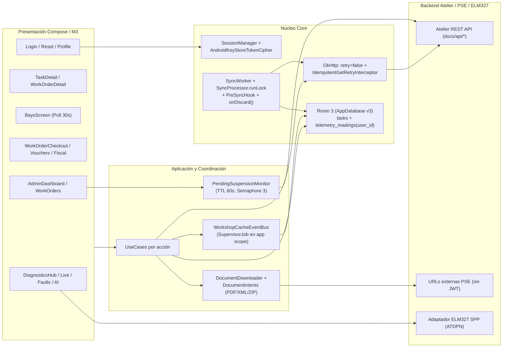

# Plan de Desarrollo Sprint 3 — Atelier Workshop Mobile (21 Historias de Usuario)

*   **Author:** shouydev
*   **Status:** Approved
*   **Date:** 2026-11-23

--------------------------------------------------------------------------------

## Overview

Este documento define el diseño técnico y el plan de implementación para llevar a estado listo para producción las **21 historias de usuario de Sprint 3 (57 SP)** de **Atelier Workshop Mobile** (Android, Jetpack Compose, Material 3, Clean Architecture + Feature-First + DDD, `minSdk = 26`), auditadas sobre la rama `feature/segment2-floor-counter-redesign`.

| Dominio | ID | Historia de Usuario | SP | Módulos afectados |
| --- | --- | --- | --- | --- |
| **Autenticación** | US04 | Cierre de sesión seguro y revocación de credenciales en el dispositivo móvil | 1 | `auth`, `main/profile`, `core/data/local`, `core/notifications` |
| **Autenticación** | US05 | Restablecimiento de credenciales de acceso mediante token de verificación | 2 | `auth`, `navigation` |
| **Diagnóstico e IA** | US16 | Enlace inalámbrico y sincronización de escáner OBD-II en bahía | 3 | `diagnostics`, `main/obd` (eliminación) |
| **Diagnóstico e IA** | US17 | Extracción y decodificación de códigos de falla computarizados | 2 | `diagnostics` |
| **Diagnóstico e IA** | US18 | Monitoreo dinámico de parámetros telemétricos en tiempo real | 3 | `diagnostics` |
| **Diagnóstico e IA** | US19 | Almacenamiento local resiliente y sincronización diferida en fosa | 3 | `diagnostics`, `core/data/sync`, `main/sync` |
| **Diagnóstico e IA** | US20 | Borrado y verificación de restablecimiento de fallas en la computadora vehicular | 2 | `diagnostics` |
| **Diagnóstico e IA** | US21 | Generación de informe pericial predictivo con IA y exportación en PDF | 5 | `diagnostics`, `core/presentation` |
| **Diagnóstico e IA** | US43 | Descarga y remisión de informe pericial de salud vehicular en PDF (clientes y flotas) | 3 | `diagnostics`, `reports`, `core/presentation` |
| **Bahía y Piso** | US28 | Registro fotográfico pericial de desmontaje y montaje de piezas en foso | 2 | `tasks`, `core/designsystem` |
| **Bahía y Piso** | US29 | Solicitud y validación administrativa de suspensión por pieza defectuosa indispensable | 2 | `tasks`, `workorders`, `main/dashboard` |
| **Bahía y Piso** | US30 | Cierre técnico de tarea con cómputo de horas hombre efectivas | 2 | `tasks`, `workorders`, `core/data/sync` |
| **Bahía y Piso** | US40 | Supervisión y reasignación de bahías de servicio en tiempo real | 3 | `bays`, `workorders` |
| **Inventario y FIFO** | US34 | Disparo y desactivación de alertas automáticas de reposición por stock mínimo | 2 | `inventory`, `navigation`, `main/dashboard` |
| **Inventario y FIFO** | US35 | Imputación automática de precios de venta de catálogo y conciliación de margen FIFO | 3 | `workorders`, `cashier` |
| **Caja y SUNAT** | US36 | Liquidación económica automática en cascada de la orden de trabajo | 3 | `workorders`, `cashier` |
| **Caja y SUNAT** | US37 | Emisión de comprobantes tributarios electrónicos UBL 2.1 ante SUNAT vía PSE | 5 | `cashier`, `core/di`, `core/data/remote` |
| **Caja y SUNAT** | US38 | Recaudación y amortización de pagos multi-medio en mostrador y patio | 3 | `cashier`, `core/di` |
| **Caja y SUNAT** | US39 | Transición a orden pagada, emisión de pase de salida vehicular y entrega en patio | 2 | `cashier`, `bays`, `core/data/sync` |
| **Gestión Fiscal** | US41 | Exportación de reporte de flujo de caja en PDF para auditoría contable externa | 3 | `reports`, `core/presentation` |
| **Gestión Fiscal** | US42 | Configuración de información fiscal y series SUNAT con PSE administrado | 3 | `cashier`, `core/data/remote`, `core/data/local` |

### Glosario del dominio y referencias de trazabilidad

*   **Tributación peruana (SUNAT):** **SUNAT** (autoridad tributaria), **RUC** (identificador fiscal de 11 dígitos), **IGV** (18 %), **UBL 2.1** (estándar XML electrónico), **PSE** (Proveedor de Servicios Electrónicos, Nubefact administrado por Atelier), **CDR** (Constancia de Recepción emitida por SUNAT en XML/ZIP), series correlativas (`F001` Factura código `"01"`, `B001` Boleta código `"03"`).
*   **OBD-II y telemetría:** **ELM327** (adaptador Bluetooth clásico SPP), **DTC** (código de falla), **PID** (parámetro en vivo, p. ej. `010B` presión de admisión, `0105` temperatura de refrigerante), **Modos 02 / 03 / 04** (cuadro congelado / leer DTC / borrar DTC), **CAN / ISO 15765-4** (protocolo vehicular con byte de conteo tras prefijo `43`), **ATDPN** (comando local del ELM327 que reporta el número de protocolo activo).
*   **Arquitectura móvil:** aplicación offline-first (`red → Room → UI`), cola transaccional `pending_operations` drenada por `SyncWorker`, barra inferior flotante con 3 pestañas primarias según permiso atómico + botón **Módulos** (`ModulesSheet`), esqueletos *boneyard* (mismo layout real en modo hueso solo cuando no hay caché en Room, con retraso de 150 ms vía `rememberDelayedLoading` para evitar destellos en cargas rápidas).
*   **Huecos de backend documentados ([docs/03-traceability.md](file:///c:/Users/joelh/Downloads/development/atelier-mobile-android/docs/03-traceability.md)):** `H1` (sin App Links de servidor todavía; pegado manual como respaldo), `H3` (`startedAt` fijo + `totalPausedSeconds`), `H5` (sin endpoint de lista de suspensiones pendientes), `H14` (push `LOW_STOCK` repetido en cada descargo bajo mínimo; debe abrir bandeja de alertas), `H15` (`receive` de OC no idempotente; la app verifica estado antes y tras fallo), `H18` (`ConnectionType` backend solo acepta `"BLUETOOTH_BLE"`), `H20` (catálogo local de DTC), `H22` (Mecánico Jefe tiene `iot:faults:resolve` sin `iot:telemetry:ingest`), `H26` (orden sin IGV vs líneas de comprobante con IGV redondeadas `HALF_UP` y nombres genéricos `"Product <uuid>"`/`"Standard Service"` que el cajero edita), `H27` (datos fiscales del cliente editables en borrador), `H28` (sin idempotencia en `POST` de comprobantes/cobros), `H29` (sin firma digital en entrega), `H30` (cashflow sin filtro `branchId`), `H31` (egresos/CxC en 0 y moneda reportada como `PEN`).

## The Problem

Las 21 historias de Sprint 3 ya cuentan con implementaciones parciales en `domain`, `application`, `infrastructure` y `presentation`, pero la auditoría del repositorio reveló cinco categorías de fallos que impiden su paso a producción:

1.  **Integridad de datos, seguridad y fallos de protocolo:**
    *   **Riesgo de duplicidad fiscal y de cobros (US37, US38):** OkHttp mantiene habilitado el reintento automático ante fallos de conexión en llamadas `POST` no idempotentes de facturación, pagos y rotación de refresh token (`H28`).
    *   **Pérdida y cruce de telemetría offline en fosa (US19):** `SyncWorker` nunca empaqueta lecturas remanentes menores a 200 filas tras muerte de proceso, y la tabla local `telemetry_readings` carece de propietario (`user_id`), lo que en terminales compartidos expone lecturas de un técnico bajo la sesión del siguiente usuario. Además, descartar una falla pendiente (`REGISTER_FAULT`) deja huérfano su registro local `local-{id}`.
    *   **Protocolo ELM327 y contrato IoT defectuosos (US16–US18):** el alta de escáneres envía `"BLUETOOTH"`/`"WIFI"`/`"USB"` en lugar de `"BLUETOOTH_BLE"` (`H18`), el cuadro congelado envía `"0202"` sin número de trama `"00"`, la decodificación de tramas CAN `43` puede leer erróneamente el byte de conteo como DTC, la presión de admisión (`010B`) se parsea pero no se visualiza en vivo, `LiveTelemetry` no filtra emisiones de otro vehículo, y en estado `LOST` el botón principal intenta iniciar en vez de reconectar.
    *   **Credenciales locales sin cifrar y fugas al cerrar sesión (US04, US05):** tokens JWT/refresh residen en texto plano en DataStore con `android:allowBackup="true"`; el cierre de sesión no limpia `PushInbox`, `cacheDir/pdfs/` ni `cacheDir/capture/`; el aviso de operaciones pendientes tras expirar la sesión no funciona porque la consulta actual exige sesión activa; y el decodificador de enlaces de recuperación falla ante `%` malformado y acepta tokens vacíos.

2.  **Criterios de aceptación incompletos:**
    *   **US40 (Bahías en tiempo real):** el sondeo periódico de 30 s está implementado pero nunca se invoca; el tablero no muestra mecánicos asignados ni permite reasignarlos desde la hoja de bahía; los conflictos `409` no refrescan el tablero.
    *   **US42 (Datos fiscales y series SUNAT):** la pantalla fiscal gestiona únicamente series correlativas y omite los endpoints existentes de perfil fiscal del taller (`GET/PUT /api/v1/tenants/current` para RUC, razón social y nombre comercial).
    *   **US37 (Comprobantes UBL 2.1):** las URLs `pdfUrl`, `xmlUrl` y `cdrUrl` del comprobante se deserializan pero no tienen descarga/apertura en UI, ni existe acción para reconsultar el estado SUNAT de comprobantes en contingencia (`ISSUED`).
    *   **US34 / US35 / US36 / US39 / US41:** el push `LOW_STOCK` abre el detalle del repuesto en lugar de la bandeja de alertas (`H14`); la vista de margen FIFO no usa esqueleto y no es accesible desde caja; la diferencia por redondeo de línea (`H26`) no se explica en caja; la entrega vehicular no refresca la caché de bahías; y el reporte de flujo de caja carece de rango personalizado y de aviso `H31`.
    *   **US28 / US29 / US30:** las fotos fallidas en tarea no permiten reintento/descarte in-situ ni muestran hora de captura; no existe visibilidad de suspensiones pendientes en dashboard ni en lista de órdenes cuando se pierde el push (`H5`); y cerrar la última tarea no actualiza la caché local de la orden a `COMPLETED`.
    *   **US21 / US43:** la exportación PDF está duplicada en 4 archivos y solo dispara `ACTION_SEND` (sin `ACTION_VIEW`), y el Hub de Diagnóstico bloquea informes IA cuando el plan incluye IA pero no telemetría.

3.  **9 bugs de RBAC y banderas de plan (violación de `docs/02-roles-and-permissions.md`):**
    *   Dashboard consulta alertas de stock con permiso de catálogo (403 para Asesor de Servicio).
    *   Tablero de bahías y detalle de orden exigen permiso de edición de orden además de `operations:bays:reassign`, y cargan órdenes sin verificar `operations:work_orders:read`.
    *   Formulario de suspensión busca repuestos sin verificar `inventory:parts:read`.
    *   Acceso a caja desde la orden omite `invoicing:invoices:read`.
    *   Módulo Reportes se muestra a usuarios con `iot:health_reports:read` sin `crm:customers:read`, generando callejón sin salida.
    *   Hub de Diagnóstico bloquea conexión Bluetooth a roles con `iot:faults:resolve` sin `iot:telemetry:ingest` (Mecánico Jefe en US20), y los puntos de entrada desde Módulos/Orden/Tarea omiten permisos de IA y alertas predictivas.
    *   El permiso `iam:tenants:read` / `iam:tenants:update` no está modelado en el catálogo de permisos del cliente.

4.  **Código muerto y defectos de ergonomía móvil (Compose / Material 3 / `DESIGN.md`):**
    *   Existe un módulo OBD duplicado e inalcanzable (`ObdScreen` + `ObdViewModel` + `ObdRoute`, >900 líneas).
    *   Cuatro pantallas núcleo de Sprint 3 (`DiagnosticsHub`, `WorkOrderCheckout`, `Bays`, `TaskDetail`) superan 800–1,567 líneas con paso masivo de parámetros (hasta 67 parámetros), impidiendo aislar estado y mantener la UI.
    *   Defectos móviles en terreno: hojas inferiores sin `imePadding()` coordinado (el teclado cubre campos en 5 módulos), doble inset superior en pantallas de inventario/autenticación/recepción, acciones de fosa menores a 56 dp, truncamientos en pantallas angostas o con fuente al 1.3x, ausencia de `BackHandler` para borradores sin guardar, esqueletos con salto visual en cargas sin caché, sombras fuera de `AtelierSurface`, y háptica ausente o tardía en confirmaciones críticas.

## Goals

*   **G1 — Cobertura verificable de las 21 historias de Sprint 3 (57 SP):** cerrar todas las brechas frente a los escenarios E1–E3 de [user-stories.md](file:///c:/Users/joelh/Downloads/development/atelier-mobile-android/docs/01-requirements/user-stories.md) y [03-traceability.md](file:///c:/Users/joelh/Downloads/development/atelier-mobile-android/docs/03-traceability.md), manejando de forma explícita los huecos abiertos de backend (`H1`, `H5`, `H14–H31`).
*   **G2 — Protección de datos locales y transacciones financieras:** cifrar tokens de sesión con Android Keystore AES-256-GCM y desactivar respaldo en la nube, impedir reintentos de transporte en `POST` no idempotentes conservando resiliencia en `GET`, aislar por `user_id` y empaquetar remanentes `<200` de telemetría tras muerte de proceso sin fragmentar sesiones activas, y purgar cachés/archivos temporales sensibles al cerrar sesión.
*   **G3 — Cierre verificado de los 9 bugs de RBAC y plan:** alinear cada acción y destino de navegación con `docs/02-roles-and-permissions.md`, validado mediante pruebas unitarias por guarda de permiso y bandera de plan.
*   **G4 — Ergonomía móvil y mantenibilidad Compose (`DESIGN.md` y `PRODUCT.md`):** eliminar el módulo OBD muerto, descomponer las 4 pantallas monolíticas de Sprint 3 con sub-estados `@Immutable` y eventos sellados, garantizar objetivos táctiles ≥ 48 dp (≥ 56 dp en pantallas de piso/fosa vía densidad ambiental), reflujo adaptable por ancho disponible (sin recortes a `fontScale = 1.3f` ni 320 dp), `imePadding()` sin doble inset, `BackHandler` seguro con hojas inferiores, háptica al presionar (press-down) en acciones críticas y vistas previas claro/oscuro completas.
*   **G5 — Cobertura automatizada de regresión:** dejar `./gradlew assembleDebug testDebugUnitTest` 100 % en verde incorporando pruebas de migración Room `2 → 3`, seguridad (cifrado, cabeceras externas, cierre de sesión), protocolos ELM327/CAN, los 9 guardas RBAC y los ViewModels hoy sin cobertura (`WorkOrderCheckout`, `DailyCash`, `FiscalSeries`, `StockAlerts`, `Reports`, `Profile`, `Login` y `Bays`).

## Non-Goals

*   **No modificar el backend** (`atelier-platform`) ni inventar endpoints o campos fuera de `docs/api/`. Los huecos confirmados de backend (`H1` validación de dominio en servidor, `H19`, `H24`, `H29`, `H30`, `H31`) se manejan con transparencia en UI.
*   **No rediseñar flujos funcionales de Sprints 1–2** (asistencia, citas/recepción, proformas, proveedores, escáner SKU, valorización). En esas pantallas solo se aplican correcciones mecánicas puntuales de insets duplicados o de RBAC en puntos compartidos (`AdminDashboard`, `WorkOrderDetail`, `ModulesSheet`).
*   **No habilitar Google Sign-In en producción** ni llaves de firma release.
*   **No integrar `/iot/health-reports/generate-async`** (`H21`: sin endpoint de consulta de estado).

## Open Questions

Todas las decisiones arquitectónicas del plan han sido cerradas antes de la fase de implementación (ver *Alternatives Considered* y *Risks & Mitigations*). No quedan decisiones abiertas para el implementador.

## Critical User Journeys (CUJs)

### CUJ 1: Diagnóstico OBD-II en fosa sin señal, borrado de DTC e informe IA (US16, US17, US18, US19, US20, US21, US43 E1)

*   **Given:** Un técnico mecánico autenticado con permisos `iot:telemetry:ingest`, `iot:faults:read`, `iot:faults:resolve`, `iot:health_reports:generate/read` y plan con telemetría e IA habilitadas opera en una fosa sin red con un adaptador ELM327 emparejado por Bluetooth.
*   **When:** Selecciona el vehículo, conecta el escáner, lee parámetros en vivo (incluyendo presión de admisión `010B`), congela una muestra, escanea DTCs (modos 03 y 02), repara la falla, ejecuta borrado (modo 04 + re-lectura modo 03), sale de la fosa (incluso tras cierre del proceso en segundo plano), recupera red y solicita el informe predictivo IA y su PDF.
*   **Then:** El protocolo vehicular se detecta determinísticamente vía `ATDPN` sin falsos DTCs; las lecturas locales llevan `user_id` y se sincronizan sin pérdida ni duplicación al volver la red; ante pérdida de señal Bluetooth la pantalla ofrece reconexión directa; y el PDF del informe IA permite **Abrir (`ACTION_VIEW`)** o **Compartir (`ACTION_SEND`)**.

### CUJ 2: Borrado de fallas por Mecánico Jefe e informes IA en plan sin telemetría (US20, US21, US43 E2)

*   **Given:** (a) Un mecánico jefe con `iot:faults:resolve` sin `iot:telemetry:ingest` verifica un vehículo en bahía (`H22`); y (b) un asesor de servicio con `iot:health_reports:read`, `crm:customers:read` y plan con IA (aun con telemetría desactivada) atiende a un cliente corporativo de flota.
*   **When:** (a) El mecánico jefe enlaza el ELM327 para borrar y re-verificar códigos de falla; y (b) el asesor ingresa al Hub de Diagnóstico para abrir el informe IA del vehículo o descarga el PDF consolidado de flota desde Reportes.
*   **Then:** (a) El borrado ejecuta modo 04 + modo 03 local y resuelve las fallas en el backend sin encolar ingesta remota prohibida (0 errores 403); y (b) el asesor selecciona vehículo y accede a informes IA y PDF de flota sin bloqueos por la bandera de telemetría.

### CUJ 3: Evidencia fotográfica en fosa, suspensión validada y cierre técnico (US28, US29, US30)

*   **Given:** Un técnico mecánico ejecuta una tarea `IN_PROGRESS` en fosa sin red; un supervisor con `operations:tasks:hold_validate` supervisa desde el patio.
*   **When:** El técnico captura fotos de desmontaje y montaje (con contador de nota real), solicita una suspensión por repuesto defectuoso; el supervisor visualiza la solicitud pendiente tanto desde el push como desde *"Esperan tu decisión"* en el dashboard y en la lista de órdenes, la resuelve en hoja inferior; finalmente el técnico confirma sus horas hombre efectivas y cierra la última tarea de la orden.
*   **Then:** Las fotos muestran hora local de captura y estado (`Pendiente`/`Falló`/`Sincronizado`) con reintento o descarte in-situ ante fallos; la visibilidad de suspensiones del supervisor nunca contamina la bandeja *"Mis tareas"*; el cierre advierte de forma suave si falta foto de montaje y refresca la caché de la orden a `COMPLETED` aun si el técnico navega atrás de inmediato.

### CUJ 4: Supervisión y reasignación de bahías en tiempo real (US40)

*   **Given:** Un mecánico jefe con `operations:bays:read` y `operations:bays:reassign` (con o sin `operations:work_orders:update`) abre el tablero de bahías con red activa.
*   **When:** Supervisa la ocupación en pantalla, consulta los mecánicos y el tiempo transcurrido en una bahía ocupada, traslada la orden a otra bahía disponible (o enfrenta una colisión `409` concurrente) y reasigna el mecánico de una tarea desde la hoja de la bahía.
*   **Then:** El tablero refresca automáticamente cada 30 s solo mientras la pantalla está visible y con conectividad, calcula el tiempo transcurrido localmente sin tormentas N+1, recarga la caché ante `409` y refleja de inmediato el cambio de bahía y de mecánico.

### CUJ 5: Alerta de stock mínimo, reposición y control de margen FIFO (US34, US35)

*   **Given:** Un encargado de inventario con `inventory:alerts:read`, `inventory:purchase_orders:read` y `inventory:batches:receive` recibe una notificación `LOW_STOCK` tras imputarse un repuesto con precio base de catálogo inmutable; un administrador con `inventory:batches:read` revisa la rentabilidad de la orden.
*   **When:** El encargado toca la notificación, revisa las alertas, abre la orden de compra emitida y registra la recepción con foto del comprobante; el administrador abre el margen FIFO desde la orden o desde la vista de caja.
*   **Then:** El push abre directamente la bandeja de alertas (`H14`); la recepción idempotente (`H15`) desactiva la alerta al subir el stock sobre el mínimo; y el detalle de rentabilidad FIFO muestra carga con esqueleto y sin errores 403 en el dashboard para roles sin permiso de alertas.

### CUJ 6: Liquidación en cascada, facturación SUNAT UBL 2.1, cobranza multi-medio y entrega (US36, US37, US38, US39)

*   **Given:** Una orden `COMPLETED` pasa a mostrador; un cajero con `invoicing:invoices:issue_sunat`, `invoicing:payments:create`, `invoicing:exit_passes:issue` y un asesor con `operations:vehicle_handover:execute` atienden al cliente.
*   **When:** El cajero verifica el desglose en cascada (mano de obra + repuestos + IGV 18 %), ajusta descripciones genéricas (`H26`) y datos fiscales (`H27`), emite Factura (`01`) o Boleta (`03`), consulta estado SUNAT si queda en `ISSUED`, abre o comparte el PDF/XML/CDR, registra pagos parciales en distintos medios hasta saldar el saldo y el asesor descarga el pase de salida PDF y registra la entrega.
*   **Then:** Los `POST` de emisión y pago nunca se reintentan en transporte ante cortes de red; cualquier diferencia de céntimos por redondeo por línea (`H26`) se explica explícitamente; los documentos externos del PSE se descargan sin enviar el JWT del backend; las deudas pendientes bloquean el pase (`422`); y la entrega refresca la disponibilidad de bahías en segundo plano.

### CUJ 7: Configuración fiscal SUNAT y exportación de flujo de caja (US41, US42)

*   **Given:** El dueño del taller con `invoicing:fiscal_config:manage`, `iam:tenants:read`, `iam:tenants:update` y `invoicing:cashflow:export_pdf` gestiona la formalidad tributaria y la auditoría contable.
*   **When:** Abre *Datos fiscales y series SUNAT*, verifica su RUC y actualiza la razón social y nombre comercial junto con las series correlativas de su sede; luego entra a Reportes, elige mes, año o un rango personalizado de fechas y exporta el flujo de caja en PDF.
*   **Then:** El nombre comercial actualizado se refleja inmediatamente en toda la sesión activa; las series duplicadas muestran el error `409` del backend; y el reporte de flujo de caja muestra la nota de alcance `H30`/`H31` y permite abrir o compartir el PDF.

### CUJ 8: Cierre de sesión seguro y recuperación de credenciales (US04, US05)

*   **Given:** Un colaborador autenticado opera en un terminal compartido del taller (posiblemente con operaciones offline pendientes en cola); otro colaborador olvidó su contraseña y recibe el correo con el enlace de recuperación.
*   **When:** El primer colaborador cierra sesión (o expira su refresh token); el segundo toca el enlace de recuperación o pega el token en *Restablecer contraseña*.
*   **Then:** Al cerrar sesión se empaqueta la telemetría del usuario saliente, se intenta revocar FCM y refresh token con presupuestos independientes, se borran cachés Room, `PushInbox` y archivos temporales (`pdfs/`, `capture/`), y los tokens locales cifrados se eliminan conservando `pending_operations`; al volver al login, un banner neutro advierte si hay operaciones pendientes en el dispositivo; y el flujo de recuperación tolera URLs malformadas sin fallar ni permitir tokens vacíos.

## Technical Plan (Architecture)

La arquitectura mantiene Clean Architecture + Feature-First + DDD (`domain` puro sin Android/Hilt/Room/Retrofit, casos de uso atómicos con `operator fun invoke`, repositorios offline-first y UI regida por `Session.has(Permission.X)`).

### Diagrama de flujo de datos y coordinación entre capas

### 1. Seguridad, transporte y resiliencia offline (US04, US05, US19, US37, US38)

*   **Transporte seguro para mutaciones financieras:** desactivar `retryOnConnectionFailure` en los clientes autenticados y de refresh de red para eliminar reenvíos ocultos en `POST /invoicing/vouchers`, `POST /invoicing/payments` y `POST /auth/refresh`. Añadir un interceptor liviano exclusivamente para peticiones idempotentes `GET` y `HEAD` (1 reintento ante `IOException`/`EOFException` previo a respuesta) para preservar resiliencia en sockets keep-alive y transiciones Wi-Fi/4G, manteniendo sin cambios el cliente sin autenticación de almacenamiento externo.
*   **Cifrado nativo de credenciales:** cifrar `access_token` y `refresh_token` con `AndroidKeyStore` AES-256-GCM (`minSdk = 26`, sin nuevas dependencias externas), respaldado por una migración atómica de DataStore para sesiones heredadas en texto plano, `android:allowBackup="false"` más exclusiones explícitas de backup, inicialización perezosa en hilo IO con autorrecuperación ante corrupción del Keystore, y validación de descifrado al emitir el estado de sesión.
*   **Limpieza completa en cierre de sesión y aviso en login:** antes de borrar la sesión en `signOut()`, empaquetar las lecturas telemétricas pendientes del usuario saliente, ejecutar la revocación de FCM y de refresh token con presupuestos de tiempo independientes, limpiar `PushInbox`, purgar archivos temporales descargados y capturas huérfanas (`cacheDir/pdfs/` y `cacheDir/capture/`), y preservar `pending_operations` por propietario. En la pantalla de login, consultar un conteo neutro a nivel de dispositivo (sin requerir sesión activa ni exponer detalles por usuario) para advertir sobre operaciones locales pendientes.
*   **Integridad offline en fosa sin acoplamiento entre features:** agregar `user_id` a `telemetry_readings` (migración Room `2 → 3`) y ejecutar el empaquetado de remanentes `<200` dentro del lock del procesador de sincronización mediante un gancho `PreSyncHook` con doble protección: (a) solo para el usuario activo con `iot:telemetry:ingest`, excluyendo vehículos con sesión Bluetooth en vivo y aplicando ventana de inactividad de 60 s dentro de una transacción Room + mutex; y (b) extender `OperationHandler` con un gancho `onDiscard` para que cada feature (como el handler de fallas locales) limpie sus propias filas optimistas sin acoplar `main` a DAOs de otras features.
*   **Enlaces de recuperación (US05):** soportar tanto el enlace web entrante (App Link en manifiesto entregado mediante buzón de deep links en `MainActivity` → `AppNavHost`, advirtiendo si ya existe sesión activa) como el pegado manual endurecido contra codificaciones `%` malformadas y tokens vacíos.

### 2. Diagnóstico OBD-II, protocolo ELM327, IA y documentos (US16–US21, US43)

*   **Eliminación de duplicados:** retirar el módulo OBD obsoleto e inalcanzable (`ObdScreen`/`ObdViewModel`/`ObdRoute`) dejando `DiagnosticsNavGraph` como única superficie de diagnóstico.
*   **Protocolo ELM327 determinista y contrato IoT:** consultar `ATDPN` una vez durante el handshake Bluetooth para informar explícitamente al parser de DTC si el vehículo usa CAN ISO 15765-4 o un protocolo legado, evitando corrupción de códigos no-CAN. Corregir el comando de cuadro congelado a trama explícita `00`, fijar el tipo de conexión en alta de escáner a `"BLUETOOTH_BLE"` (`H18`), incorporar presión de admisión (`010B`) a la vista en vivo, aislar el flujo en vivo por `vehicleId` y exponer una acción explícita de reconexión (`DiagnosticSession.reconnect()`) ante estado `LOST`.
*   **Desacoplo de permisos y plan:** separar el acceso al Hub de Diagnóstico por capacidad (selector de vehículo visible en cabecera del Hub para que un plan con IA sin telemetría pueda elegir unidad y abrir informes IA sin la pestaña Bluetooth). Habilitar enlace Bluetooth y borrado local/remoto de fallas para roles con `iot:faults:resolve` sin `iot:telemetry:ingest`, omitiendo la ingesta remota (`REGISTER_FAULT`/`TELEMETRY_BATCH`) para evitar errores 403. Mantener `GET /iot/installations/vehicle/{id}/active` estrictamente bajo `iot:devices:read` y conservar `iot:devices:register` en `ModulesSheet`.
*   **Descarga y apertura unificada de documentos (PDF, XML, CDR):** generalizar la descarga y apertura de archivos en `core/` para soportar `.pdf`, `.xml` y `.zip` con MIME correcto, validar esquema `https://`, usar el cliente OkHttp sin autenticación para hosts externos del PSE (evitando filtración de JWT) y reemplazar las 4 copias dispersas de apertura PDF para ofrecer tanto **Abrir (`ACTION_VIEW`)** como **Compartir (`ACTION_SEND`)**.

### 3. Operaciones de fosa, suspensiones y tablero de bahías (US28, US29, US30, US40)

*   **Evidencias y cierre técnico (US28, US30):** mostrar hora local de captura en cada evidencia, contador real descontando el prefijo de clasificación (`"Desmontaje: "`/`"Montaje: "`) únicamente en el flujo de evidencias US28, y reintento/descarte in-situ aprovechando el callback de toque existente en la grilla de fotos. Al cerrar una tarea, mostrar advertencia suave si falta foto de montaje y emitir un evento en un bus de caché con ámbito de aplicación (`WorkshopCacheEventBus`, `SupervisorJob`) para refrescar la orden en Room aunque el técnico salga inmediatamente de la pantalla.
*   **Mitigación parcial en cliente para H5 sin contaminar `tasks` (US29):** persistir la fecha de solicitud de suspensión (`INTEGER` epoch ms UTC) en la tabla local de tareas propias (`tasks`) y crear un monitor en memoria independiente con TTL de 60 s y concurrencia acotada (`Semaphore(3)`, hasta 15 órdenes `IN_PROGRESS`) que proyecta oportunidades de lectura ya ocurridas y alimenta tanto `AdminDashboard` como la insignia ámbar en `WorkOrdersScreen`, sin escribir tareas de terceros en la tabla `tasks:my`. Proteger la búsqueda de repuestos dentro de la solicitud de suspensión con `inventory:parts:read`.
*   **Tablero de bahías en tiempo real (US40):** activar el sondeo de 30 s acotado al ciclo de vida visible y pausado sin conectividad, conservar caché *stale-while-revalidate* con concurrencia limitada y refresco completo inmediato ante cambios de orden o conflicto `409`, calcular el tiempo transcurrido localmente desde `startedAt`/`totalPausedSeconds` (`H3`), mostrar mecánicos asignados y habilitar reasignación de mecánico desde la hoja de bahía, corregir permisos (`operations:bays:reassign` independiente de `operations:work_orders:update`; órdenes condicionadas a `operations:work_orders:read`) y deduplicar alias de tipo de bahía.

### 4. Inventario, margen FIFO, caja SUNAT, datos fiscales y reportes (US34–US39, US41–US42)

*   **Alertas y margen FIFO (US34, US35):** redirigir el push `LOW_STOCK` a la bandeja de alertas (`H14`), añadir banner de stock bajo con acceso a compras en detalle de repuesto, corregir la consulta de alertas del dashboard a `inventory:alerts:read` estricto, dotar de esqueleto al resumen de margen FIFO y exponerlo también en la vista de caja.
*   **Liquidación, comprobantes SUNAT y entrega (US36–US39):** permitir entrada de solo lectura a caja con `invoicing:invoices:read`, explicar explícitamente diferencias de céntimos por redondeo por línea (`H26`), incorporar acciones de descarga/apertura de PDF/XML/CDR y consulta puntual de estado SUNAT para comprobantes `ISSUED`, persistir campos del borrador de comprobante ante muerte de proceso (`SavedStateHandle`), y publicar evento en `WorkshopCacheEventBus` tras la entrega vehicular para refrescar bahías.
*   **Datos fiscales del taller y series (US42):** ubicar el servicio IAM de tenant en `core/data/remote/tenant/` junto a los demás servicios transversales de IAM, exponer en la pantalla fiscal la ficha de RUC (solo lectura) y edición de razón social/nombre comercial (actualizando de inmediato el nombre en sesión al guardar), más la tarjeta de PSE administrado y las series correlativas, protegiendo el acceso desde `ModulesSheet` con `FISCAL_CONFIG_MANAGE || TENANTS_UPDATE`.
*   **Reportes (US41, US43 E2):** habilitar la baldosa de Reportes solo con `CASHFLOW_EXPORT_PDF || (canReadAiReports() && CUSTOMERS_READ)` para eliminar callejones sin salida, agregar selección de rango personalizado en Material 3 con conversión segura en UTC, mostrar advertencia honesta `H31` y aplicar los patrones de cabecera, pull-to-refresh y estado vacío de `DESIGN.md`.

### 5. Sistema visual, ergonomía móvil y modularización Compose

Todas las decisiones visuales siguen estrictamente [DESIGN.md](file:///c:/Users/joelh/Downloads/development/atelier-mobile-android/DESIGN.md) y [PRODUCT.md](file:///c:/Users/joelh/Downloads/development/atelier-mobile-android/PRODUCT.md) (paleta fija de marca, Satoshi tabular, Material 3, contraste WCAG 2.2 AA):

*   **Densidad ambiental y reflujo por ancho:** proveer un `CompositionLocal` de altura táctil mínima (48 dp por defecto; 56 dp en pantallas raíz de piso/fosa) y un contenedor adaptable por medición intrínseca de ancho para que las filas de botones y resúmenes se apilen automáticamente tanto en pantallas de 320 dp como a escala de fuente 1.3x sin umbrales arbitrarios dispersos.
*   **Hojas, teclado, insets y gesto Atrás:** coordinar insets de barra de navegación + teclado en hojas inferiores desplazables para evitar doble margen inferior en `targetSdk = 37`, eliminar el doble padding de barra de estado en pantallas secundarias, corregir botones atrás indebidos en raíces de pestaña, y aplicar `BackHandler` únicamente cuando existan cambios sucios y ninguna hoja inferior esté abierta, usando un diálogo estándar de confirmación de descarte.
*   **Esqueletos boneyard consistentes y háptica:** pintar caché Room en el primer cuadro (incluyendo la placa/cabecera de la orden de trabajo antes de que responda la red); cuando no hay caché, mantener visible la estructura fija de la pantalla y activar huesos tras 150 ms (`rememberDelayedLoading`) sin cuadros en blanco ni cifras falsas como `"00:00:00"`. Sincronizar háptica al presionar (press-down) en acciones de compromiso y hacer reactivo el detector de movimiento reducido del sistema.
*   **Modularización de pantallas Sprint 3:** descomponer únicamente las 4 pantallas de Sprint 3 que reciben cambios funcionales mayores (`DiagnosticsHub`, `WorkOrderCheckout`, `Bays`, `TaskDetail`) agrupando callbacks en eventos sellados (`sealed interface *Event`) y dividiendo estados en sub-estados `@Immutable` para aislar recomposiciones y reducir firmas de hasta 67 parámetros a 3–5.

## Alternatives Considered

### Alternative A: Conservar `ObdScreen` como gestión separada de dispositivos OBD-II

*   **Pros:** Evita eliminar >900 líneas ya escritas y separa visualmente el inventario de escáneres del enlace Bluetooth.
*   **Cons:** Duplica la pestaña de dispositivos de `DiagnosticsHub`, retiene bugs activos de RBAC y de `ConnectionType` (`H18`), y no tiene ninguna ruta activa en el grafo de navegación.
*   **Reason for Rejection:** Descartada por duplicación técnica sin valor de producto: mantener dos flujos paralelos para los mismos endpoints duplica mantenimiento y superficie de regresión.

### Alternative B: Desactivar `retryOnConnectionFailure` globalmente sin recuperación para `GET`, frente a interceptor selectivo para `GET`/`HEAD`

*   **Pros (desactivar global sin interceptor):** Cambio de 2 líneas sin código adicional.
*   **Cons:** Elimina la recuperación automática ante sockets keep-alive cerrados (`EOFException`) y saltos Wi-Fi/4G en todas las lecturas idempotentes (`BaysScreen`, dashboard, catálogo), generando fallos visibles evitables en taller.
*   **Reason for Rejection:** Descartada por degradación de estabilidad en red móvil: combinar `retryOnConnectionFailure(false)` como base segura (protegiendo `POST`/`PUT` financieros y refresh) con un interceptor de 1 reintento acotado exclusivamente a `GET`/`HEAD` resuelve la seguridad financiera sin penalizar lecturas.

### Alternative C: Agregar Google Tink (`tink-android`) frente a `AndroidKeyStore` AES-256-GCM nativo

*   **Pros (Tink):** Biblioteca criptográfica auditada con rotación de keysets integrada.
*   **Cons:** Introduce una dependencia externa pesada (con runtime protobuf) únicamente para cifrar 2 cadenas cortas en una app con `minSdk = 26`, donde `AndroidKeyStore` + `AES/GCM/NoPadding` es nativo y requiere el mismo manejo defensivo de backup y recuperación de Keystore.
*   **Reason for Rejection:** Descartada por YAGNI y tamaño de binario: `AndroidKeyStore` AES-256-GCM encapsulado detrás de `TokenCipher` con `DataMigration`, `allowBackup="false"` y autorrecuperación cumple el requisito de US04 con cero dependencias externas nuevas.

### Alternative D: Sondear todas las órdenes abiertas en `AdminDashboard` y almacenarlas en `TaskDao` para H5

*   **Pros:** Reutiliza la tabla `tasks` existente y garantiza ver el 100 % de suspensiones en caché local.
*   **Cons:** `TaskDao` almacena exclusivamente el ámbito `tasks:my` (`replaceMine` borra toda la tabla), por lo que escribir tareas de terceros corrompe *"Mis tareas"* del Mecánico Jefe y se borra al refrescar; además, consultar todas las órdenes abiertas en cada apertura de "Hoy" provoca tormentas N+1.
*   **Reason for Rejection:** Descartada por corrupción de ámbito de datos y costo de red: un monitor en memoria independiente con TTL de 60 s, proyección oportunista desde detalles ya consultados y concurrencia acotada (`Semaphore(3)`, tope 15 órdenes `IN_PROGRESS`) protege `tasks:my` y evita N+1 repetitivos.

### Alternative E: Inyección directa de DAOs/Repositorios entre features frente a `OperationHandler.onDiscard` + `WorkshopCacheEventBus`

*   **Pros (inyección directa):** Llamadas lineales directas sin abstracciones intermedias.
*   **Cons:** Acopla `features/main` a DAOs de `features/diagnostics` y `features/cashier`/`features/tasks` a repositorios hermanos, violando el aislamiento Feature-First y cancelando el refresco de caché si el usuario navega atrás inmediatamente al completar una tarea o entregar un vehículo.
*   **Reason for Rejection:** Descartada por acoplamiento y cancelación de corrutinas en navegación: `OperationHandler.onDiscard()` mantiene a `main` agnóstico de features, y `WorkshopCacheEventBus` (con `SupervisorJob` en ámbito de aplicación) desacopla los refrescos y sobrevive al cierre de pantalla.

## Risks & Mitigations

| Riesgo | Modo de fallo / Impacto | Mitigación | Plan de rollback |
| --- | --- | --- | --- |
| **Corrupción de Keystore o backup restaurado (US04)** | Dispositivo restaurado o fallo OEM de `AndroidKeyStore` impide descifrar tokens y genera bucle de crash al iniciar. | `android:allowBackup="false"`, exclusiones explícitas en reglas XML, inicialización en `Dispatchers.IO` con borrado de alias corrupto + `clear()` de sesión devolviendo `null` (re-login limpio conservando `pending_operations`). | Revertir `TokenCipher` a `NoOpTokenCipher` mediante binding DI sin alterar esquema de DataStore. |
| **Fuga de telemetría entre usuarios o fragmentación de sesiones en vivo (US19)** | En terminal compartido, `SyncWorker` sube lecturas del técnico A bajo sesión del técnico B (403 o fuga cross-tenant) o parte sesiones en vivo en micro-lotes. | Columna `user_id` en `telemetry_readings` (`MIGRATION_2_3`), flush bajo `SyncProcessor.runLock` + `@Transaction` + `Mutex` condicionado a `TELEMETRY_INGEST`, exclusión de vehículos con stream activo, ventana de inactividad de 60 s y flush previo en `signOut()`. | Desactivar registro del `PreSyncHook` en DI; `telemetry_readings` permanece íntegra y compatible. |
| **Migración Room `2 → 3` en instalaciones existentes** | Fallo SQL o desajuste de esquema impide abrir `AppDatabase`. | Migración estrictamente aditiva (`ALTER TABLE ... ADD COLUMN` nullable en dos tablas), esquema exportado `3.json` versionado y prueba automatizada `MigrationsTest` (`2 → 3`) con datos preexistentes. | Al ser columnas nullable sin borrado, un rollback de app en desarrollo puede reconstruir caché limpia sin pérdida de datos del servidor (excepto cola local). |
| **Sondeo de bahías y H5 sobrecargando red móvil (US40, US29)** | Múltiples supervisores generando picos de `GET /work-orders/{id}` en patio con mala señal. | Concurrencia acotada `Semaphore(3)`, caché *stale-while-revalidate* con TTL 60 s, pausa automática sin red (`ConnectivityObserver`), backoff exponencial ante 429/5xx y cómputo local de `laborElapsed` (`H3`). | Ajustar constantes de TTL/intervalo o desactivar sondeo dejando pull-to-refresh manual. |
| **Filtración de JWT a dominios externos del PSE (US37)** | Descarga de `pdfUrl`/`xmlUrl`/`cdrUrl` externos con cliente autenticado enviaría cabecera `Authorization` a terceros. | Validar esquema `https://`, comparar `scheme+host+port` contra `BuildConfig.API_BASE_URL` y usar el cliente OkHttp sin autenticación (`@SupabaseClient`) para todo host externo; verificar con prueba unitaria de cabeceras. | Abrir URLs externas exclusivamente con Custom Tabs del navegador. |
| **App Links sin `assetlinks.json` publicado en servidor (US05)** | Android muestra selector de aplicación o abre navegador en lugar de abrir la app directamente. | El `<intent-filter>` sigue ofreciendo la app al usuario y el pegado manual del enlace o token (`H1`) permanece plenamente operativo en `ResetPasswordScreen`. | Eliminar `<intent-filter>` del manifiesto sin impacto en el flujo manual. |

--------------------------------------------------------------------------------

## Non-Functional Requirements

*   **Security & Privacy:**
    *   Tokens de acceso y refresh cifrados con `AndroidKeyStore` AES-256-GCM; `android:allowBackup="false"`.
    *   Ninguna petición a hosts distintos de `BuildConfig.API_BASE_URL` lleva cabecera `Authorization`.
    *   Al cerrar sesión se purgan cachés Room, `PushInbox`, `cacheDir/pdfs/` y `cacheDir/capture/`; `pending_operations` se conserva asociada a su `user_id`.
*   **Performance & Latency:**
    *   El sondeo de bahías corre exclusivamente entre `ON_START` y `ON_STOP` y se pausa sin conectividad.
    *   Los datos en Room se pintan en el primer cuadro; sin caché, los esqueletos boneyard esperan 150 ms (`rememberDelayedLoading`) manteniendo visible la estructura fija.
    *   Sub-estados `@Immutable` + eventos sellados en pantallas descompuestas evitan recomposición de pestañas/pasos inactivos.
*   **Offline Resilience & Data Integrity:**
    *   Cero reintentos de transporte en `POST` de comprobantes, pagos y refresh; 1 reintento seguro en `GET`/`HEAD`.
    *   Protección transaccional contra duplicación de lotes telemétricos y limpieza garantizada de filas optimistas al descartar operaciones.
*   **Mobile Accessibility & Ergonomics:**
    *   Objetivos táctiles ≥ 48 dp globales y ≥ 56 dp en pantallas de piso/fosa; soporte sin recortes en anchos de 320 dp y escala de fuente 1.3x; contraste WCAG 2.2 AA verificado en claro y oscuro en tokens de `Color.kt` y en emulador; soporte reactivo a "quitar animaciones" del sistema.
*   **Rollout & Rollback:**
    *   Ejecución en 5 fases incrementales compilables y verificables (`./gradlew assembleDebug testDebugUnitTest` verde al cierre de cada fase).

--------------------------------------------------------------------------------

### Additional Resources

*   [Requisitos — Historias de usuario](file:///c:/Users/joelh/Downloads/development/atelier-mobile-android/docs/01-requirements/user-stories.md)
*   [Roles y permisos RBAC](file:///c:/Users/joelh/Downloads/development/atelier-mobile-android/docs/02-roles-and-permissions.md)
*   [Matriz de trazabilidad y huecos](file:///c:/Users/joelh/Downloads/development/atelier-mobile-android/docs/03-traceability.md)
*   [Integración móvil (ELM327, FCM, FileProvider)](file:///c:/Users/joelh/Downloads/development/atelier-mobile-android/docs/04-mobile-integration.md)
*   [Arquitectura Android](file:///c:/Users/joelh/Downloads/development/atelier-mobile-android/docs/05-android-architecture.md)
*   [Sincronización offline y Room](file:///c:/Users/joelh/Downloads/development/atelier-mobile-android/docs/06-offline-sync.md)
*   [Roadmap de construcción](file:///c:/Users/joelh/Downloads/development/atelier-mobile-android/docs/07-roadmap.md)
*   [Contratos API REST](file:///c:/Users/joelh/Downloads/development/atelier-mobile-android/docs/api/README.md)
*   [PRODUCT.md](file:///c:/Users/joelh/Downloads/development/atelier-mobile-android/PRODUCT.md) y [DESIGN.md](file:///c:/Users/joelh/Downloads/development/atelier-mobile-android/DESIGN.md)

### Future Improvements

*   **Bandeja paginada de suspensiones y filtro `branchId` en cashflow:** reemplazar `PendingSuspensionMonitor` y activar filtro de sucursal + egresos en `ReportsScreen` cuando el backend cierre `H5`, `H30` y `H31`.
*   **Generación asíncrona de informes IA (`generate-async`):** migrar cuando el backend exponga consulta por `jobId` (`H21`).
*   **Firma digital de conformidad en entrega (`H29`):** añadir captura de firma cuando `POST /work-orders/{id}/deliver` acepte adjunto.

--------------------------------------------------------------------------------

## Detailed Implementation Plan

Todas las rutas son relativas a la raíz del repositorio (`c:/Users/joelh/Downloads/development/atelier-mobile-android`). Cada fase deja el proyecto compilando y con `./gradlew assembleDebug testDebugUnitTest` en verde. **Cero decisiones abiertas quedan para el implementador.** Los sub-composables extraídos en descomposiciones usan visibilidad `internal` en el mismo paquete y preservan las firmas públicas de `*Screen(...)` salvo donde se indique explícitamente.

---

### Fase 1 — Núcleo `core/`, Seguridad de Sesión, Transporte Seguro, Documentos y Design System

#### 1.1 `app/src/main/java/com/andeva/atelier/mobile/core/data/remote/IdempotentGetRetryInterceptor.kt` (Create) y `app/src/main/java/com/andeva/atelier/mobile/core/di/NetworkModule.kt` (Modify)
*   **Type / Scope:** Red / OkHttp (US37, US38, US04).
*   **Proposed Changes:**
    *   Crear `IdempotentGetRetryInterceptor : Interceptor` que solo reintente una vez (1 retry) peticiones con `request.method in setOf("GET", "HEAD")` ante `IOException` (incluyendo `EOFException` por socket keep-alive cerrado) antes de recibir respuesta HTTP; cualquier `POST`, `PUT`, `PATCH` o `DELETE` se ejecuta una sola vez sin captura de reintento.
    *   En `NetworkModule.kt`: agregar `.retryOnConnectionFailure(false)` y `.addInterceptor(IdempotentGetRetryInterceptor())` a `provideOkHttpClient`, y agregar `.retryOnConnectionFailure(false)` a `provideRefreshOkHttpClient`. Mantener `provideSupabaseOkHttpClient` (`@SupabaseClient`) sin `AuthInterceptor`/`TokenAuthenticator` y con su configuración actual (`x-upsert: true`).

#### 1.2 `app/src/main/java/com/andeva/atelier/mobile/core/domain/Permission.kt` (Modify)
*   **Type / Scope:** Dominio RBAC (US42).
*   **Proposed Changes:** Añadir en `Permission.Companion`:
    *   `val TENANTS_READ = Permission("iam:tenants:read")`
    *   `val TENANTS_UPDATE = Permission("iam:tenants:update")`

#### 1.3 `app/src/main/java/com/andeva/atelier/mobile/core/data/local/TokenCipher.kt` (Create), `SessionManager.kt` (Modify), `core/di/DataStoreModule.kt` (Modify), `app/src/main/AndroidManifest.xml` (Modify), `app/src/main/res/xml/backup_rules.xml` (Modify), `app/src/main/res/xml/data_extraction_rules.xml` (Modify)
*   **Type / Scope:** Seguridad de credenciales locales (US04).
*   **Proposed Changes:**
    *   Crear `interface TokenCipher { fun encrypt(plain: String): String; fun decrypt(stored: String): String? }`, `object NoOpTokenCipher : TokenCipher` (identidad para pruebas existentes), y `class AndroidKeyStoreTokenCipher : TokenCipher`:
        *   Alias fijo `"atelier_session_aes_gcm_v1"` en `"AndroidKeyStore"`, `KeyGenParameterSpec` con `PURPOSE_ENCRYPT or PURPOSE_DECRYPT`, `BLOCK_MODE_GCM`, `ENCRYPTION_PADDING_NONE`, 256 bits.
        *   Formato almacenado: `"enc:v1:" + Base64.encodeToString(iv12Bytes + ciphertextWithTag, Base64.NO_WRAP)`, AAD vacío.
        *   Inicialización perezosa de la clave sincronizada; ante `GeneralSecurityException`/`KeyStoreException`/`IOException` al cargar/crear la clave, eliminar el alias corrupto del Keystore, regenerar clave nueva y devolver `null` en `decrypt()` para forzar re-login limpio.
    *   En `DataStoreModule.kt`: proveer `@Provides @Singleton fun provideTokenCipher(): TokenCipher = AndroidKeyStoreTokenCipher()` y registrar un `DataMigration<Preferences>` en `PreferenceDataStoreFactory` que, si `TOKEN` o `REFRESH_TOKEN` existen sin prefijo `"enc:v1:"`, los cifre atómicamente una sola vez antes de cualquier lectura.
    *   En `SessionManager.kt`: constructor primario `@Inject constructor(private val dataStore: DataStore<Preferences>, private val tokenCipher: TokenCipher = NoOpTokenCipher)` (preserva compatibilidad con los 13 tests unitarios existentes).
        *   Cifrar `user.accessToken` y `user.refreshToken` dentro de `save(user: AuthenticatedUserDto)`.
        *   En `toSession()`: validar que `this[TOKEN]` sea descifrable (`tokenCipher.decrypt(raw) != null`); si falla el descifrado de un valor `"enc:v1:"`, retornar `null`.
        *   En `getAuthToken()` y `getRefreshToken()`: si un valor con prefijo `"enc:v1:"` falla al descifrar, ejecutar `clear()` y devolver `null`.
        *   Añadir `suspend fun updateTenantName(name: String)` para actualizar `TENANT_NAME` en caliente tras `PUT /api/v1/tenants/current` (US42).
    *   En `AndroidManifest.xml`: establecer `android:allowBackup="false"`. En `backup_rules.xml` y `data_extraction_rules.xml`: excluir explícitamente `datastore/session.preferences_pb`.

#### 1.4 `app/src/main/java/com/andeva/atelier/mobile/core/notifications/PushInbox.kt` (Modify) y `app/src/main/java/com/andeva/atelier/mobile/features/auth/infrastructure/repository/AuthRepositoryImpl.kt` (Modify)
*   **Type / Scope:** Limpieza completa en cierre de sesión (US04).
*   **Proposed Changes:**
    *   En `PushInbox.kt`: añadir `fun clear() { _history.value = emptyList(); _pending.value = null }`.
    *   En `AuthRepositoryImpl.kt`: inyectar `PushInbox`, `PreSyncHook` (`Set<@JvmSuppressWildcards PreSyncHook>`) y `@ApplicationContext context: Context`:
        *   Al inicio de `signOut()`, antes de borrar la sesión: ejecutar `withTimeoutOrNull(1_500L)` invocando los `PreSyncHook` con `forceFlushAll = true` para el usuario saliente (empaquetando lecturas `<200` antes de cerrar sesión).
        *   Separar presupuestos de red: `withTimeoutOrNull(2_000L) { deviceTokenRegistrar.clear() }` seguido de `withTimeoutOrNull(4_000L) { refreshService.signOut(SignOutRequestDto(refreshToken)) }`.
        *   Ejecutar `pushInbox.clear()`, eliminar recursivamente `File(context.cacheDir, "pdfs")` y `File(context.cacheDir, "capture")`, ejecutar `cacheMaintenanceDao.clearCaches()` y `sessionManager.clear()` conservando `pending_operations`.

#### 1.5 `app/src/main/java/com/andeva/atelier/mobile/core/data/sync/PreSyncHook.kt` (Create), `WorkshopCacheEventBus.kt` (Create), `OperationHandler.kt` (Modify), `SyncProcessor.kt` (Modify), `SyncWorker.kt` (Modify), `PendingOperationDao.kt` (Modify), `features/main/infrastructure/repository/PendingOperationRepositoryImpl.kt` (Modify), `features/diagnostics/infrastructure/sync/RegisterFaultHandler.kt` (Modify), `features/diagnostics/infrastructure/di/DiagnosticsSyncModule.kt` (Modify)
*   **Type / Scope:** Cola offline en fosa, descarte sin acoplamiento y refrescos de caché (US19, US28, US30, US39).
*   **Proposed Changes:**
    *   Crear `interface PreSyncHook { suspend fun beforeSync(userId: String, forceFlushAll: Boolean = false) }`.
    *   En `OperationHandler.kt`: añadir método por defecto `suspend fun onDiscard(operation: PendingOperationEntity) {}`.
    *   En `SyncProcessor.kt` y `SyncWorker.kt`: inyectar `Set<@JvmSuppressWildcards PreSyncHook>` en `SyncWorker`, pasarlo a `SyncProcessor` y ejecutar cada `hook.beforeSync(userId, forceFlushAll = false)` dentro de `runLock.withLock { ... }` justo antes del ciclo principal en `processor.run(session.userId)`.
    *   En `RegisterFaultHandler.kt`: sobrescribir `override suspend fun onDiscard(operation: PendingOperationEntity) { faultDao.deleteById(VehicleFault.LOCAL_PREFIX + operation.id) }`.
    *   En `PendingOperationRepositoryImpl.kt`: inyectar `handlers: Map<String, @JvmSuppressWildcards OperationHandler>` (mismo multibinding ya existente en `core`) y dentro de `discard(id)` invocar `operations.forEach { op -> handlers[op.type]?.onDiscard(op) }` tras `dao.deleteAll(ids)`.
    *   En `PendingOperationDao.kt`: añadir `@Query("SELECT COUNT(*) FROM pending_operations") suspend fun countAll(): Int` (para el banner neutro de `LoginScreen`).
    *   Crear `@Singleton class WorkshopCacheEventBus @Inject constructor()` con `sealed interface WorkshopCacheEvent { data class WorkOrderMutated(val workOrderId: String) : WorkshopCacheEvent; data class VehicleDelivered(val branchId: String?) : WorkshopCacheEvent }`, `MutableSharedFlow<WorkshopCacheEvent>(extraBufferCapacity = 16)`, `fun emit(event: WorkshopCacheEvent)` y `val events: SharedFlow<WorkshopCacheEvent>`, además de un `CoroutineScope(SupervisorJob() + Dispatchers.IO)` en `AtelierApplication.kt` (Modify) que suscribe `WorkOrderRepository.refreshDetailBestEffort(id)` y `BayRepository.refreshBranchBaysBestEffort()` para sobrevivir a navegación inmediata.

#### 1.6 `app/src/main/java/com/andeva/atelier/mobile/core/data/remote/PdfDownloader.kt` (Modify), `app/src/main/java/com/andeva/atelier/mobile/core/presentation/DocumentIntents.kt` (Create), `features/cashier/presentation/CashierComponents.kt` (Modify), `features/diagnostics/presentation/DiagnosticsUiFormatters.kt` (Modify), `features/reports/presentation/ReportsScreen.kt` (Modify), `features/workorders/presentation/detail/WorkOrderDetailScreen.kt` (Modify)
*   **Type / Scope:** Descarga segura y apertura/envío unificado de PDF, XML y CDR (US21, US37, US39, US41, US43).
*   **Proposed Changes:**
    *   En `PdfDownloader.kt`: añadir `suspend fun downloadFromUrl(url: String, fallbackName: String, extension: String): Result<File>` que valide `url.startsWith("https://", ignoreCase = true)`, compare `(scheme, host, port)` contra `BuildConfig.API_BASE_URL.toHttpUrl()`, use el `OkHttpClient` autenticado solo si coincide exactamente y `@SupabaseClient` (sin `AuthInterceptor`) para cualquier host externo (PSE/Nubefact), guardando en `cacheDir/pdfs/` con la extensión exacta (`.pdf`, `.xml`, `.zip`) sin forzar `.pdf`.
    *   Crear `DocumentIntents.kt` con autoridad `"${context.packageName}.fileprovider"`:
        *   `fun openDocument(context: Context, file: File, mimeType: String, chooserTitle: String)`: intenta `ACTION_VIEW` con `FLAG_GRANT_READ_URI_PERMISSION` (y `FLAG_ACTIVITY_NEW_TASK` si `context !is Activity`); ante `ActivityNotFoundException`, recurre automáticamente a `shareDocument(...)`.
        *   `fun shareDocument(context: Context, file: File, mimeType: String, chooserTitle: String)`: lanza `Intent.createChooser(ACTION_SEND, chooserTitle)`.
        *   Atajos `openPdf(...)` y `sharePdf(...)` delegando con `"application/pdf"`.
    *   Eliminar las 4 copias locales de `shareOrOpenPdf` en `CashierComponents.kt`, `DiagnosticsUiFormatters.kt`, `ReportsScreen.kt` y `WorkOrderDetailScreen.kt`, redirigiéndolas a `DocumentIntents`.

#### 1.7 `app/src/main/java/com/andeva/atelier/mobile/core/data/local/AppDatabase.kt` (Modify) y `Migrations.kt` (Modify)
*   **Type / Scope:** Migración Room 3 `version = 2 -> 3` (US19, US29).
*   **Proposed Changes:**
    *   Incrementar `@Database(..., version = 3, exportSchema = true)` en `AppDatabase.kt`.
    *   En `Migrations.kt`: definir `MIGRATION_2_3 = object : Migration(2, 3)` (`androidx.room3.migration.Migration`, `SQLiteConnection.execSQL`) ejecutando:
        1. `ALTER TABLE tasks ADD COLUMN pending_suspension_requested_at INTEGER`
        2. `ALTER TABLE telemetry_readings ADD COLUMN user_id TEXT`
    *   Registrar `MIGRATION_2_3` en `AppMigrations` y versionar el esquema exportado `app/schemas/com.andeva.atelier.mobile.core.data.local.AppDatabase/3.json` (Generated).

#### 1.8 Sistema de diseño `core/designsystem/` (Modify / Create)
Archivos exactos a crear o modificar:
*   `core/designsystem/theme/Color.kt` (Modify) y `core/designsystem/theme/Theme.kt` (Modify): agregar tokens `destructiveTop = Color(0xFFFF3B45)`, `destructiveBottom = Color(0xFFD91E29)` y `plateBase = Color(0xFFF1F3F7)` a `AtelierColors` (confirmando `plateBase` constante en claro y oscuro per `DESIGN.md`).
*   `core/designsystem/component/AtelierDensity.kt` (Create): definir `val LocalAtelierMinTouchTarget = compositionLocalOf { 48.dp }`.
*   `core/designsystem/component/AtelierAdaptiveRow.kt` (Create): `Layout` composable que mide anchos intrínsecos de sus hijos con separación `8.dp`; los acomoda horizontalmente si caben en `constraints.maxWidth` y los apila en columna si exceden el ancho disponible (soporta 320 dp y `fontScale = 1.3f` sin umbrales arbitrarios).
*   `core/designsystem/component/AtelierSheet.kt` (Modify): configurar `ModalBottomSheet` con `contentWindowInsets = { WindowInsets(0) }` y contenido envuelto en `Modifier.verticalScroll(rememberScrollState()).navigationBarsPadding().imePadding()`; en `AtelierFab`, reemplazar `.shadow(...)` directo por `AtelierSurface(tier = SurfaceTier.Floating)`.
*   `core/designsystem/component/AtelierButton.kt` (Modify): leer `val minTouch = LocalAtelierMinTouchTarget.current` como `minHeight` por defecto (sobreescribible vía `minHeight: Dp = LocalAtelierMinTouchTarget.current`), reemplazar colores hex literales destructivos por `AtelierTheme.colors.destructiveTop/Bottom`, encapsular elevación en `AtelierSurface` sin `.shadow(...)` directo, y ajustar padding horizontal compacto (`12.dp`) cuando el contenedor sea estrecho.
*   `core/designsystem/component/AtelierNavigationBar.kt` (Modify): retirar `.shadow(...)` directo (sin sombra per `DESIGN.md`).
*   `core/designsystem/component/AtelierPlate.kt` (Modify): usar `AtelierTheme.colors.plateBase` y retirar `.shadow(...)` directo.
*   `core/designsystem/component/AtelierPhotoGrid.kt` (Modify): retirar `.shadow(...)` directo; añadir `val capturedAtLabel: String? = null` a `@Immutable data class AtelierPhotoItem` (manteniendo `onPhotoClick: ((AtelierPhotoItem) -> Unit)? = null` en `AtelierPhotoGrid` sin agregar lambdas a `AtelierPhotoItem`).
*   `core/designsystem/component/AtelierSegmentedControl.kt` (Modify): retirar `.shadow(...)` directo y reemplazar `RoundedCornerShape(8.dp)` por `PlateShape`.
*   `core/designsystem/component/AtelierSelectionCard.kt` (Modify): retirar `.shadow(...)` directo, aplicar `Modifier.heightIn(min = LocalAtelierMinTouchTarget.current)` y cambiar título a `maxLines = 2`.
*   `core/designsystem/component/AtelierTextField.kt` (Modify): retirar `.shadow(...)` directo.
*   `core/designsystem/component/AtelierPanels.kt` (Modify): en `AtelierDecisionRow`, retirar el filete lateral de `4.dp` y envolver contenido + monto en `AtelierAdaptiveRow`.
*   `core/designsystem/component/AtelierBanner.kt` (Modify): eliminar `.border()` anidado dentro de `AtelierSurface(Card)` usando borde único de estado.
*   `core/designsystem/component/AtelierGroupedCard.kt` (Modify): cambiar título de fila (`L151`) de `maxLines = 1` a `maxLines = 2`.
*   `core/designsystem/component/Motion.kt` (Modify): en `rememberReducedMotion()`, observar `Settings.Global.getUriFor(Settings.Global.ANIMATOR_DURATION_SCALE)` mediante `ContentObserver` en `DisposableEffect`.

---

### Fase 2 — Diagnóstico OBD-II, ELM327, Telemetría, Fallas, Informe IA y Flota PDF (US16–US21, US43)

#### 2.1 Eliminación del módulo OBD muerto
*   `app/src/main/java/com/andeva/atelier/mobile/features/main/presentation/obd/ObdScreen.kt` (Delete)
*   `app/src/main/java/com/andeva/atelier/mobile/features/main/presentation/obd/ObdViewModel.kt` (Delete)
*   `app/src/main/java/com/andeva/atelier/mobile/features/main/presentation/obd/ObdUiState.kt` (Delete)
*   `app/src/main/java/com/andeva/atelier/mobile/features/main/presentation/navigation/MainNavigation.kt` (Modify): eliminar `ObdRoute` y `composable<ObdRoute>`.
*   `app/src/main/java/com/andeva/atelier/mobile/features/attendance/presentation/navigation/AttendanceNavGraph.kt` (Modify): eliminar import no usado de `ObdRoute`.

#### 2.2 Protocolo ELM327 determinista (`ATDPN`), Parser CAN, Telemetría con `user_id` y Reconexión (`LOST`)
*   `app/src/main/java/com/andeva/atelier/mobile/features/diagnostics/domain/ObdResponseParser.kt` (Modify): añadir parámetro `isCanProtocol: Boolean? = null` a `dtcs(raw: String, isCanProtocol: Boolean? = null)`:
    *   Si `isCanProtocol == true`: descartar siempre el byte de conteo `data[0]` tras `43` y tomar exactamente `min(count, (data.size - 1) / 2)` pares de 2 bytes ignorando `00 00`.
    *   Si `isCanProtocol == false`: leer pares directos desde `data[0]` ignorando `00 00` (0 falsos positivos en ISO 9141-2 como `43 01 33 00 00` o `43 02 01 03 00 00 00`).
    *   Si `isCanProtocol == null`: usar fallback de paridad impar exclusivamente.
*   `app/src/main/java/com/andeva/atelier/mobile/features/diagnostics/infrastructure/bluetooth/Elm327ObdLink.kt` (Modify):
    *   En `connect()`: almacenar `isCanProtocol` evaluando la respuesta de `ATDPN` (`6`–`C` o `A6`–`AC` → `true`; `1`–`5` o `A1`–`A5` → `false`; `?`/desconocido → `null`) y pasarlo a `ObdResponseParser.dtcs(raw, isCanProtocol)`.
    *   En `readFreezeFrame()`: corregir el comando `"0202"` a `"020200"`.
*   `app/src/main/java/com/andeva/atelier/mobile/features/diagnostics/domain/DiagnosticSession.kt` (Modify), `features/diagnostics/infrastructure/session/LiveDiagnosticSession.kt` (Modify) y `features/diagnostics/application/ReconnectObdUseCase.kt` (Create):
    *   Añadir `suspend fun reconnect(): Result<ObdConnectionInfo>` en `DiagnosticSession` e implementarlo en `LiveDiagnosticSession` (bajo `mutex`, llamando `link.reconnect()` sobre el último adaptador enlazado y actualizando estado a `CONNECTED`).
    *   Crear `ReconnectObdUseCase` delegando a `diagnosticSession.reconnect()`.
    *   Exponer `val activeVehicleId: String?` en `DiagnosticSession` para que el hook de sincronización omita vehículos actualmente transmitiendo en vivo.
*   `app/src/main/java/com/andeva/atelier/mobile/features/diagnostics/infrastructure/local/TelemetryReadingEntity.kt` (Modify), `TelemetryReadingDao.kt` (Modify), `DiagnosticsRepositoryImpl.kt` (Modify), `features/diagnostics/infrastructure/sync/DiagnosticsPreSyncHook.kt` (Create) y `features/diagnostics/infrastructure/di/DiagnosticsSyncModule.kt` (Modify):
    *   Añadir `@ColumnInfo(name = "user_id") val userId: String? = null` en `TelemetryReadingEntity` y poblarlo con `sessionManager.getSession()?.userId` al insertar muestras.
    *   En `TelemetryReadingDao.kt`: añadir consultas filtradas por `user_id = :userId` (`vehiclesWithUnbatchedForUser(userId)` y `maxTimestampUnbatched(vehicleId, userId)`).
    *   Proteger `DiagnosticsRepositoryImpl.enqueueUnbatchedReadings(onlyFull: Boolean, userId: String?, excludeVehicleId: String?, minIdleMs: Long = 0L)` con un `Mutex` + `database.withTransaction { ... }`, filtrando por `userId`, omitiendo `excludeVehicleId`, y cuando `minIdleMs > 0` empaquetando remanentes `<200` solo si `MAX(timestamp) < now - minIdleMs`.
    *   Crear `DiagnosticsPreSyncHook : PreSyncHook` (registrado `@IntoSet` en `DiagnosticsSyncModule.kt`): verifica `session.has(Permission.TELEMETRY_INGEST)`; con `forceFlushAll = false` invoca `enqueueUnbatchedReadings(onlyFull = false, userId = userId, excludeVehicleId = session.activeVehicleId, minIdleMs = 60_000L)`; con `forceFlushAll = true` (desde `signOut`) usa `minIdleMs = 0L` y `excludeVehicleId = null`.
*   `app/src/main/java/com/andeva/atelier/mobile/features/diagnostics/application/RegisterObdDeviceUseCase.kt` (Modify) y `features/diagnostics/presentation/DiagnosticsUiFormatters.kt` (Modify):
    *   Aceptar únicamente `"BLUETOOTH_BLE"` como `connectionType` válido (`H18`), lanzando `InvalidDiagnosticsInputException("connectionType")` para cualquier otro valor.
    *   En `DiagnosticsUiFormatters.kt`: mapear `InvalidDiagnosticsInputException.field == "connectionType"` a un mensaje específico en `strings_diagnostics.xml` (sin caer en `diag_installation_odometer_invalid`).

#### 2.3 RBAC, Plan Flags, Pantallas de Diagnóstico y Descomposición de `DiagnosticsHubScreen`
*   `app/src/main/java/com/andeva/atelier/mobile/features/main/presentation/more/ModulesSheet.kt` (Modify):
    *   Habilitar `MoreDestination.OBD` cuando `s.canUseTelemetry() || s.canReadTelemetry() || s.canUseAiDiagnostics() || s.canReadAiReports() || s.has(Permission.DEVICES_READ) || s.has(Permission.DEVICES_REGISTER) || s.has(Permission.PREDICTIVE_ALERTS_READ)`.
    *   Habilitar `MoreDestination.REPORTS` únicamente cuando `s.has(Permission.CASHFLOW_EXPORT_PDF) || (s.canReadAiReports() && s.has(Permission.CUSTOMERS_READ))` (elimina callejón sin salida para Mecánico).
    *   Habilitar `MoreDestination.FISCAL_SERIES` cuando `s.has(Permission.FISCAL_CONFIG_MANAGE) || s.has(Permission.TENANTS_UPDATE)`.
*   `app/src/main/java/com/andeva/atelier/mobile/features/diagnostics/application/ScanFaultsUseCase.kt` (Modify) y `ClearFaultsUseCase.kt` (Modify):
    *   Cuando la sesión tenga `Permission.FAULTS_RESOLVE` pero **no** `Permission.TELEMETRY_INGEST` (Mecánico Jefe, `H22`), ejecutar lectura ELM327 (modo 03/02) y borrado (modo 04 → 03) + `POST /iot/faults/{id}/resolve` omitiendo el encolado remoto de `REGISTER_FAULT` (`POST /iot/faults`) para evitar HTTP 403.
*   `app/src/main/java/com/andeva/atelier/mobile/features/diagnostics/presentation/hub/DiagnosticsHubUiState.kt` (Modify), `DiagnosticsHubViewModel.kt` (Modify), `DiagnosticsHubEvent.kt` (Create), `DiagnosticsHubScreen.kt` (Modify), `DiagnosticsConnectTab.kt` (Create), `DiagnosticsDevicesTab.kt` (Create), `DiagnosticsAlertsTab.kt` (Create), `DiagnosticsHubSheets.kt` (Create):
    *   Envolver el contenido raíz en `CompositionLocalProvider(LocalAtelierMinTouchTarget provides 56.dp)`.
    *   Separar `canConnectBluetooth = session.canUseTelemetry() || (session.has(Permission.FAULTS_RESOLVE) && (session.plan?.iotTelemetryEnabled ?: true))`.
    *   Mantener `getActiveInstallation` estrictamente condicionado a `session.has(Permission.DEVICES_READ)`.
    *   Eliminar el bloqueo global por `!planIncludesTelemetry`: ubicar el selector de vehículo (con `AtelierPlate`) en la cabecera del Hub encima de las pestañas para que un usuario con plan IA-only (`!planIncludesTelemetry && planIncludesAi`) seleccione vehículo y abra `AiHealthReportScreen` directamente; ocultar solo las pestañas/controles que requieran telemetría cuando `!planIncludesTelemetry`.
    *   Añadir `vehiclesLoading: Boolean = true` para mostrar esqueleto boneyard antes de cargar la lista de vehículos.
    *   Dividir `DiagnosticsHubUiState` en sub-estados `@Immutable` (`ConnectTabState`, `DevicesTabState`, `AlertsTabState`) y consolidar los ~67 callbacks en `onEvent: (DiagnosticsHubEvent) -> Unit`.
    *   En `DiagnosticsDevicesTab.kt` / `DiagnosticsHubSheets.kt`: fijar `connectionType = "BLUETOOTH_BLE"` con nota explicativa `H18` y usar `AtelierPlate` en el selector de vehículos.
*   `app/src/main/java/com/andeva/atelier/mobile/features/diagnostics/presentation/live/LiveTelemetryUiState.kt` (Modify), `LiveTelemetryViewModel.kt` (Modify), `LiveTelemetryScreen.kt` (Modify):
    *   Envolver en `LocalAtelierMinTouchTarget provides 56.dp`.
    *   Derivar `canReadFaults = session.has(Permission.FAULTS_READ)`.
    *   Filtrar emisiones de `ObserveLiveTelemetryUseCase` exigiendo `live.vehicleId == null || live.vehicleId == vehicleId` (exponiendo aviso si el escáner está conectado a otro vehículo).
    *   Eliminar el chequeo muerto de `CONNECTED` en `init` antes de recolectar el flujo.
    *   Inyectar `ReconnectObdUseCase`; cuando `linkState == ObdLinkState.LOST`, mostrar CTA principal *"Reconectar escáner"* ejecutando `onReconnect()` (y reanudando streaming al reconectar).
    *   Añadir `AtelierPidTile` para `intakePressureKpa` (`010B`, unidad `kPa`, umbral en `TelemetryThresholds`).
*   `app/src/main/java/com/andeva/atelier/mobile/features/diagnostics/presentation/faults/VehicleFaultsUiState.kt` (Modify), `VehicleFaultsViewModel.kt` (Modify), `VehicleFaultsScreen.kt` (Modify):
    *   Envolver en `LocalAtelierMinTouchTarget provides 56.dp`; derivar `canReadFaults = session.has(Permission.FAULTS_READ)`; disparar háptica al presionar (press-down) en *Escanear DTC* y *Confirmar borrado*.
*   `app/src/main/java/com/andeva/atelier/mobile/features/diagnostics/presentation/report/AiHealthReportScreen.kt` (Modify):
    *   Reemplazar acción única de compartir por dos acciones explícitas sobre `DocumentIntents`: **Abrir PDF** (`openPdf`) y **Compartir** (`sharePdf`).

---

### Fase 3 — Tareas en Fosa (US28, US29, US30) y Tablero de Bahías en Tiempo Real (US40)

#### 3.1 Persistencia de `pendingSuspensionRequestedAt` y Monitor H5 Aislado
*   `app/src/main/java/com/andeva/atelier/mobile/features/tasks/infrastructure/local/TaskEntity.kt` (Modify), `TaskMappers.kt` (Modify), `TaskDao.kt` (Modify), `features/tasks/domain/Task.kt` (Modify), `TaskDetail.kt` (Modify):
    *   Añadir `@ColumnInfo(name = "pending_suspension_requested_at") val pendingSuspensionRequestedAt: Long? = null` (epoch ms UTC) en `TaskEntity`, propagarlo en `TaskEntity.keepDetailOf(...)`, `TaskDao.mergeDetail(...)` y `TaskMappers`.
    *   Definir `hasPendingSuspension` como `pendingSuspensionRequestedAt != null || !pendingSuspensionReason.isNullOrBlank()`.
*   `app/src/main/java/com/andeva/atelier/mobile/features/tasks/infrastructure/repository/TaskRepositoryImpl.kt` (Modify):
    *   Inyectar `WorkshopCacheEventBus` y emitir `WorkshopCacheEvent.WorkOrderMutated(workOrderId)` tras éxito en `complete(taskId, ...)` (refresco desacoplado en ámbito de aplicación que sobrevive al cierre de pantalla).
*   `app/src/main/java/com/andeva/atelier/mobile/features/workorders/infrastructure/repository/PendingSuspensionMonitor.kt` (Create) y `WorkOrderRepositoryImpl.kt` (Modify):
    *   Crear `@Singleton class PendingSuspensionMonitor` con caché en memoria TTL de 60 s (`StateFlow<Map<String, List<PendingSuspensionSummary>>>`) que:
        1. Recibe proyecciones oportunistas cada vez que `WorkOrderRepositoryImpl.getDetail(id)` completa o llega un push `TASK_SUSPENSION_REQUESTED`.
        2. Expone `suspend fun sweepStaleInProgress(workOrderIds: List<String>)` con `Semaphore(3)` y tope de 15 órdenes `IN_PROGRESS` cuya entrada tenga >60 s de antigüedad, sin escribir jamás en `TaskDao` (cero contaminación de `tasks:my`).

#### 3.2 Evidencias US28, Suspensiones US29, Cierre US30 y Descomposición de `TaskDetailScreen`
*   `app/src/main/java/com/andeva/atelier/mobile/features/tasks/presentation/detail/TaskDetailUiState.kt` (Modify), `TaskDetailViewModel.kt` (Modify), `TaskDetailEvent.kt` (Create), `TaskDetailScreen.kt` (Modify), `features/tasks/presentation/detail/components/TaskEvidenceSection.kt` (Create), `TaskPitActionDock.kt` (Create), `TaskSheets.kt` (Modify):
    *   Envolver raíz en `CompositionLocalProvider(LocalAtelierMinTouchTarget provides 56.dp)`.
    *   Inyectar `RetryPendingOperationUseCase` y `DiscardPendingOperationUseCase`; añadir eventos para abrir hoja de foto fallida (al tocar un ítem `FAILED` vía `AtelierPhotoGrid.onPhotoClick`), mostrando `lastErrorMessage` + **Reintentar** / **Descartar**.
    *   Formatear hora local (`America/Lima`) en `AtelierPhotoItem.capturedAtLabel`.
    *   En la hoja de captura de evidencia US28 (dentro de `TaskSheets.kt`), mostrar contador de caracteres real `note.length / (500 - kindPrefix.length)` descontando `"Desmontaje: "` (12) o `"Montaje: "` (9).
    *   Proteger `onSearchSuspensionParts` en `TaskDetailViewModel` con `session.has(Permission.PARTS_READ)` y ocultar el buscador de catálogo en `RequestSuspensionSheet` cuando `!canSearchSuspensionParts`.
    *   Validar `resolvedWorkOrderId = workOrderId.ifBlank { task.workOrderId }` no vacío antes de capturar foto.
    *   Exponer `canOpenDiagnostics` con la disyunción completa de permisos/plan IoT.
    *   Exponer `hasAssemblyEvidence: Boolean` para advertencia suave no bloqueante en la hoja de cierre (US30 E1).
    *   En `TaskPitActionDock.kt`: usar `AtelierAdaptiveRow` para Pausar/Completar y háptica al presionar (press-down) vía `rememberAtelierHaptics()`.
    *   Eliminar el destello `"00:00:00"` de 150 ms: pintar los datos de Room inmediatamente si existe caché y, sin caché, mostrar estructura fija + huesos tras `rememberDelayedLoading`.
    *   Aplicar `BackHandler(enabled = uiState.hasUnsavedFormChanges && uiState.activeSheet == null)` abriendo un `AlertDialog` estándar (*"¿Descartar cambios?"* / *Seguir editando* / *Descartar*).
*   `app/src/main/java/com/andeva/atelier/mobile/features/main/presentation/dashboard/AdminDashboardUiState.kt` (Modify), `AdminDashboardViewModel.kt` (Modify), `AdminDashboardScreen.kt` (Modify):
    *   Corregir `getStockAlerts()` para exigir estrictamente `Permission.INVENTORY_ALERTS_READ` (nunca `PARTS_READ`).
    *   Inyectar `PendingSuspensionMonitor`: cuando `session.has(Permission.TASKS_HOLD_VALIDATE)`, observar sus suspensiones pendientes y lanzar `sweepStaleInProgress` no bloqueante en background, listando cada solicitud en *"Esperan tu decisión"* con navegación a `WorkOrderDetailRoute(workOrderId)`.
    *   Aplicar `rememberDelayedLoading`, migrar a `rememberAtelierHaptics()` y añadir `horizontal = 16.dp` en estados vacíos.
*   `app/src/main/java/com/andeva/atelier/mobile/features/workorders/presentation/list/WorkOrdersUiState.kt` (Modify), `WorkOrdersViewModel.kt` (Modify), `WorkOrdersScreen.kt` (Modify):
    *   Observar `PendingSuspensionMonitor` cuando `session.has(Permission.TASKS_HOLD_VALIDATE)` para renderizar una marca de estado ámbar *"Suspensión pendiente"* en las filas de órdenes afectadas.
*   `app/src/main/java/com/andeva/atelier/mobile/features/workorders/presentation/detail/WorkOrderDetailUiState.kt` (Modify), `WorkOrderDetailViewModel.kt` (Modify), `WorkOrderDetailScreen.kt` (Modify):
    *   Observar `ObserveWorkOrderUseCase(workOrderId)` (Room) para pintar placa y cabecera inmediatamente sin espera en blanco de 150 ms.
    *   Corregir `canAssignBay = session.has(Permission.BAYS_REASSIGN)` (sin exigir `WORK_ORDERS_UPDATE`).
    *   Incluir `Permission.INVOICES_READ` en `hasCheckoutPermission` y la disyunción completa de permisos/plan IoT en `canOpenDiagnostics`.
    *   Eliminar el fallback silencioso a `PUT /tasks/{id}` en `onConfirmAssignMechanic` cuando falla `PUT /tasks/{id}/mechanic`.

#### 3.3 Tablero de Bahías en Tiempo Real (US40) y Descomposición de `BaysScreen`
*   `app/src/main/java/com/andeva/atelier/mobile/features/bays/infrastructure/repository/BayRepositoryImpl.kt` (Modify) y `features/bays/application/PollBayBoardUseCase.kt` (Modify):
    *   Conservar caché *stale-while-revalidate* de detalles por orden con `private val refreshVersion = MutableStateFlow(0)` y `fetchedAt` por orden: refrescar detalles en paralelo con `Semaphore(3)` solo si `session.has(Permission.WORK_ORDERS_READ)` cuando cambia `currentWorkOrderId`, tras mutaciones locales (`reassignBay`/`reassignTaskMechanic`), o cuando `fetchedAt` supera 60 s; nunca borrar placa/mecánicos ante error transitorio.
    *   En `reassignBay()`: si el servidor responde HTTP `409`, invocar `refreshBranchBays()` antes de retornar el fallo `ApiException`.
    *   En `PollBayBoardUseCase`: observar `ConnectivityObserver` para pausar el ciclo mientras no haya red, aplicar backoff exponencial (30 s → 60 s → 120 s) ante fallos consecutivos 429/5xx, y reiniciar el temporizador a 30 s tras éxito o refresco manual.
*   `app/src/main/java/com/andeva/atelier/mobile/features/bays/presentation/BaysUiState.kt` (Modify), `BaysViewModel.kt` (Modify), `BaysEvent.kt` (Create), `BaysScreen.kt` (Modify), `BayBoardCard.kt` (Create), `BayActionSheets.kt` (Create):
    *   Inyectar `PollBayBoardUseCase`, `ReassignTaskMechanicUseCase` y `GetBranchMechanicsUseCase` (`features/workorders/application/`).
    *   Corregir `canAssignBay = session.has(Permission.BAYS_REASSIGN)` y proteger `refreshOrders()` con `session.has(Permission.WORK_ORDERS_READ)`.
    *   Construir mapa `mechanicNamesById: Map<String, String>` keyed por `MechanicOption.membershipId` (cuando `session.has(Permission.MEMBERS_READ)`).
    *   En `BaysScreen.kt`: lanzar `LaunchedEffect` con `LocalLifecycleOwner.current.repeatOnLifecycle(Lifecycle.State.STARTED)` recolectando `viewModel.pollWhileVisible()`, y computar `laborElapsed` localmente cada minuto desde `startedAt`/`totalPausedSeconds` (`H3`).
    *   En `BayBoardCard.kt` y `BayActionSheets.kt`: mostrar `AtelierLiveBeacon` (*"En vivo · 30 s"*), listar los mecánicos asignados en cada bahía ocupada, añadir acción *"Reasignar mecánico"* por tarea en la hoja de bahía, sustituir placas en texto plano por `AtelierPlate`, y mantener las 5 opciones deduplicadas en `CreateBaySheet` (sin duplicar alias `WASHING`/`ALIGNMENT` sobre `WASH_BAY`/`ALIGNMENT_STATION`).

---

### Fase 4 — Inventario, Margen FIFO, Caja SUNAT, Información Fiscal y Reportes (US34–US39, US41–US42)

#### 4.1 Alertas de Stock y Margen FIFO (US34, US35)
*   `app/src/main/java/com/andeva/atelier/mobile/navigation/AppNavHost.kt` (Modify):
    *   Cambiar `is PushDestination.LowStockAlerts -> StockAlertsRoute` (en lugar de `PartDetailRoute`).
    *   Pasar `showDailyCashBack = MainTab.Cash !in mainState.tabs` hacia `cashierNavGraph(...)`.
    *   Conectar consumo de `AuthDeepLinkInbox` (Fase 5.1).
*   `app/src/main/java/com/andeva/atelier/mobile/features/inventory/presentation/navigation/InventoryNavGraph.kt` (Modify), `PartDetailScreen.kt` (Modify), `PartDetailViewModel.kt` (Modify):
    *   Pasar callback `onOpenPurchaseOrders = { navController.navigate(PurchaseOrdersRoute) }` a `PartDetailScreen`; cuando `part.totalStock <= part.minimumStock`, mostrar `AtelierBanner` de advertencia con botón a Órdenes de compra si `session.has(Permission.PURCHASE_ORDERS_READ)`.
*   `app/src/main/java/com/andeva/atelier/mobile/features/workorders/presentation/detail/components/OrderCostSheets.kt` (Modify):
    *   Reemplazar `stringResource(R.string.search_loading)` en `ProfitabilitySheet` por 3 filas con `Modifier.bone(true)`.

#### 4.2 Liquidación en Cascada, Comprobantes SUNAT, Cobros y Entrega (US36–US39) y Descomposición de `WorkOrderCheckoutScreen`
*   `app/src/main/java/com/andeva/atelier/mobile/features/cashier/domain/CashierRepository.kt` (Modify), `CashierRepositoryImpl.kt` (Modify), `features/cashier/application/DownloadVoucherDocumentUseCase.kt` (Create), `features/cashier/application/RefreshVoucherStatusUseCase.kt` (Create), `features/cashier/application/DeliverVehicleUseCase.kt` (Modify):
    *   Crear `enum class VoucherDocumentKind(val extension: String, val mimeType: String) { PDF("pdf", "application/pdf"), XML("xml", "application/xml"), CDR("zip", "application/zip") }`.
    *   Añadir `suspend fun downloadVoucherDocument(url: String, voucherNumber: String, kind: VoucherDocumentKind): Result<File>` en `CashierRepository` / `CashierRepositoryImpl` delegando a `PdfDownloader.downloadFromUrl(...)`.
    *   Crear `DownloadVoucherDocumentUseCase` y `RefreshVoucherStatusUseCase` (delegando al existente `cashierRepository.getVoucher(voucherId)`).
    *   En `DeliverVehicleUseCase.kt`: inyectar `WorkshopCacheEventBus` y `SessionManager` (o emitir desde `CashierRepositoryImpl.deliver()`) para publicar `WorkshopCacheEvent.VehicleDelivered(sessionManager.getSession()?.branchId)` tras entregar el vehículo, sin acoplamiento directo a `BayRepository`.
*   `app/src/main/java/com/andeva/atelier/mobile/features/cashier/presentation/checkout/WorkOrderCheckoutUiState.kt` (Modify), `WorkOrderCheckoutViewModel.kt` (Modify), `CheckoutEvent.kt` (Create), `WorkOrderCheckoutScreen.kt` (Modify), `CheckoutSummaryStep.kt` (Create), `CheckoutVoucherStep.kt` (Create), `CheckoutPaymentStep.kt` (Create), `CheckoutHandoverStep.kt` (Create), `CheckoutSheets.kt` (Create):
    *   Añadir `pdfUrl`, `xmlUrl`, `cdrUrl` a `VoucherView` y mapearlos en `Voucher.toView()`.
    *   Persistir los campos editables del borrador de comprobante (documento, razón social, dirección fiscal, descripciones corregidas) en `SavedStateHandle` para sobrevivir a muerte de proceso al abrir apps bancarias o visores PDF.
    *   Exponer `canViewProfitability = session.has(Permission.BATCHES_READ) || session.has(Permission.CASHFLOW_EXPORT_PDF)` y abrir `ProfitabilitySheet` desde `CheckoutSummaryStep`.
    *   Mostrar nota aclaratoria `H26` cuando `order.totalAmount != null && voucher.total.compareTo(order.totalAmount.amount) != 0`.
    *   En `CheckoutVoucherStep.kt`: añadir botones **Abrir PDF**, **Compartir PDF**, **Abrir/Compartir XML** y **CDR** (cuando las URLs no sean nulas) vía `DocumentIntents`, y **Consultar SUNAT** cuando `voucher.status == VoucherStatus.ISSUED`.
    *   En `CheckoutProgressRail`: permitir 2 líneas (`maxLines = 2`) sin `Ellipsis` para `fontScale = 1.3f`.
    *   Conectar `onRetry` en `AtelierErrorState` y `AtelierOfflineState`.
    *   Aplicar `BackHandler(enabled = uiState.isDraftDirty && uiState.activeSheet == null)` con `AlertDialog` de descarte.
*   `app/src/main/java/com/andeva/atelier/mobile/features/cashier/presentation/vouchers/VouchersUiState.kt` (Modify), `VouchersViewModel.kt` (Modify), `VouchersScreen.kt` (Modify):
    *   Reemplazar `VoucherRow` + `pressScale` por `AtelierListRow` + `springPressScale`; añadir **Abrir PDF**, **Compartir**, **XML/CDR** y **Consultar SUNAT** (`ISSUED`) en la hoja de detalle.
*   `app/src/main/java/com/andeva/atelier/mobile/features/cashier/presentation/navigation/CashierNavGraph.kt` (Modify), `features/cashier/presentation/dailycash/DailyCashScreen.kt` (Modify), `features/attendance/presentation/navigation/AttendanceNavGraph.kt` (Modify):
    *   Propagar `showDailyCashBack: Boolean` a `DailyCashScreen(showBack = showDailyCashBack, onBack = ...)` para ocultar la flecha Atrás cuando `DailyCashScreen` es raíz de `MainTab.Cash`.

#### 4.3 Información Fiscal del Taller y Series SUNAT (US42)
*   `app/src/main/java/com/andeva/atelier/mobile/core/data/remote/tenant/TenantDtos.kt` (Create), `TenantService.kt` (Create), `core/di/NetworkModule.kt` (Modify):
    *   Definir `TenantDto(id, name, legalName, taxId, status)` y `UpdateTenantProfileRequestDto(name, legalName)` con Retrofit `@GET("api/v1/tenants/current")` y `@PUT("api/v1/tenants/current")` (sin `/` inicial). Proveer `TenantService` en `NetworkModule.kt`.
*   `app/src/main/java/com/andeva/atelier/mobile/features/cashier/domain/TenantFiscalProfile.kt` (Create), `CashierValidation.kt` (Modify), `CashierRepository.kt` (Modify), `CashierRepositoryImpl.kt` (Modify), `features/cashier/application/GetTenantFiscalProfileUseCase.kt` (Create), `UpdateTenantFiscalProfileUseCase.kt` (Create), `features/cashier/presentation/CashierLabels.kt` (Modify):
    *   Validar `name` (1..100, `InvalidCashierInputException("tenantName")`) y `legalName` (1..150, `InvalidCashierInputException("tenantLegalName")`) y mapear ambos campos en `CashierLabels.kt`.
    *   En `CashierRepositoryImpl.updateTenantFiscalProfile(name, legalName)`: tras éxito 200, invocar `sessionManager.updateTenantName(updated.name)` para reflejar el nombre comercial de inmediato en toda la app.
*   `app/src/main/java/com/andeva/atelier/mobile/features/cashier/presentation/series/FiscalSeriesUiState.kt` (Modify), `FiscalSeriesViewModel.kt` (Modify), `FiscalSeriesScreen.kt` (Modify):
    *   Cargar perfil fiscal con `session.has(Permission.TENANTS_READ)`; habilitar hoja de edición (solo en línea vía `ConnectivityObserver`) con `session.has(Permission.TENANTS_UPDATE)` y `BackHandler(enabled = isDirty && activeSheet == null)`.
    *   Mostrar RUC (`taxId`, solo lectura), razón social, nombre comercial y tarjeta de PSE administrado encima de las series correlativas (series visibles con `FISCAL_CONFIG_MANAGE || INVOICES_ISSUE_SUNAT`, mutables con `FISCAL_CONFIG_MANAGE`).

#### 4.4 Reportes de Flujo de Caja y Salud de Flota PDF (US41, US43 E2)
*   `app/src/main/java/com/andeva/atelier/mobile/features/reports/presentation/ReportsUiState.kt` (Modify), `ReportsViewModel.kt` (Modify), `ReportsScreen.kt` (Modify):
    *   Convertir `enum class PeriodChoice` en `sealed interface PeriodChoice` (`ThisMonth`, `PreviousMonth`, `ThisYear`, `data class Custom(val from: LocalDate, val to: LocalDate)`), actualizando `periodFor(...)`.
    *   Añadir `DateRangePickerDialog` de Material 3 convirtiendo milisegundos con `Instant.ofEpochMilli(ms).atZone(ZoneOffset.UTC).toLocalDate()` (evita desfase de -1 día en `America/Lima`) y validando `from <= to`.
    *   Añadir nota honesta `H31` bajo el resumen de ingresos, ofrecer **Abrir PDF** y **Compartir PDF** con háptica al presionar, y migrar a `AtelierFichaPanel`, `PullToRefreshBox`, `AtelierRefreshBar`, `rememberDelayedLoading` y `AtelierEmptyState` en `FleetSheetContent`.

---

### Fase 5 — Hardening Auth (US04, US05), Insets/Pulido Móvil, Documentación y Pruebas

#### 5.1 Auth Hardening, Banner de Pendientes y App Links (US04, US05)
*   `app/src/main/java/com/andeva/atelier/mobile/features/auth/domain/AuthValidation.kt` (Modify): envolver `URLDecoder.decode` en `runCatching` en `tokenFrom()`, limitar longitud máxima a 512 caracteres tras `trim()`, y exigir dominio válido en `isEmail` (rechazar `a@.b`).
*   `app/src/main/java/com/andeva/atelier/mobile/features/auth/domain/AuthRepository.kt` (Modify), `AuthRepositoryImpl.kt` (Modify), `features/auth/application/GetDevicePendingOperationCountUseCase.kt` (Create): exponer `devicePendingOperationCount(): Int` respaldado por `PendingOperationDao.countAll()` sin requerir sesión activa.
*   `app/src/main/java/com/andeva/atelier/mobile/features/auth/presentation/login/LoginUiState.kt` (Modify), `LoginViewModel.kt` (Modify), `LoginScreen.kt` (Modify): cargar `devicePendingCount` al abrir Login y mostrar `AtelierBanner` neutro cuando `devicePendingCount > 0`.
*   `app/src/main/java/com/andeva/atelier/mobile/features/auth/presentation/reset/ResetPasswordUiState.kt` (Modify) y `ResetPasswordScreen.kt` (Modify): exigir `AuthValidation.tokenFrom(token).isNotBlank()` en `canSubmit` y añadir `BackHandler(enabled = hasUnsavedChanges)` con `AlertDialog`.
*   `app/src/main/java/com/andeva/atelier/mobile/core/notifications/AuthDeepLinkInbox.kt` (Create), `MainActivity.kt` (Modify), `app/src/main/AndroidManifest.xml` (Modify), `features/auth/presentation/navigation/AuthNavGraph.kt` (Modify):
    *   Registrar `<intent-filter android:autoVerify="true">` para `https://atelier.andeva.tech` con `android:pathPrefix="/auth/reset-password"` y `android:pathPrefix="/auth/accept-invitation"`.
    *   Publicar el `AuthDeepLink` extraído desde `MainActivity.onCreate`/`onNewIntent` en `AuthDeepLinkInbox`; en `AppNavHost`, si `SessionState.SignedOut`, navegar a `ResetPasswordRoute(token)` o `RegisterRoute(token)` sanitizado; si `SessionState.SignedIn`, descartar el enlace y mostrar aviso *"Cierra sesión para usar este enlace"*.
*   `app/src/main/java/com/andeva/atelier/mobile/features/main/presentation/profile/ProfileScreen.kt` (Modify): añadir háptica al presionar (press-down) en confirmación de cierre de sesión y cambiar `maxLines = 1` a `maxLines = 2`.

#### 5.2 Correcciones Mecánicas de Insets, `@Preview`s, `PendingOperationsScreen`, Textos y Documentación
*   Retirar doble `.safeDrawingPadding()` y completar pares `@Preview` claro/oscuro en los archivos exactos:
    *   `features/auth/presentation/login/LoginScreen.kt` (Modify)
    *   `features/auth/presentation/register/RegisterScreen.kt` (Modify)
    *   `features/auth/presentation/forgot/ForgotPasswordScreen.kt` (Modify)
    *   `features/auth/presentation/reset/ResetPasswordScreen.kt` (Modify)
    *   `features/auth/presentation/verifyemail/VerifyEmailScreen.kt` (Modify)
    *   `features/auth/presentation/branch/BranchSelectionScreen.kt` (Modify)
    *   `features/inventory/presentation/alerts/StockAlertsScreen.kt` (Modify)
    *   `features/inventory/presentation/catalog/PartsCatalogScreen.kt` (Modify — también eliminar hueco de 150 ms sin caché)
    *   `features/inventory/presentation/detail/PartDetailScreen.kt` (Modify — también eliminar hueco de 150 ms sin caché)
    *   `features/inventory/presentation/orders/PurchaseOrdersScreen.kt` (Modify)
    *   `features/inventory/presentation/orders/PurchaseOrderDetailScreen.kt` (Modify)
    *   `features/inventory/presentation/scanner/SkuScannerScreen.kt` (Modify)
    *   `features/inventory/presentation/suppliers/SuppliersScreen.kt` (Modify)
    *   `features/inventory/presentation/valuation/InventoryValuationScreen.kt` (Modify)
    *   `features/reception/presentation/register/RegisterCustomerScreen.kt` (Modify)
*   `features/attendance/presentation/dashboard/FloorHubScreen.kt` (Modify — solo correcciones mecánicas de ergonomía sin reestructuración funcional de Sprint 1–2): envolver en `LocalAtelierMinTouchTarget provides 56.dp`, sustituir placa en texto por `AtelierPlate`, usar `AtelierAdaptiveRow` en fila de tarea activa, añadir `AtelierErrorState`/`AtelierOfflineState` y padding horizontal `16.dp` en estados vacíos.
*   `features/main/presentation/attendance/AdminAttendanceScreen.kt` (Modify): añadir `rememberDelayedLoading`, usar `rememberAtelierHaptics()`, y ocultar `AtelierTopBar` con flecha Atrás muerta cuando es raíz de `MainTab.Team` sin permiso.
*   `features/main/presentation/sync/PendingOperationsScreen.kt` (Modify): añadir la etiqueta faltante `SUBMIT_PROPOSAL` en `operationTypeLabel()` y actualizar el KDoc de clase.
*   Textos nuevos en español en los archivos exactos:
    *   `app/src/main/res/values/strings.xml` (Modify — Auth: banner pendientes en login, deep link con sesión activa, diálogo descartar cambios)
    *   `app/src/main/res/values/strings_diagnostics.xml` (Modify — `connectionType` H18, reconectar escáner, `010B` presión admisión, abrir/compartir PDF)
    *   `app/src/main/res/values/strings_tasks_seg2.xml` (Modify — hora de evidencia, reintento/descarte foto fallida, aviso sin foto de montaje)
    *   `app/src/main/res/values/strings_supervision.xml` (Modify — bahías en vivo 30 s, reasignar mecánico, insignia suspensión pendiente)
    *   `app/src/main/res/values/strings_cashier.xml` y `strings_cashier_seg2.xml` (Modify — perfil fiscal RUC/razón social/PSE, nota H26, abrir/compartir PDF/XML/CDR, consultar SUNAT, rango personalizado, nota H31)
    *   `app/src/main/res/values/strings_inventory.xml` (Modify — banner stock bajo en detalle de repuesto)
    *   `app/src/main/res/values/strings_more.xml` (Modify — etiqueta `SUBMIT_PROPOSAL`)
*   Sincronización documental en el mismo commit: `DESIGN.md` (Modify — documentar `LocalAtelierMinTouchTarget` y `AtelierAdaptiveRow`), `docs/03-traceability.md` (Modify — actualizar `H18` y `H22`), `docs/06-offline-sync.md` (Modify — documentar esquema Room v3) y `docs/07-roadmap.md` (Modify — marcar cierre Sprint 3).

#### 5.3 Plan de Pruebas Unitarias y Migración
Archivos de prueba bajo `app/src/test/java/com/andeva/atelier/mobile/`:
*   `core/data/local/MigrationsTest.kt` (Create): verifica `MIGRATION_2_3` conservando filas existentes y creando `tasks.pending_suspension_requested_at INTEGER` y `telemetry_readings.user_id TEXT`.
*   `core/data/local/SessionManagerEncryptionTest.kt` (Create): cifrado/descifrado AES-GCM, `DataMigration` de texto plano heredado, `toSession() == null` y limpieza ante ciphertext o Keystore corrupto.
*   `core/data/remote/IdempotentGetRetryInterceptorTest.kt` (Create): confirma 1 reintento en `GET`/`HEAD` ante `EOFException` y 0 reintentos en `POST`/`PUT`/`DELETE`.
*   `core/data/sync/SyncProcessorPreSyncAndDiscardTest.kt` (Create): verifica flush age-gated (`60_000L`) bajo `runLock`, aislamiento por `user_id` (0 cruce entre Usuario A y B), exclusión de vehículo en stream activo, y `RegisterFaultHandler.onDiscard()` borrando `local-${operation.id}`.
*   `features/auth/domain/AuthValidationTest.kt` (Modify): `%ZZ` malformado, `?token=` vacío, límite de 512 chars, `a@.b` rechazado.
*   `features/auth/infrastructure/repository/AuthRepositoryImplTest.kt` (Modify): `forgotPassword`, `resetPassword`, flush pre-signOut, timeouts independientes, limpieza de `PushInbox` y `cacheDir/pdfs`.
*   `features/auth/presentation/login/LoginViewModelTest.kt` (Create): muestra banner neutro con `devicePendingCount > 0` estando sin sesión.
*   `features/main/presentation/profile/ProfileViewModelTest.kt` (Create): aviso de operaciones pendientes del usuario y flujo de cierre de sesión.
*   `features/main/presentation/dashboard/AdminDashboardViewModelTest.kt` (Create): exige `INVENTORY_ALERTS_READ` (no `PARTS_READ`) y proyecta suspensiones desde `PendingSuspensionMonitor` sin contaminar `TaskDao`.
*   `features/diagnostics/domain/ObdResponseParserTest.kt` (Modify): matriz `isCanProtocol = true / false / null` incluyendo regresión ISO 9141-2 (`43 01 33 00 00` → `P0133` y `43 02 01 03 00 00 00` → `P0201 + P0300`) y CAN `43` par con padding.
*   `features/diagnostics/infrastructure/bluetooth/Elm327ObdLinkTest.kt` (Modify): verificación de `ATDPN` y comando `"020200"`.
*   `features/diagnostics/application/RegisterObdDeviceUseCaseTest.kt` (Create): rechaza `"BLUETOOTH"`/`"WIFI"` y acepta `"BLUETOOTH_BLE"`.
*   `features/diagnostics/presentation/hub/DiagnosticsHubViewModelTest.kt` (Modify): plan AI-only sin telemetría, Mecánico Jefe (`FAULTS_RESOLVE && !TELEMETRY_INGEST` sin ingesta remota), `DEVICES_READ` estricto en instalación activa.
*   `features/diagnostics/presentation/live/LiveTelemetryViewModelTest.kt` (Modify): filtro de `vehicleId` cruzado, estado `LOST` → `ReconnectObdUseCase`, `FAULTS_READ` independiente.
*   `features/tasks/presentation/detail/TaskDetailViewModelTest.kt` (Modify): reintento/descarte de foto `FAILED`, `PARTS_READ` en suspensión, contador con prefijo US28, advertencia sin foto de montaje, error en `complete()`.
*   `features/workorders/presentation/detail/WorkOrderDetailViewModelTest.kt` (Modify): suspensión H5, `BAYS_REASSIGN` sin `WORK_ORDERS_UPDATE`, `INVOICES_READ` en checkout, `GetProfitabilityUseCase`.
*   `features/bays/presentation/BaysViewModelTest.kt` (Modify): polling 30 s pausado sin red, reasignación de mecánico, conflicto `409` con `refreshBranchBays()`, RBAC `BAYS_REASSIGN` y `WORK_ORDERS_READ`.
*   `features/cashier/application/DownloadVoucherDocumentUseCaseTest.kt` (Create): confirma que hosts externos del PSE **nunca** reciben cabecera `Authorization`, valida `https://` y guarda `.pdf`/`.xml`/`.zip`.
*   `features/cashier/presentation/checkout/WorkOrderCheckoutViewModelTest.kt` (Create): nota H26 con `compareTo`, emisión idempotente, consulta SUNAT en `ISSUED`, descarga PDF/XML/CDR, `PaymentOutcomeUnknownException`, entrega emitiendo `VehicleDelivered`.
*   `features/cashier/presentation/dailycash/DailyCashViewModelTest.kt` (Create) y `features/cashier/presentation/series/FiscalSeriesViewModelTest.kt` (Create): carga/edición de `TenantFiscalProfile`, actualización de `SessionManager.TENANT_NAME`, series SUNAT y `409`.
*   `features/inventory/presentation/alerts/StockAlertsViewModelTest.kt` (Create): alertas en línea y fallback offline Room.
*   `features/reports/presentation/ReportsViewModelTest.kt` (Create): `PeriodChoice.Custom` con conversión `ZoneOffset.UTC`, nota H31 y permisos desacoplados.

### Verification Plan

*   **Compilation/Build:** `./gradlew assembleDebug` (0 errores, 0 warnings nuevos de KSP/Compose).
*   **Unit Tests & Room Migration:** `./gradlew testDebugUnitTest` (100 % en verde, incluyendo `MigrationsTest` `2 → 3` y las 23 suites listadas en 5.3).
*   **Static Analysis & Design Audit:** script de auditoría sobre `app/src/main/java` (excluyendo definiciones de tokens en `core/designsystem/theme/` y `AtelierSurface.kt`) confirmando: 0 `Color(0x`, 0 `.sp`, 0 `RoundedCornerShape(`, 0 `.shadow(` fuera de `AtelierSurface`, 0 doble `.safeDrawingPadding()`, 0 referencias a `ObdScreen`/`ObdRoute`.
*   **Contrast & Mobile Emulator Review (obligatorio antes de merge):** verificar contraste WCAG 2.2 AA en `Color.kt` (claro/oscuro) y recorrer en emulador Android (API 34+ y API 28/29) en **tema claro**, **tema oscuro**, **ancho compacto (360 dp)** y **escala de fuente 1.3x** con teclado IME abierto:
    1. Login (banner de pendientes), ResetPassword (App Link + manual) y Profile (sign-out con pendientes) — US04, US05.
    2. DiagnosticsHub (incluyendo perfil AI-only y Mecánico Jefe), LiveTelemetry (`010B`, `LOST` → reconectar), VehicleFaults y AiHealthReport (`Abrir` / `Compartir` PDF) — US16–US21.
    3. TaskDetail (evidencia offline + error/reintento, suspensión, cierre con advertencia de montaje), AdminDashboard y WorkOrdersScreen (H5) — US28–US30.
    4. BaysScreen en vivo 30 s, mecánicos visibles y reasignación de bahía/mecánico — US40.
    5. StockAlerts (push + offline), PartDetail (banner stock bajo) y ProfitabilitySheet — US34, US35.
    6. WorkOrderCheckout (cascada H26, emisión SUNAT, PDF/XML/CDR, consultar `ISSUED`, pago fraccionado, pase de salida PDF, entrega), Datos fiscales + Series SUNAT (US42) y Reports (rango personalizado UTC, nota H31, flota PDF) — US36–US39, US41–US43.

--------------------------------------------------------------------------------

*Drafted & Hardened with EGM (7/7 Goldfish Reviewers)*
